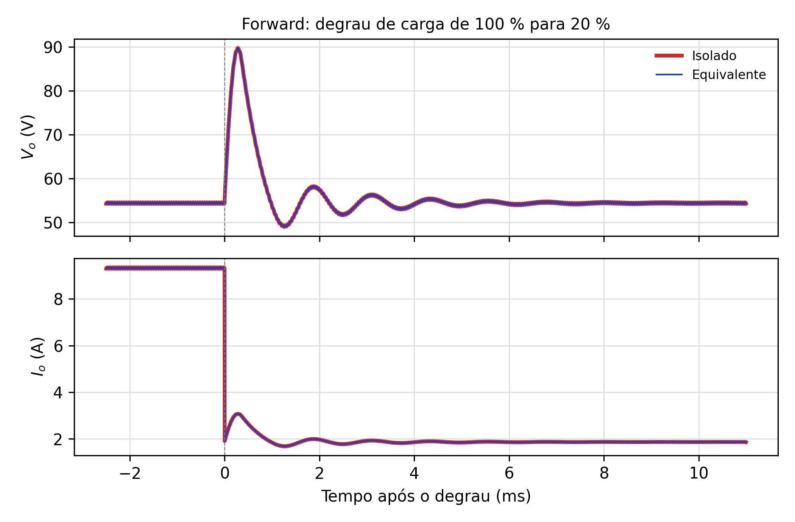
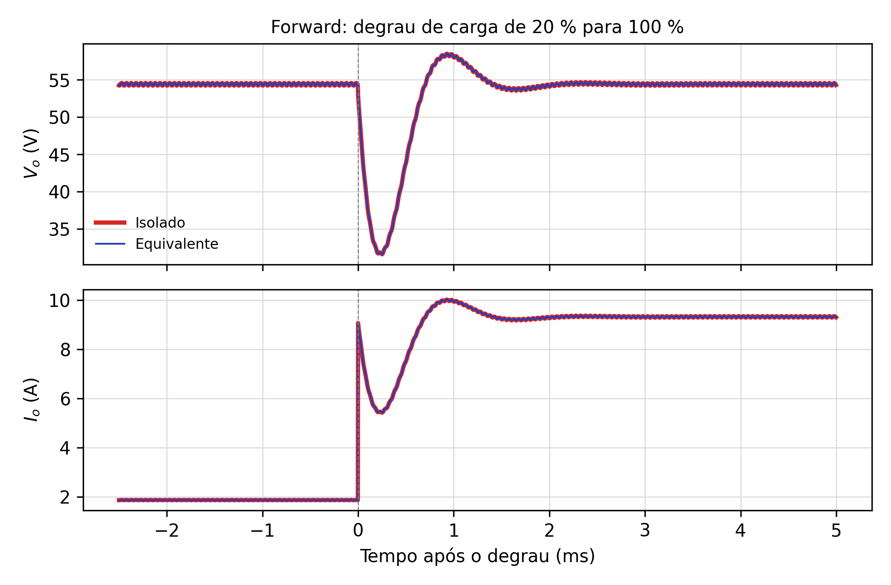

# 02. Conversor CC-CC Forward de Uma Chave

A seção 1 do enunciado já vem desenvolvida pelo professor e serve de modelo para as demais. Este
documento não a repete: registra o que é preciso acrescentar para o artigo, isto é, a leitura das
formas de onda à luz do documento 01, os esforços nos semicondutores, a equivalência com o Buck e os
resultados obtidos no PLECS, que substituem os do PSIM.

## 1. Pontos-chave da análise qualitativa

**Topologia.** Fonte $V_i$, transformador de três enrolamentos (primário, secundário e terciário de
desmagnetização), chave $S_1$, diodo de transferência $D_1$, diodo de roda livre $D_2$, filtro
$L_o$–$C_o$ e carga $R_o$ (Fig. 1 do enunciado). Os pontos do primário e do secundário estão do
mesmo lado: a energia vai à carga **enquanto a chave conduz**, que é o que caracteriza o Forward.

**Etapas (Fig. 3 do enunciado).**
1. *Transferência* ($0$–$DT$): $S_1$ e $D_1$ conduzem; o filtro recebe $nV_i$ e a corrente
   magnetizante cresce.
2. *Desmagnetização e roda livre*: $S_1$ abre; $i_{Lo}$ circula por $D_2$ e a corrente
   magnetizante é devolvida à fonte pelo terciário e por $D_t$; $S_1$ suporta $2V_i$.
3. *Roda livre*: o núcleo já está desmagnetizado; só $D_2$ conduz, e $S_1$ suporta $V_i$.

**Restrição de razão cíclica.** O terciário aplica $-V_iN_p/N_t$ ao primário durante a
desmagnetização. O balanço volt-segundo, $V_iDT = V_i(N_p/N_t)t_{desm}$, com
$t_{desm} \le (1-D)T$, dá

$$D \le \frac{1}{1 + N_t/N_p} = 0{,}5 \quad (N_t = N_p)$$

Com $D = 0{,}4$ sobra $0{,}1T$ = 5 µs com o núcleo desmagnetizado, o intervalo "Transf.
Desmagnetizado" da Fig. 2.

## 2. Esforços nos semicondutores (complemento ao projeto)

| Componente | Tensão máxima | Corrente |
|---|---|---|
| $S_1$ | $2V_i$ = 400 V (com $N_t = N_p$) | pico $n(I_o + \Delta I_{Lo}/2) + I_{Lm,pk}$ = 6,76 + 0,31 = 7,07 A |
| $D_1$ | $nV_i$ = 135 V (na desmagnetização) | pico 10,0 A; médio $DI_o$ = 3,70 A |
| $D_2$ | $nV_i$ = 135 V | pico 10,0 A; médio $(1-D)I_o$ = 5,56 A |
| $D_t$ | $2V_i$ = 400 V | pico $I_{Lm,pk}$ = 0,31 A |

A corrente magnetizante de pico, $V_iDT/L_m = 200\cdot 0{,}4\cdot 50\ \text{µs}/13\ \text{mH} = 0{,}31$ A,
é maior que os 0,125 A do critério do enunciado, porque o critério usa a reatância $X_{Lm}$ (uma
grandeza senoidal) e não o pico da rampa. A diferença não afeta o projeto do filtro.

## 3. Equivalência com o Buck

Do documento 01: o nó de entrada do filtro recebe $nV_i$ durante $DT$ e zero no restante, a mesma
forma de onda do nó de comutação de um Buck alimentado por $nV_i$ com a mesma razão cíclica e a
mesma frequência. A corrente magnetizante circula apenas no primário e no terciário e não passa pelo
filtro, por isso a equivalência é **exata**.

## 4. Resultados de simulação (substituem a Fig. 5 do enunciado)

Circuitos simulados no PLECS (`simulação PLECS/forward.plecs`) com os valores da Fig. 4: espiras
100:68:100 ($n = 0{,}68$), $L_m$ = 13 mH, $L_o$ = 1080 µH, $C_o$ = 34,72 µF com RSE de 0,18 Ω, e Buck
equivalente alimentado com $V_i\,N_s/N_p$ = 136 V. A carga alterna entre 20 % e 100 % a 10 Hz.

| Grandeza | 100 → 20 % (isolado / equivalente) | 20 → 100 % (isolado / equivalente) | Professor (Fig. 5) |
|---|---|---|---|
| $V_o$ antes e depois | 54,40 / 54,40 V | 54,40 / 54,40 V | ≈ 54 V |
| Extremo de $V_o$ | pico 89,55 V em 0,28 ms | vale 31,77 V em 0,23 ms | ≈ 90 V / ≈ 31 V |
| $I_o$ antes → depois | 9,33 → 1,87 A | 1,87 → 9,33 A | ≈ 9,3 → 1,9 A |
| Acomodação (±2 %) | 3,8 ms | 1,3 ms | — |
| Diferença isolado − equivalente | 0,000 % | 0,000 % | curvas sobrepostas |

**Discussão.** Os dois circuitos produzem respostas idênticas. A tensão de 54,4 V, e não 54 V, é
consequência das espiras 100:68 usadas pelo professor ($n = 0{,}68$ em vez de 0,675):
$0{,}68\cdot 200\cdot 0{,}4 = 54{,}4$ V, exatamente o valor simulado. O transitório oscila na
frequência do filtro, $f_0 = 1/(2\pi\sqrt{L_oC_o}) \approx 820$ Hz (período de 1,2 ms), e é bem mais
amortecido que o da ponte completa porque a RSE de 0,18 Ω é relativamente grande diante da
impedância característica do filtro, $\sqrt{L_o/C_o} = 5{,}6$ Ω. O degrau para carga leve demora
mais a se acomodar (3,8 ms contra 1,3 ms), porque a carga de 29 Ω amortece pouco.

**Registro de uma simulação inválida.** Na primeira execução deste ensaio a tensão estabilizou em
68 V nos dois circuitos. A análise da corrente no indutor mostrou razão cíclica efetiva de 0,5, e
não 0,4: o parâmetro `D` havia sido alterado na sessão do PLECS. A simulação foi refeita com
`D = 0.4`. O episódio mostra por que a tensão de regime simulada deve ser comparada com a prevista
antes de aceitar qualquer resultado de degrau: a equivalência entre os dois circuitos continuava
perfeita, e só essa conferência revelou o erro.

Próximo arquivo: `03-full-bridge.md`.
