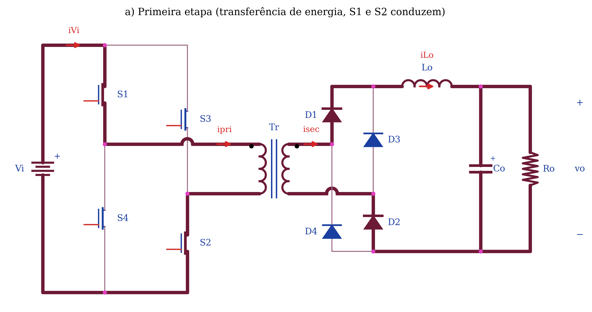
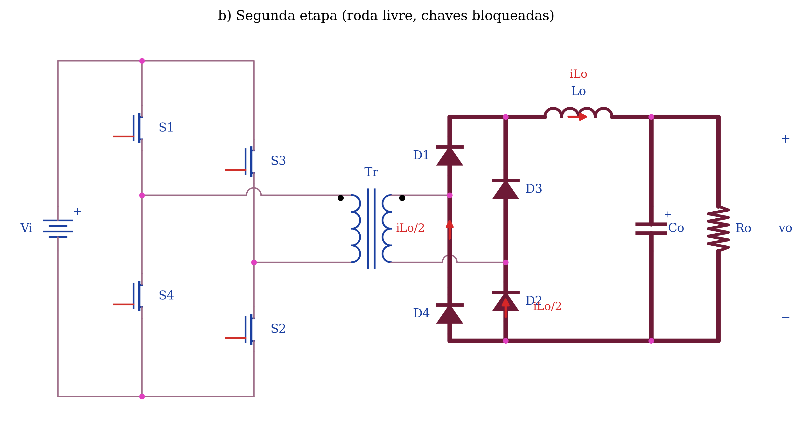
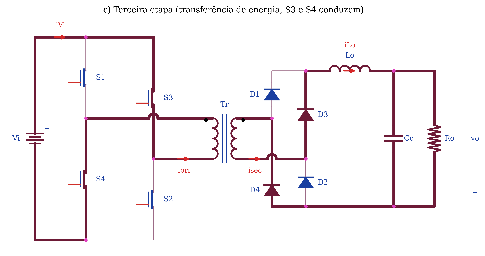
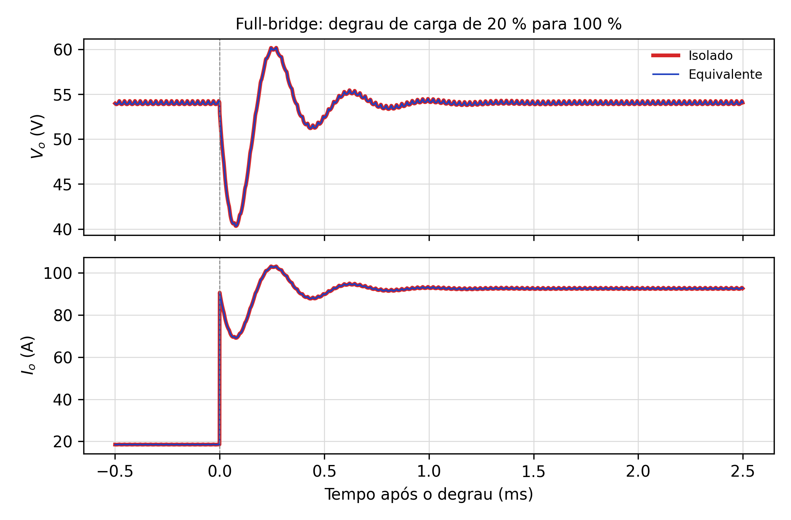
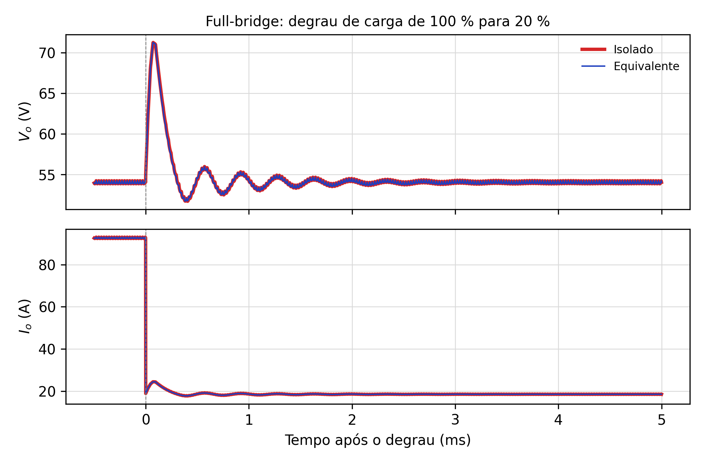

# 03. Conversor CC-CC Ponte Completa (*Full-Bridge*)

Este documento preenche a seção 2 do enunciado. Os trechos marcados pelo professor como
**ESCREVER** estão desenvolvidos nas seções 1 a 3 abaixo, na ordem do enunciado. O projeto (seção 4)
reproduz e justifica as contas do professor, e a seção 5 traz os resultados do PLECS.

## 1. Introdução (enunciado 2.1)

O conversor ponte completa é o conversor isolado derivado do Buck mais usado em potências elevadas,
tipicamente de 1 kW a dezenas de quilowatts: fontes de telecomunicações e de servidores, carregadores
de veículos elétricos, soldagem e fontes de laboratório. A razão é que ele excita o transformador
nos dois sentidos, com a tensão plena da fonte, usando quatro chaves que suportam apenas a tensão de
entrada. Com isso o núcleo trabalha nos dois quadrantes do laço B-H, sem enrolamento de
desmagnetização, e a potência processada por chave é a metade da de um Forward de mesma potência.

O preço é o número de semicondutores (quatro chaves com comando isolado para as duas superiores) e
a sensibilidade a desequilíbrios de tensão-segundo entre os dois semiciclos, que produzem um nível
CC no transformador e podem levá-lo à saturação. Na prática isso é tratado com um capacitor de
bloqueio em série com o primário ou com controle em modo corrente.

Nesta seção são apresentadas a análise qualitativa do conversor (topologia, formas de onda teóricas
e etapas de operação), o exemplo de projeto de 5 kW e os resultados de simulação que comparam o
conversor isolado com o seu equivalente Buck, referido ao secundário, durante degraus de carga de
20 % para 100 % e vice-versa.

## 2. Análise qualitativa

### 2.1 Topologia (enunciado 2.2.1)

A topologia é mostrada na Fig. 6 do enunciado. Ela consiste de uma fonte de tensão contínua de
entrada $V_i$; quatro chaves controladas $S_1$ a $S_4$ dispostas em dois braços ($S_1$–$S_4$ e
$S_3$–$S_2$), cujos pontos médios alimentam o primário do transformador; um transformador de alta
frequência $T_r$ de dois enrolamentos, com relação $a = N_s/N_p$; um retificador de onda completa
em ponte, formado pelos diodos $D_1$ a $D_4$; um filtro passa-baixa $L_o$–$C_o$; e a carga $R_o$.

As chaves são comandadas aos pares, em diagonal: $S_1$ e $S_2$ conduzem juntas durante $DT$ e
aplicam $+V_i$ ao primário; meio período depois, $S_3$ e $S_4$ conduzem durante $DT$ e aplicam
$-V_i$. Entre os dois pulsos há intervalos de roda livre, com as quatro chaves bloqueadas. Para que
as chaves de um mesmo braço nunca conduzam juntas (o que curto-circuitaria a fonte), a razão cíclica
de cada diagonal é limitada a $D < 0{,}5$.

### 2.2 Formas de onda teóricas (enunciado 2.2.2)

As formas de onda da Fig. 7 do enunciado mostram, de cima para baixo:

- **Comandos.** $v_{gsS1} = v_{gsS2}$ em nível alto durante $DT$; $v_{gsS3} = v_{gsS4}$ igual,
  deslocado de $T/2$. O intervalo entre o fim de um pulso e o início do outro dura $(1-2D)T/2$.
- **Tensão e corrente no indutor.** Durante os pulsos, a entrada do filtro recebe $aV_i$ e
  $v_{Lo} = aV_i - V_o$ (área $A^+$); na roda livre, $v_{Lo} = -V_o$ (área $A^-$). A igualdade das
  áreas dá o ganho estático, $V_o = 2aDV_i$. A corrente $i_{Lo}$ é triangular em torno de $I_o$,
  com ondulação $\Delta I_{Lo}$ e **frequência $2f_s$**: o filtro vê dois pulsos por período.
- **Corrente magnetizante.** $i_{Lm}$ cresce com $+V_i$, fica constante na roda livre (tensão nula
  no transformador), decresce com $-V_i$: é um trapézio simétrico em torno de zero, com pico
  $\pm V_iDT/(2L_m)$. A simetria é a desmagnetização natural do núcleo.
- **Diodos do retificador.** Com $+V_i$ conduzem $D_1$ e $D_2$ e levam $i_{Lo}$; com $-V_i$
  conduzem $D_3$ e $D_4$; na roda livre os quatro conduzem e cada par leva $I_o/2$. Bloqueados,
  suportam $aV_i$ (o traço $-n\,V_i$ de $v_{D1}$ na figura).
- **Chave $S_1$.** Conduz $a\,i_{Lo}$ (mais a parcela magnetizante) durante $DT$. Bloqueada, suporta
  $V_i$ quando a diagonal oposta conduz e $V_i/2$ na roda livre, quando as capacitâncias das quatro
  chaves dividem a tensão por igual.
- **Capacitor.** $i_{Co} = i_{Lo} - I_o$ é triangular, de frequência $2f_s$ e amplitude
  $\Delta I_{Lo}/2$; a carga acumulada em meio ciclo dessa onda (a área hachurada, que dura $T/4$)
  define a ondulação $\Delta V_{Co}$.

### 2.3 Etapas de operação (enunciado 2.2.3)

Em um período de comutação $T$ o conversor apresenta quatro etapas de operação, sendo duas de
transferência de energia da entrada para a saída e duas de roda livre. As figuras abaixo destacam,
em traço grosso, o caminho percorrido pela corrente (atende ao pedido "colocar 4 conversores e
marcar em negrito por onde percorre a corrente").

**Primeira etapa ($0 < t < DT$), transferência de energia.** $S_1$ e $S_2$ conduzem e aplicam $+V_i$
ao primário. No secundário a tensão $aV_i$ polariza diretamente $D_1$ e $D_2$, que conduzem a
corrente do indutor; $D_3$ e $D_4$ ficam bloqueados com $aV_i$. O indutor recebe $aV_i - V_o > 0$ e
sua corrente cresce. A fonte entrega energia à carga e ao indutor, e a corrente magnetizante cresce.

**Segunda etapa ($DT < t < T/2$), roda livre.** As quatro chaves são bloqueadas. A corrente de $L_o$
não pode se interromper e circula pelos quatro diodos do retificador, metade por cada braço, o que
põe o secundário em curto e anula a tensão do transformador. O indutor recebe $-V_o$ e sua corrente
decresce; a fonte não fornece energia. A corrente magnetizante, sem tensão aplicada, permanece
constante e circula pelos enrolamentos e pelos diodos (na prática, as capacitâncias intrínsecas das
chaves dividem $V_i$ e cada uma fica com $V_i/2$).

**Terceira etapa ($T/2 < t < T/2 + DT$), transferência de energia.** É a simétrica da primeira: $S_3$
e $S_4$ conduzem e aplicam $-V_i$ ao primário. No secundário conduzem $D_3$ e $D_4$, e o filtro
recebe novamente $+aV_i$, porque o retificador de onda completa inverte o semiciclo negativo. A
corrente magnetizante decresce, desfazendo o que cresceu na primeira etapa.

**Quarta etapa ($T/2 + DT < t < T$), roda livre.** Idêntica à segunda. Ao seu término recomeça a
primeira etapa.

## 3. Por que o equivalente é um Buck de frequência dobrada

A entrada do filtro vê, a cada meio período, um pulso de amplitude $aV_i$ e duração $DT$ seguido
de tensão nula. Um Buck alimentado por $aV_i$, comutando com período $T/2$ e razão cíclica
$DT/(T/2) = 2D$, gera exatamente a mesma forma de onda. Por isso o equivalente da Fig. 8(b) do
enunciado tem 67,6 V, 40 kHz e razão cíclica 0,8. A dedução geral está no documento 01, seção 4.

## 4. Exemplo de projeto (enunciado 2.3)

### 4.1 Especificações e considerações

| Grandeza | Valor |
|---|---|
| $P_o$ / $V_i$ / $V_o$ | 5000 W / 400 V / 54 V |
| $f_s$ | 20 kHz |
| $\Delta I_{Lo}$ | 18,52 A (≈ 20 % de $I_o$) |
| $\Delta V_{Co}$ | 0,27 V (0,5 % de $V_o$) |
| $D$ | 0,4 por diagonal |
| $\eta$ | 1 (ideal) |

### 4.2 Relação de transformação e corrente de saída

Do ganho estático $V_o/V_i = 2aD$:

$$a = \frac{V_o}{V_i}\cdot\frac{1}{2D} = \frac{54}{400}\cdot\frac{1}{0{,}8} = 0{,}169, \qquad
I_o = \frac{P_o}{V_o} = 92{,}59\ \text{A}$$

A escolha $D = 0{,}4$, e não um valor mais próximo de 0,5, deixa margem de $(1-2D)T/2 = 5$ µs de
roda livre para acomodar tempo morto, perda de razão cíclica pela dispersão e o aumento de $D$ que o
controle exigirá quando $V_i$ cair.

### 4.3 Indutor de saída

Na roda livre, que dura $(1-2D)T/2$, o indutor recebe $-V_o$ e sua corrente cai de $\Delta I_{Lo}$:

$$\Delta I_{Lo} = \frac{V_o}{L_o}\cdot\frac{(1-2D)}{2f_s}
\quad\Rightarrow\quad
L_o = \frac{V_o(0{,}5 - D)}{f_s\,\Delta I_{Lo}} = \frac{54\cdot 0{,}1}{20\,000\cdot 18{,}52} = 14{,}58\ \text{µH}$$

### 4.4 Capacitor de saída

A corrente no capacitor é triangular de frequência $2f_s$ e pico $\Delta I_{Lo}/2$. Pela mesma
dedução do Buck, $\Delta V_{Co} = \Delta I_{Lo}/(8C_o f_{eq})$ com $f_{eq} = 2f_s$. Substituindo
$\Delta I_{Lo}$ da seção anterior obtém-se a forma usada pelo professor:

$$C_o = \frac{\Delta I_{Lo}}{16 f_s \Delta V_{Co}} = \frac{(1-2D)V_o}{32\,L_o f_s^2\,\Delta V_{Co}}
= 214{,}4\ \text{µF}, \qquad R_c = \frac{\Delta V_{Co}}{\Delta I_{Lo}} = 14{,}6\ \text{mΩ}$$

A RSE máxima é a que, sozinha, produziria a ondulação especificada. Na prática ela domina a
ondulação em capacitores eletrolíticos, e é esse o critério de escolha do componente.

### 4.5 Resistor de carga

$$R_o = \frac{V_o^2}{P_o} = 0{,}583\ \Omega; \qquad
R_{20\%} = 5R_o = 2{,}916\ \Omega, \quad R_{80\%} = 1{,}25R_o = 0{,}729\ \Omega$$

### 4.6 Indutância magnetizante

O critério do enunciado fixa a corrente magnetizante em 2 % da corrente de pico do primário:

$$I_m = 0{,}02\,(a I_o), \qquad X_{Lm} = \frac{V_i}{I_m}, \qquad L_m = \frac{X_{Lm}}{2\pi f_s}$$

**Atenção.** O enunciado usa $n = 0{,}675$ (a relação do Forward) nessa conta e obtém $I_m = 1{,}25$ A
e $L_m = 2{,}546$ mH. Com a relação deste conversor, $a = 0{,}169$, o mesmo critério dá
$I_m = 0{,}3125$ A e $L_m = 10{,}2$ mH. As simulações usaram 2,6 mH, para permitir a comparação com
a Fig. 9 do professor; isso não altera o comportamento da saída, mas é justamente a corrente
magnetizante maior que explica a pequena diferença entre o isolado e o equivalente (seção 5).

### 4.7 Esforços nos semicondutores (complemento)

| Componente | Tensão máxima | Corrente |
|---|---|---|
| Chaves $S_1$ a $S_4$ | $V_i$ = 400 V | pico $a(I_o + \Delta I_{Lo}/2) + I_{Lm,pk}$ ≈ 17,2 + 1,5 = 18,7 A |
| Diodos $D_1$ a $D_4$ | $aV_i$ = 67,5 V | pico $I_o + \Delta I_{Lo}/2$ = 101,9 A; médio $I_o/2$ = 46,3 A |

## 5. Resultados de simulação (enunciado 2.4)

Os circuitos foram simulados no PLECS (`simulação PLECS/fullbridge.plecs`), reproduzindo a Fig. 8
do enunciado: ponte completa isolada com transformador 100:16,875 e $L_m$ = 2,6 mH, e Buck
equivalente com 67,5 V, 40 kHz e $D$ = 0,8. A carga alterna entre 20 % e 100 % a 5 Hz.

| Grandeza | 20 → 100 % (isolado / equivalente) | 100 → 20 % (isolado / equivalente) | Professor (Fig. 9) |
|---|---|---|---|
| $V_o$ antes e depois | 54,00 / 54,00 V | 54,00 / 54,00 V | 54 V |
| Extremo de $V_o$ | vale 40,83 / 40,83 V em 0,075 ms | pico 70,74 / 70,73 V em 0,082 ms | ≈ 40 V / ≈ 71 V |
| $I_o$ antes → depois | 18,52 → 92,59 A | 92,59 → 18,52 A | ≈ 18 → 93 A |
| Acomodação (±2 %) | 0,65 / 0,65 ms | 0,79 / 0,78 ms | — |
| Diferença isolado − equivalente | 0,000 % RMS | 0,088 % RMS, 0,78 % máx. | curvas sobrepostas |

**Discussão.** As curvas do conversor isolado e do Buck equivalente se sobrepõem em todo o
transitório. A oscilação tem o período da ressonância do filtro,
$f_0 = 1/(2\pi\sqrt{L_oC_o}) \approx 2{,}85$ kHz (período de 0,35 ms), e é pouco amortecida porque
o filtro opera em malha aberta, com amortecimento dado apenas pela carga e pela RSE; por isso a
oscilação é mais persistente no degrau para 20 %, com carga leve. A única diferença perceptível,
menor que 1 % e restrita ao degrau 100 → 20 %, vem da corrente magnetizante, que existe no
transformador do circuito isolado e não no equivalente (documento 01, seção 4.5). Conclui-se que o
Buck equivalente reproduz a dinâmica de saída da ponte completa, e que a função de transferência do
Buck, com $V_{i,eq} = aV_i$ e $f_{eq} = 2f_s$, pode ser usada para projetar seu controle.

Próximo arquivo: `04-push-pull-alimentado-em-corrente.md`.
