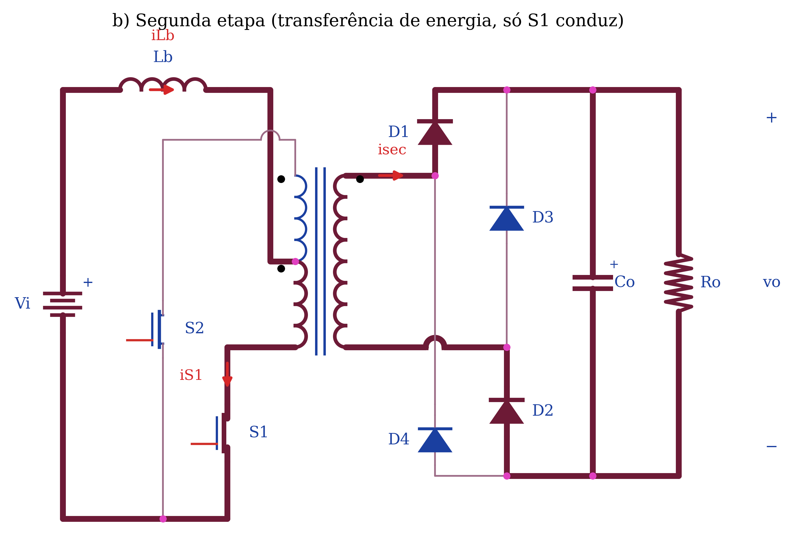
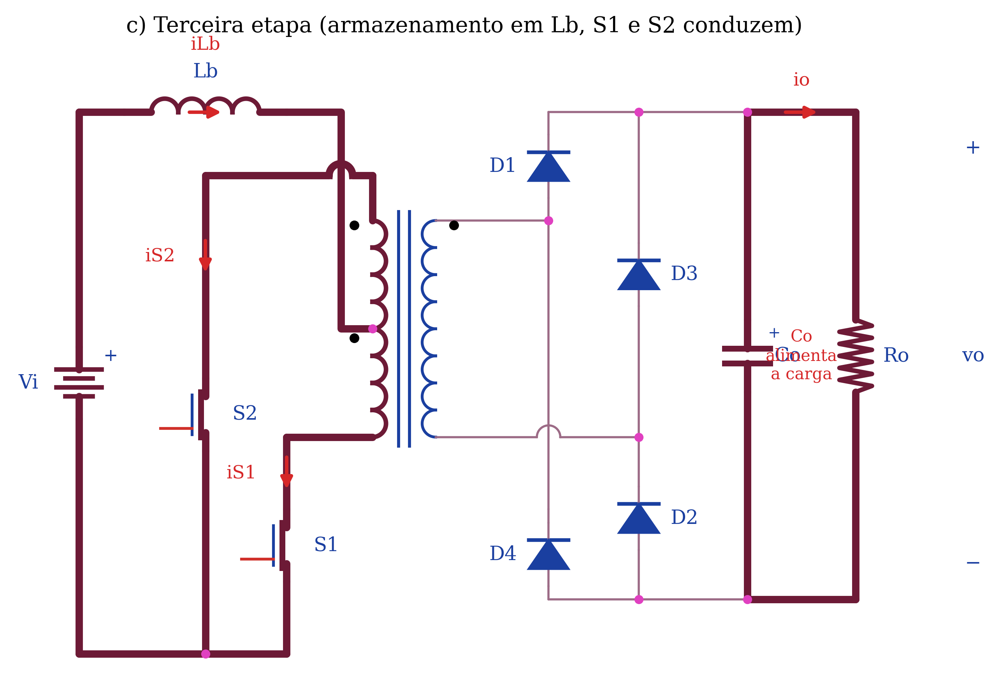
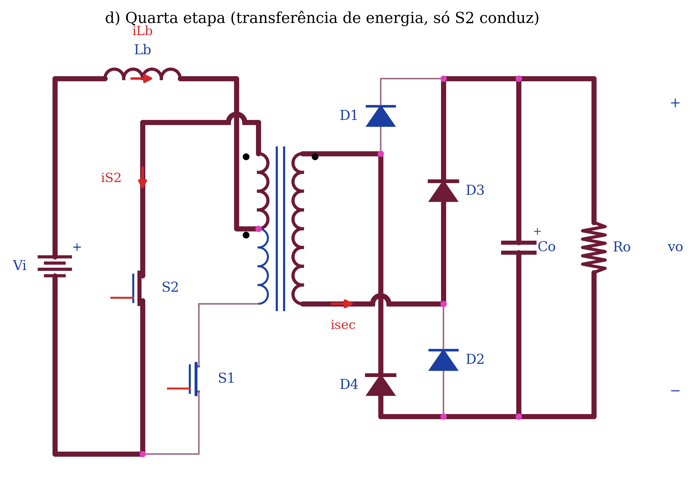
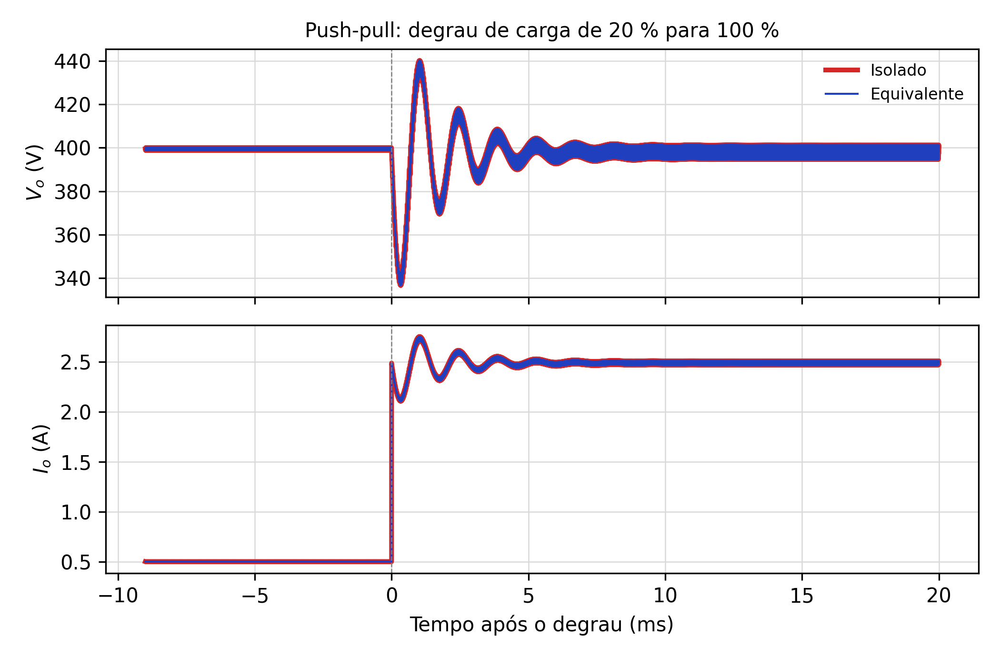
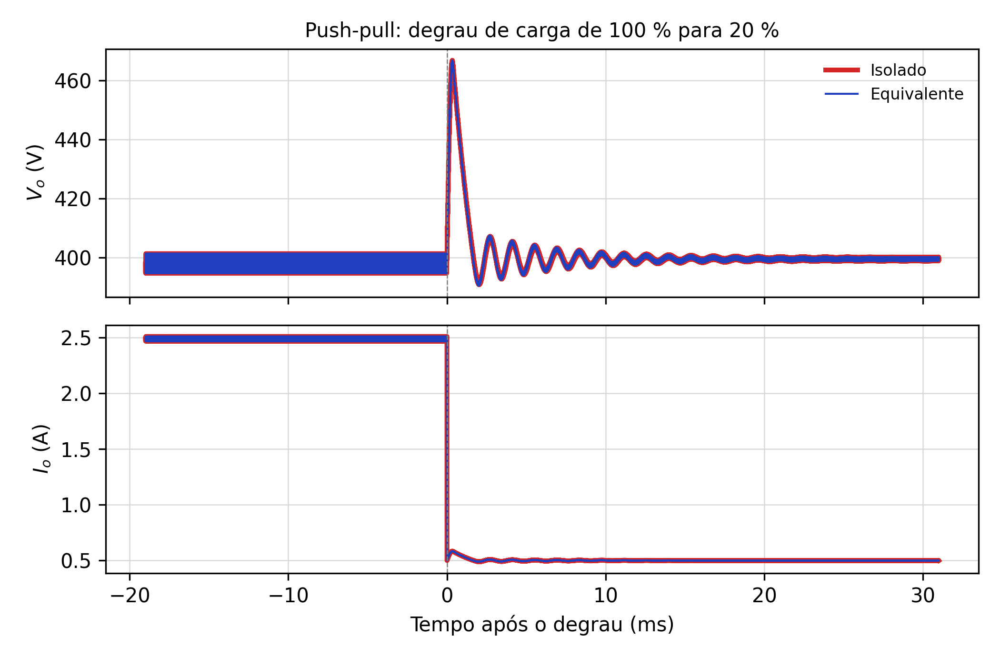

# 04. Conversor CC-CC Push-Pull Alimentado em Corrente

Este documento preenche a seção 3 do enunciado: introdução, topologia e formas de onda
(**ESCREVER**), etapas de operação (**COLOCAR OS QUATRO CONVERSORES**), exemplo de projeto e
resultados de simulação.

## 1. Introdução (enunciado 3.1)

O push-pull alimentado em corrente é o conversor isolado derivado do Boost. Em vez de alimentar o
transformador por uma fonte de tensão, como na ponte completa, ele o alimenta através de um indutor
de entrada $L_b$ (ou $L_i$), que impõe uma corrente praticamente constante. É a topologia natural
quando a fonte tem tensão baixa e corrente alta e a saída precisa de tensão elevada: bancos de
baterias e barramentos de 48–54 V elevados para 400 V, células a combustível, painéis
fotovoltaicos e pré-reguladores de inversores.

Três características explicam essa preferência. A corrente de entrada é contínua e de baixa
ondulação, o que protege baterias e células a combustível. As duas chaves têm a fonte ligada ao
mesmo ponto de referência, o que simplifica o comando. E, por ser alimentado em corrente, o
conversor não sofre o desequilíbrio de fluxo (*flux walking*) do push-pull alimentado em tensão,
já que um pequeno desequilíbrio de tempo não pode produzir corrente ilimitada no transformador.

Em contrapartida, as chaves precisam conduzir com sobreposição ($D > 0{,}5$), porque abrir as duas
ao mesmo tempo interromperia a corrente do indutor; a tensão sobre elas é o dobro da tensão
refletida ($2V_o/a$); e a partida exige cuidado, já que, como em todo Boost, não há limitação
natural da corrente de carga do capacitor de saída.

Nesta seção são apresentados a análise qualitativa, o exemplo de projeto de 1 kW (54 V → 400 V) e a
comparação, por simulação, entre o conversor isolado e o seu Boost equivalente durante degraus de
carga de 20 % para 100 % e vice-versa.

## 2. Análise qualitativa

### 2.1 Topologia (enunciado 3.2.1)

A topologia é mostrada na Fig. 10 do enunciado. Ela consiste de uma fonte de tensão contínua $V_i$;
um indutor de entrada $L_b$, ligado à derivação central do primário; um transformador de alta
frequência com primário dividido em duas metades iguais, de $N_p$ espiras cada, e um secundário de
$N_s$ espiras, com $a = N_s/N_p$; duas chaves controladas $S_1$ e $S_2$, cada uma ligada entre a
extremidade de uma metade do primário e o negativo da fonte; um retificador de onda completa em
ponte, com os diodos $D_1$ a $D_4$; um capacitor de filtro $C_o$; e a carga $R_o$. Não há indutor
de saída: o filtro de saída é apenas capacitivo, como no Boost.

As chaves recebem pulsos de mesma razão cíclica $D > 0{,}5$, defasados de meio período, de modo
que em cada período há dois intervalos de sobreposição, com as duas chaves conduzindo, e dois
intervalos com apenas uma delas conduzindo.

### 2.2 Formas de onda teóricas (enunciado 3.2.2)

As formas de onda da Fig. 11 do enunciado mostram:

- **Comandos.** $v_{gsS1}$ em nível alto durante $DT$; $v_{gsS2}$ igual, deslocado de $T/2$. As
  sobreposições duram $(2D-1)T/2$ cada, e os intervalos com uma só chave duram $(1-D)T$.
- **Tensão e corrente no indutor de entrada.** Nas sobreposições o primário fica em curto (as
  duas metades se cancelam) e o indutor recebe $+V_i$ (área $A^+$), com a corrente crescendo. Com
  uma só chave o indutor recebe $V_i - V_o/a$, negativo (área $A^-$), e entrega energia. A
  igualdade das áreas dá o ganho:
  $$V_i\,\frac{(2D-1)T}{2} = \left(\frac{V_o}{a} - V_i\right)(1-D)T
  \quad\Rightarrow\quad \frac{V_o}{V_i} = \frac{a}{2(1-D)}$$
  A corrente $i_{Lb}$ é triangular em torno de $I_i$, com **frequência $2f_s$**.
- **Corrente magnetizante.** Cresce e decresce de forma simétrica nos intervalos de uma só chave e
  fica constante nas sobreposições (tensão nula no transformador).
- **Chave $S_1$.** Conduz $I_i/2$ nas sobreposições (a corrente do indutor se divide entre as duas
  metades) e $I_i$ quando conduz sozinha; bloqueada, suporta $2V_o/a$, porque a metade do primário
  ligada a ela soma sua tensão à da outra metade.
- **Diodos.** $D_1$ e $D_2$ conduzem $I_i/a$ quando só $S_1$ conduz; $D_3$ e $D_4$, quando só $S_2$
  conduz. Nas sobreposições o secundário está em curto e os quatro diodos ficam bloqueados, cada
  par dividindo $V_o$ (o patamar $-V_o/2$ de $v_{D1}$); quando o par oposto conduz, suportam $V_o$.
- **Capacitor.** Nas sobreposições nenhum diodo conduz e $C_o$ alimenta sozinho a carga
  ($i_{Co} = -I_o$); nos intervalos de transferência recebe $I_i/a - I_o$.

### 2.3 Etapas de operação (enunciado 3.2.3)

Em um período de comutação $T$ o conversor apresenta quatro etapas, sendo duas de armazenamento de
energia no indutor de entrada e duas de transferência de potência da entrada para a saída. Nas
figuras, o traço grosso indica o caminho da corrente (atende ao pedido "colocar os quatro
conversores e destacar os caminhos de circulação de corrente").

**Primeira etapa ($0 < t < (2D-1)T/2$), armazenamento.** $S_1$ e $S_2$ conduzem. A corrente do
indutor entra pela derivação central e se divide igualmente entre as duas metades do primário, cujos
fluxos se cancelam: a tensão do transformador é nula, o secundário não conduz e os quatro diodos
ficam bloqueados. O indutor recebe $V_i$ e armazena energia, enquanto o capacitor sozinho alimenta a
carga.

**Segunda etapa ($(2D-1)T/2 < t < T/2$), transferência.** $S_2$ é bloqueada e só $S_1$ conduz. Toda
a corrente do indutor passa pela metade inferior do primário, o transformador é excitado e a
tensão $V_o/a$ aparece em cada metade. No secundário conduzem $D_1$ e $D_2$, que entregam $I_i/a$ ao
capacitor e à carga. O indutor recebe $V_i - V_o/a < 0$ e descarrega sua energia na saída, junto
com a da fonte. $S_2$ suporta $2V_o/a$.

**Terceira etapa ($T/2 < t < T/2 + (2D-1)T/2$), armazenamento.** $S_2$ volta a conduzir e a situação é
idêntica à da primeira etapa.

**Quarta etapa, transferência.** $S_1$ é bloqueada e só $S_2$ conduz. A corrente percorre a metade
superior do primário em sentido oposto ao da segunda etapa, o que excita o transformador com a
polaridade inversa e desmagnetiza o núcleo. No secundário conduzem $D_3$ e $D_4$. Ao final,
recomeça a primeira etapa.

## 3. Por que o equivalente é um Boost de frequência dobrada

Do ponto de vista do indutor, as sobreposições são a "chave fechada" de um Boost (o indutor recebe
toda a tensão da fonte) e os intervalos de uma só chave são a "chave aberta" (o indutor descarrega na
saída através do transformador). Como isso ocorre duas vezes por período, o Boost equivalente comuta
em $2f_s$ com razão cíclica igual à fração de sobreposição em cada meio período,

$$D_{eq} = \frac{(2D-1)T/2}{T/2} = 2D - 1 = 0{,}4,$$

e, referido ao secundário, recebe $V_{i,eq} = aV_i = 240$ V com $L_{eq} = a^2L_i = 2{,}88$ mH,
exatamente os valores da Fig. 13(b) do enunciado.

## 4. Exemplo de projeto (enunciado 3.3)

### 4.1 Especificações e considerações

| Grandeza | Valor |
|---|---|
| $P_o$ / $V_i$ / $V_o$ | 1000 W / 54 V / 400 V |
| $f_s$ | 20 kHz |
| $\Delta I_{Li}$ | 3,7 A (≈ 20 % de $I_i$) |
| $\Delta V_{Co}$ | 4 V (1 % de $V_o$) |
| $D$ | 0,7 |
| $\eta$ | 1 (ideal) |

### 4.2 Relação de transformação e correntes

$$a = \frac{V_o}{V_i}\,2(1-D) = \frac{400}{54}\cdot 0{,}6 = 4{,}444, \qquad
I_o = \frac{P_o}{V_o} = 2{,}5\ \text{A}, \qquad I_i = \frac{P_i}{V_i} = 18{,}52\ \text{A}$$

### 4.3 Indutor de entrada

Na sobreposição, que dura $(2D-1)T/2$, o indutor recebe $V_i$ e sua corrente sobe $\Delta I_{Li}$:

$$L_i = \frac{(2D-1)V_i}{2f_s\,\Delta I_{Li}} = \frac{0{,}4\cdot 54}{40\,000\cdot 3{,}7} = 145{,}9\ \text{µH}$$

### 4.4 Capacitor de saída

Durante a mesma sobreposição nenhum diodo conduz, e o capacitor fornece sozinho $I_o$:

$$C_o = \frac{(2D-1)I_o}{2f_s\,\Delta V_{Co}} = 6{,}25\ \text{µF}$$

A RSE máxima é a que produz $\Delta V_{Co}$ com o pico da corrente de secundário,
$I_{Li,max}/a$, que é o degrau de corrente que o capacitor recebe no início da transferência:

$$I_{Li,max} = I_i + \frac{\Delta I_{Li}}{2} = 20{,}37\ \text{A}, \qquad
R_c = \frac{\Delta V_{Co}}{I_{Li,max}/a} = 0{,}873\ \Omega$$

### 4.5 Carga e indutância magnetizante

$$R_o = \frac{V_o^2}{P_o} = 160\ \Omega; \quad R_{20\%} = 800\ \Omega, \quad R_{80\%} = 200\ \Omega$$

$$I_{Lm} = 0{,}01\,I_i = 0{,}185\ \text{A}, \quad V_{pri} = \frac{V_o}{a} = 90\ \text{V}, \quad
L_m = \frac{V_{pri}}{2\pi f_s I_{Lm}} = 3{,}87\ \text{mH}$$

O enunciado usa 1 % (e não os 2 a 5 % citados no texto) e autoriza um valor maior no simulador; o
professor usou 200 mH referidos ao secundário, o que foi mantido nas simulações.

### 4.6 Esforços nos semicondutores (complemento)

| Componente | Tensão máxima | Corrente |
|---|---|---|
| Chaves $S_1$, $S_2$ | $2V_o/a$ = 180 V | pico $I_{Li,max}$ = 20,4 A |
| Diodos $D_1$ a $D_4$ | $V_o$ = 400 V | pico $I_{Li,max}/a$ = 4,58 A |

A chave suporta 3,3 vezes a tensão de entrada, contra 1 vez na ponte completa; é o custo de ter as
duas chaves referidas ao mesmo terra.

## 5. Resultados de simulação (enunciado 3.4)

Os circuitos foram simulados no PLECS (`simulação PLECS/pushpull.plecs`), reproduzindo a Fig. 13:
push-pull isolado com primário 22,5 + 22,5 espiras e secundário de 100 espiras, e Boost equivalente
com 240 V, 2,88 mH, 40 kHz e $D$ = 0,4. A carga alterna entre 20 % e 100 % a 2 Hz.

| Grandeza | 20 → 100 % (isolado / equivalente) | 100 → 20 % (isolado / equivalente) | Professor (Fig. 14) |
|---|---|---|---|
| $V_o$ antes → depois | 399,66 → 398,50 / 399,66 → 398,50 V | 398,50 → 399,66 V (ambos) | ≈ 400 V |
| Extremo de $V_o$ | vale 340,00 / 340,00 V em 0,32 ms | pico 466,27 / 466,27 V em 0,34 ms | ≈ 338 V / ≈ 465 V |
| $I_o$ antes → depois | 0,50 → 2,49 A | 2,49 → 0,50 A | 0,5 → 2,5 A |
| Acomodação (±2 %) | 3,34 / 3,34 ms | 2,05 / 2,05 ms | — |
| Diferença isolado − equivalente | 0,002 % RMS | 0,064 % RMS, 0,34 % máx. | curvas sobrepostas |

**Discussão.** Também aqui as respostas se sobrepõem. A frequência da oscilação é a do par de polos
do Boost, $\omega_0 = (1-D_{eq})/\sqrt{L_{eq}C_o} \approx 4{,}5$ krad/s (cerca de 710 Hz), bem
menor que a do filtro da ponte, porque o indutor refletido é grande. A tensão média a plena carga,
398,5 V em vez de 400 V, é a mesma nos dois circuitos e se deve à perda na RSE de 0,873 Ω, percorrida
pela corrente pulsada do retificador: não é um erro da equivalência, mas uma não idealidade que o
equivalente também reproduz. A diferença máxima de 0,34 %, no degrau para 20 %, é novamente devida
à corrente magnetizante do transformador isolado. O Boost equivalente, com $V_{i,eq} = aV_i$,
$L_{eq} = a^2L_i$, $D_{eq} = 2D-1$ e $f_{eq} = 2f_s$, representa corretamente a dinâmica de saída do
push-pull alimentado em corrente, inclusive o zero no semiplano direito característico do Boost,
que o controle desse conversor terá de levar em conta.

Próximo arquivo: `05-flyback.md`.
