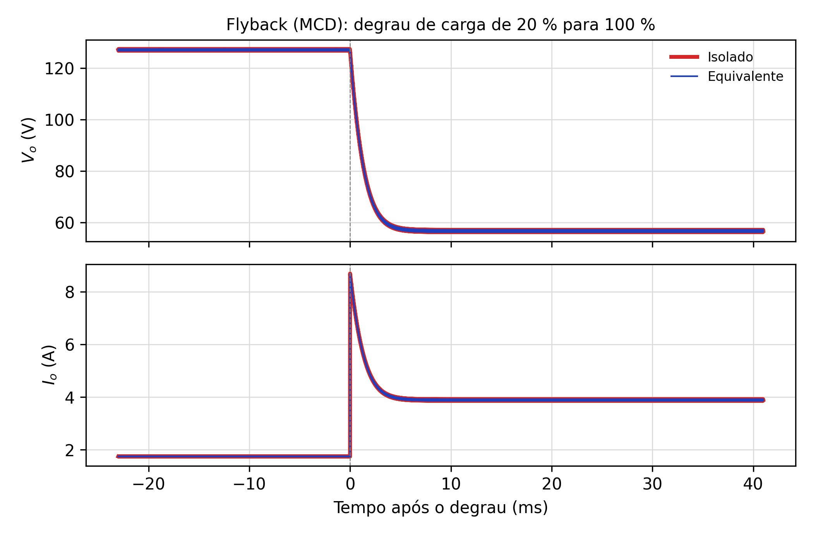
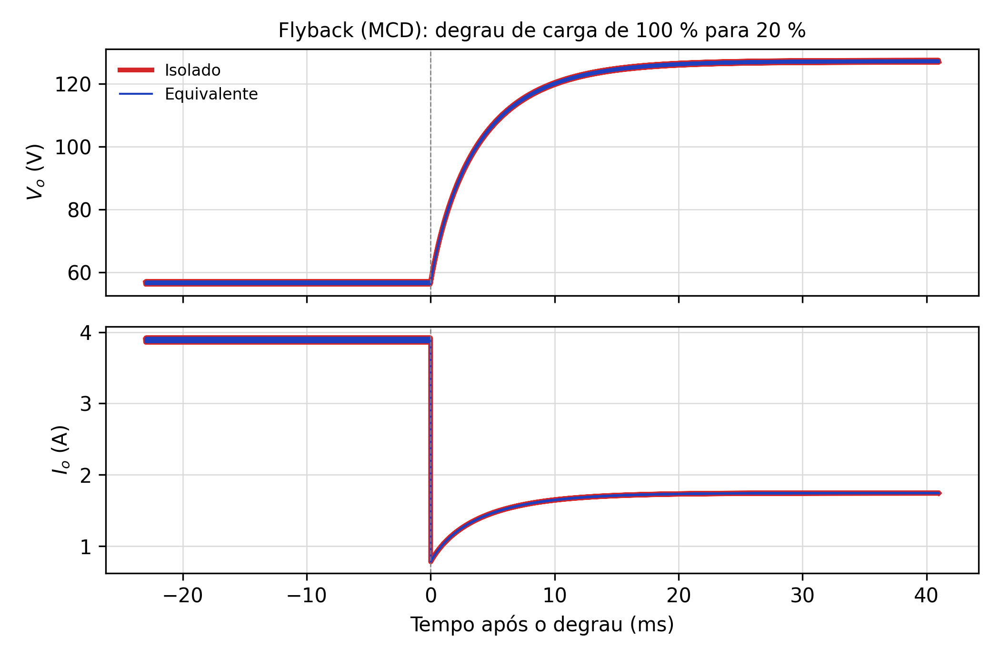
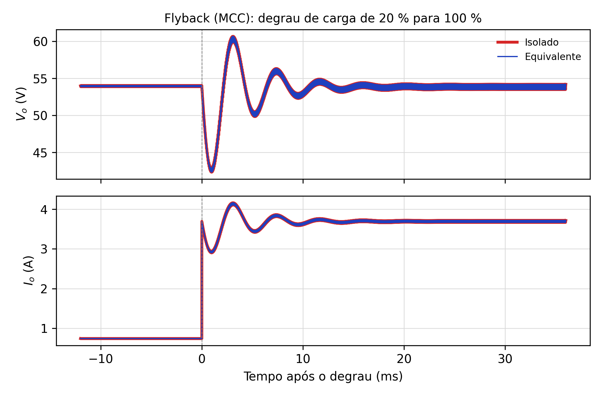
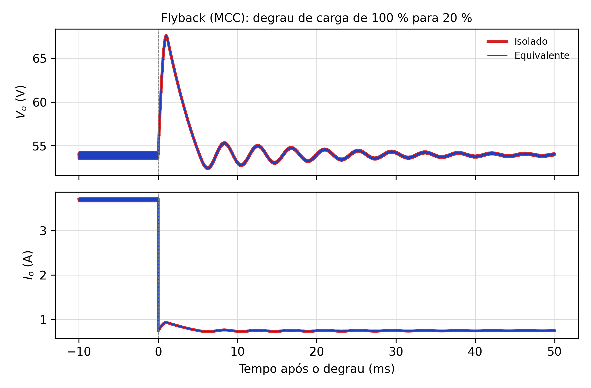

# 05. Conversor CC-CC Flyback de Uma Chave

Este documento preenche a seção 4 do enunciado: introdução e texto das formas de onda
(**ESCREVER**), etapas em modo descontínuo (já desenhadas pelo professor na Fig. 17), exemplo de
projeto e resultados de simulação em MCD e em MCC. Inclui também o degrau 100 → 20 % em MCD, que
falta no enunciado (as Figs. 19a e 19b do original são o mesmo gráfico).

## 1. Introdução (enunciado 4.1)

O Flyback é o conversor isolado derivado do Buck-Boost e o mais simples de todos: uma chave, um
diodo, um capacitor e um componente magnético que acumula as funções de transformador e de indutor.
Por isso domina as fontes de baixa potência, de alguns watts até cerca de 200 W: carregadores de
celular e notebook, fontes auxiliares de inversores e de equipamentos industriais, fontes com
várias saídas (basta acrescentar enrolamentos) e fontes de alta tensão.

A diferença essencial em relação ao Forward está na polaridade dos enrolamentos. No Flyback os
pontos do primário e do secundário estão em lados opostos, de modo que o diodo do secundário
bloqueia enquanto a chave conduz: a energia é primeiro **armazenada** na indutância magnetizante e
só depois, com a chave aberta, **transferida** à carga. O "transformador" do Flyback é, portanto, um
indutor acoplado, projetado com entreferro para armazenar energia, e sua desmagnetização é feita
pela própria carga.

As limitações vêm dessa mesma característica: toda a energia passa pelo núcleo a cada ciclo, o que
limita a potência, e a energia da dispersão, que não é transferida, exige um grampeador (o circuito
RCD da Fig. 18 do enunciado) e se torna a principal fonte de perdas.

O Flyback pode operar em modo de condução descontínua (MCD), com a corrente magnetizante se anulando
em cada período, ou contínua (MCC). Nesta seção os dois casos são analisados e simulados, e em ambos
o conversor isolado é comparado com o seu Buck-Boost equivalente durante degraus de carga de 20 %
para 100 % e vice-versa.

## 2. Análise qualitativa

### 2.1 Topologia (enunciado 4.2.1)

A topologia (Fig. 15 do enunciado) consiste de uma fonte de tensão $V_i$; um transformador de dois
enrolamentos com polaridades opostas e relação $n = N_s/N_p$; uma chave controlada $S_1$ em série
com o primário; um diodo $D_1$ em série com o secundário; um capacitor de filtro $C_o$; e a carga
$R_o$. Não há indutor de filtro: o elemento indutivo é a indutância magnetizante $L_m$.

### 2.2 Formas de onda (enunciado 4.2.2)

As formas de onda da Fig. 16 do enunciado correspondem ao modo descontínuo e mostram:

- **Comando e primário.** Com $S_1$ fechada ($0 < t < DT$) o primário recebe $V_i$ (área $A^+$) e a
  corrente magnetizante vista do primário, $i_{Lm,pri}$, cresce linearmente de zero até
  $I_{p,pri} = V_iDT/L_m$. Com $S_1$ aberta a tensão do primário se inverte para $-V_o/n$ (área
  $A^-$), a tensão refletida da saída.
- **Secundário.** A corrente magnetizante passa ao secundário com pico $I_{p,sec} = I_{p,pri}/n$ e
  decresce com inclinação $V_o/L_{m,sec}$ até se anular em $t_2$, após o intervalo $t_x$. De $t_2$ a
  $T$ as duas correntes são nulas e o núcleo está totalmente desmagnetizado, o que caracteriza o MCD.
  A tensão do secundário vale $nV_i$ com a chave fechada e $-V_o$ enquanto $D_1$ conduz.
- **Chave.** Conduz a rampa $i_{Lm,pri}$ com a chave fechada; aberta, suporta $V_i + V_o/n$ enquanto
  o diodo conduz e apenas $V_i$ depois que o núcleo se desmagnetiza.
- **Diodo.** Conduz a rampa decrescente do secundário, cujo valor médio é $I_o$; bloqueado, suporta
  $-(nV_i + V_o)$ com a chave fechada e $-V_o$ no intervalo morto.
- **Capacitor.** Recebe $i_{D1} - I_o$: fornece $I_o$ sozinho durante $DT$ e no intervalo morto, e é
  recarregado durante $t_x$.

### 2.3 Etapas de operação em MCD (enunciado 4.2.3)

Em um período há três etapas, desenhadas na Fig. 17 do enunciado.

**Primeira etapa ($t_0$–$t_1$), armazenamento.** $S_1$ conduz; o primário recebe $V_i$ e a energia é
acumulada em $L_m$. $D_1$ está reversamente polarizado com $nV_i + V_o$, e o capacitor alimenta a
carga.

**Segunda etapa ($t_1$–$t_2$), transferência.** $S_1$ é bloqueada. A corrente magnetizante, que não
pode se interromper, passa ao secundário, polariza $D_1$ diretamente e carrega o capacitor e a carga.
$L_m$ recebe $-V_o$ (referida ao secundário) e se descarrega linearmente até zero.

**Terceira etapa ($t_2$–$T$), corrente nula.** Com a corrente magnetizante nula, $D_1$ bloqueia e
nenhum enrolamento conduz. O capacitor alimenta a carga sozinho até o próximo período.

Em **MCC** a terceira etapa não existe: a corrente magnetizante não chega a zero, e a chave volta a
conduzir enquanto $D_1$ ainda conduz. O conversor passa a ter só duas etapas, e a corrente no
secundário é um trapézio em vez de um triângulo.

## 3. O equivalente Buck-Boost e a diferença entre MCD e MCC

Referindo $L_m$ ao secundário ($L_{eq} = n^2L_m$) e a fonte ($V_{i,eq} = nV_i$), obtém-se um
Buck-Boost com as mesmas etapas. O ganho depende do modo de condução:

| | MCC | MCD |
|---|---|---|
| Ganho estático | $\dfrac{V_o}{V_i} = n\dfrac{D}{1-D}$ | $\dfrac{V_o}{V_i} = D\sqrt{\dfrac{R_o}{2L_mf_s}}$ |
| Depende da carga? | não | sim |
| Ordem da dinâmica de saída | 2 (par LC, oscilatório) | 1 (só o polo do capacitor) |
| Constante de tempo / frequência | $\omega_0 = (1-D)/\sqrt{L_{eq}C_o}$ | $\tau \approx R_oC_o/2$ |

Em MCD o indutor esvazia a cada período e entrega uma energia fixa, $\tfrac12 L_mI_{p,pri}^2$, por
ciclo, independentemente da carga: é uma fonte de potência constante. Em malha aberta, reduzir a
carga eleva a tensão até que $V_o^2/R_o$ volte a igualar essa potência; daí os 127 V a 20 % de
carga. É também por isso que a relação de espiras do enunciado é calculada **no modo crítico**, a
fronteira entre MCD e MCC, onde as duas expressões coincidem.

## 4. Exemplo de projeto (enunciado 4.3)

### 4.1 Especificações e considerações

| Grandeza | Valor |
|---|---|
| $P_o$ / $V_i$ / $V_o$ | 200 W / 200 V / 54 V |
| $f_s$ | 20 kHz |
| $\Delta V_{Co}$ | 0,54 V (1 % de $V_o$) |
| $D$ | 0,4 |
| $\eta$ | 1 (ideal) |

### 4.2 Relação de transformação (modo crítico)

$$n = \frac{V_o}{V_i}\cdot\frac{1-D}{D} = \frac{54}{200}\cdot 1{,}5 = 0{,}405, \qquad
I_o = \frac{P_o}{V_o} = 3{,}704\ \text{A}$$

### 4.3 Indutância magnetizante

A energia armazenada por ciclo, $\tfrac12 L_m I_{p,pri}^2$ com $I_{p,pri} = V_iDT/L_m$, multiplicada
pela frequência, deve suprir a potência de entrada. Isso dá a indutância crítica:

$$L_{m,crit} = \frac{V_i^2D^2}{2f_sP_i} = 800\ \text{µH}, \qquad
L_{m,MCD} = 0{,}9\,L_{m,crit} = 720\ \text{µH}$$

O fator 0,9 garante operação em MCD em toda a faixa de carga. Para a simulação em MCC (nota do
professor), $L_m$ é multiplicada por 10: 7,2 mH, o que mantém o MCC até cerca de 11 % de carga.

### 4.4 Capacitor de saída

Durante $DT$ o capacitor fornece sozinho a corrente de carga:

$$C_o = \frac{I_oD}{f_s\,\Delta V_{Co}} = 137{,}2\ \text{µF}$$

A RSE máxima é calculada com o pico da corrente de secundário no modo crítico, $2I_o/(1-D)$, que
é o degrau de corrente aplicado ao capacitor quando a chave abre:

$$R_{se} = \frac{\Delta V_{Co}}{2I_o/(1-D)} = 0{,}044\ \Omega$$

### 4.5 Carga

$$R_o = \frac{V_o^2}{P_o} = 14{,}58\ \Omega; \quad R_{20\%} = 72{,}9\ \Omega, \quad R_{80\%} = 18{,}2\ \Omega$$

### 4.6 Esforços nos semicondutores (complemento)

| Componente | MCD | MCC |
|---|---|---|
| Tensão em $S_1$ | $V_i + V_o/n$: 340 V a 100 %, **514 V a 20 %** | 333 V |
| Pico de corrente em $S_1$ | 5,56 A | ≈ 2,8 A |
| Tensão reversa em $D_1$ | $nV_i + V_o$: 138 V a 100 %, 208 V a 20 % | 135 V |
| Pico de corrente em $D_1$ | 13,7 A | ≈ 6,9 A |

A tabela mostra a consequência prática do MCD em malha aberta: com carga leve a tensão de saída
sobe e, com ela, a tensão refletida sobre a chave. Em malha fechada o controle reduz $D$ e evita
isso; é um argumento a favor de simular o degrau com o conversor já regulado, numa etapa futura.

## 5. Resultados de simulação (enunciado 4.4)

Os circuitos foram simulados no PLECS (`simulação PLECS/flyback.plecs`), reproduzindo as Figs. 18
(MCD, $L_m$ = 720 µH) e 20 (MCC, $L_m$ = 7,2 mH): Flyback isolado com transformador 100:40,5 e
Buck-Boost equivalente com 81 V e $L_{eq}$ = 118 µH ou 1,18 mH. A carga alterna entre 20 % e 100 %
a 2 Hz. O grampeador RCD do professor não foi incluído, porque o transformador ideal não tem
dispersão (guia 07, seção 7.2).

### 5.1 Modo de condução descontínua

| Grandeza | 20 → 100 % (isolado / equivalente) | 100 → 20 % (isolado / equivalente) | Professor (Fig. 19) |
|---|---|---|---|
| $V_o$ antes → depois | 127,13 → 56,82 V (ambos) | 56,82 → 127,12 V (ambos) | ≈ 125 → ≈ 56 V |
| Sobressinal | nenhum (resposta exponencial) | nenhum | nenhum |
| $I_o$ antes → depois | 1,74 → 3,90 A | 3,90 → 1,74 A | ≈ 1,7 → 3,9 A |
| Acomodação (±2 %) | 4,6 ms | 15,1 ms | — |
| Diferença isolado − equivalente | 0,000 % | 0,000 % | curvas sobrepostas |

As tensões de regime conferem com a expressão do MCD: 127,3 V e 56,9 V previstos. A resposta é de
primeira ordem, como previsto na seção 3, e a constante de tempo acompanha $R_oC_o/2$: cerca de
1,0 ms a plena carga (acomodação em ≈ 4τ = 4,6 ms) e 5,0 ms com 20 % (acomodação de 15 ms). O
degrau 100 → 20 %, ausente no enunciado, é portanto três vezes mais lento que o de subida de
carga.

### 5.2 Modo de condução contínua

| Grandeza | 20 → 100 % (isolado / equivalente) | 100 → 20 % (isolado / equivalente) | Professor (Fig. 21) |
|---|---|---|---|
| $V_o$ antes → depois | 53,97 → 53,88 V (ambos) | 53,88 → 53,98 V (ambos) | ≈ 54 V |
| Extremo de $V_o$ | vale 42,63 V em 0,95 ms | pico 67,53 V em 1,02 ms | ≈ 43 V / ≈ 67 V |
| $I_o$ antes → depois | 0,74 → 3,70 A | 3,70 → 0,74 A | ≈ 0,74 → 3,7 A |
| Acomodação (±2 %) | 9,8 ms | 10,7 ms | — |
| Diferença isolado − equivalente | 0,000 % | 0,000 % | curvas sobrepostas |

Em MCC a tensão de saída é praticamente independente da carga e o transitório é oscilatório, com a
frequência do par de polos do Buck-Boost, $\omega_0 = (1-D)/\sqrt{L_{eq}C_o} \approx 1{,}5$ krad/s
(cerca de 240 Hz, período de 4,2 ms), o que se vê nas figuras.

### 5.3 Discussão

Nos dois modos o Flyback isolado e o Buck-Boost equivalente produzem respostas **idênticas**, e não
apenas próximas. A razão é que no Flyback a corrente magnetizante não é um efeito parasita: ela é a
própria corrente do indutor, e o equivalente a representa integralmente (documento 01, seção 4.6).
O ensaio confirma também a observação da nota do professor: a diferença de comportamento entre MCD
e MCC é qualitativa. Em MCD a planta é de primeira ordem e fácil de compensar, mas o ganho varia com
a carga; em MCC reaparecem o par de polos e o zero no semiplano direito do Buck-Boost, e o
compensador precisa ser projetado para eles. Em ambos os casos, as funções de transferência do
Buck-Boost equivalente valem para o Flyback.

Próximo arquivo: `02-forward.md`.
