# ANÁLISE DE CONVERSORES CC-CC ISOLADOS E COMPARAÇÃO COM OS EQUIVALENTES

**(TRABALHO 2)**

Disciplina: Eletrônica Industrial

Autores:
Prof. Dr. René Pastor Torrico-Bascopé
Discente
Discente

Fortaleza, setembro de 2026

> Conversão fiel para Markdown do arquivo `Trabalho02_Conversores_Isolados_2026b.pdf` (27 páginas).
> As equações, que no original são blocos do Mathcad, foram reescritas em LaTeX com a mesma
> notação do professor. As figuras foram recortadas do PDF a 220 dpi e estão na pasta `imagens`.
> Os trechos marcados pelo professor como **ESCREVER**, **LISTAR** ou **COLOCAR ...** são as
> partes que a equipe precisa desenvolver e foram mantidos como estão, em destaque.
> Observações de conversão aparecem em blocos "Nota da conversão" e não fazem parte do original.

---

## 1. CONVERSOR CC-CC FORWARD DE UMA CHAVE

### 1.1. INTRODUÇÃO

Neste trabalho é apresentada para o conversor CC-CC Forward de uma chave, a análise qualitativa e os resultados de simulação destacando e tensão de saída e a corrente através do indutor de armazenamento, tanto para o conversor isolado e seu equivalente. O degrau de carga para verificar seu comportamento dinâmico foi de 20% para 100% e viceversa. Para compatibilizar os resultados, o conversor equivalente está referido ao lado secundário do transformador.

### 1.2. ANÁLISE QUALITATIVA

#### 1.2.1. Topologia do Conversor

A topologia do conversor CC-CC Forward de uma chave é mostrada na Fig. 1. A mesma consiste de uma fonte de tensão contínua de entrada Vi; um transformador de alta frequência de três enrolamentos, sendo um primário, um secundário e um terciário para desmagnetização dele; uma chave controlada S1; um diodo de transferência D1; um diodo de roda livre D2; um filtro passa baixa composta de Lo e Co; e a carga representada por Ro.

*Fig. 1. Topologia do conversor forward de uma chave.*

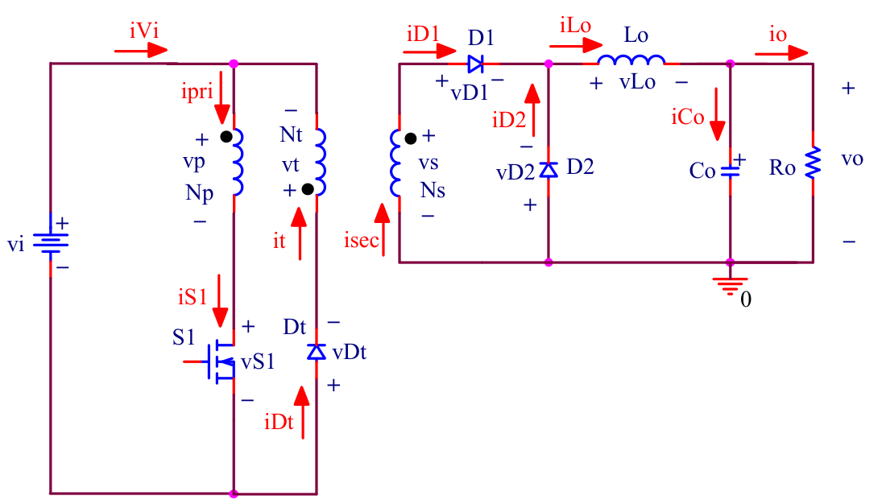

Para traçar as formas de onda foi definida a relação de transformação, n, confore a Eq. 1. O conhecimento dele facilita a determinação de grandezas elétricas, tais como, correntes e tensões.

Assim:

$$n = \frac{N_s}{N_p} = \frac{V_s}{V_p} = \frac{I_p}{I_s} \qquad (1)$$

Exemplo,

$$V_s = n \cdot V_p \qquad\qquad I_p = n \cdot I_s$$

A razão cíclica, D, é definida pela relação do tempo de condução da chave num periodo de comutação.

$$D = \frac{t_{cond}}{T}$$

#### 1.2.2. Formas de Onda

Na Fig. 2 são mostradas as formas de onda de tensão e corrente nos principais componentes do conversor da Fig. 1.

*Fig. 2. Formas de onda teóricas.*

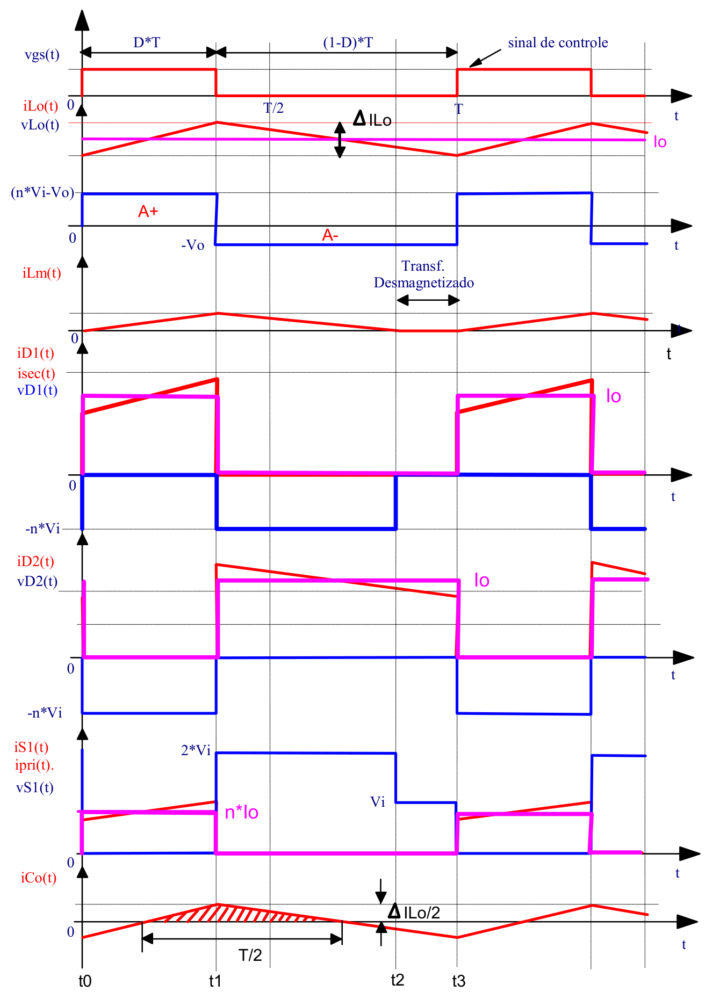

#### 1.2.3. Etapas de Operação

Em um periodo há três etapas de operação, que as mesmas são indicadas topologicamente na Figura 3.

*Fig. 3. Circuitos correspondentes as etapas de operação num período.*

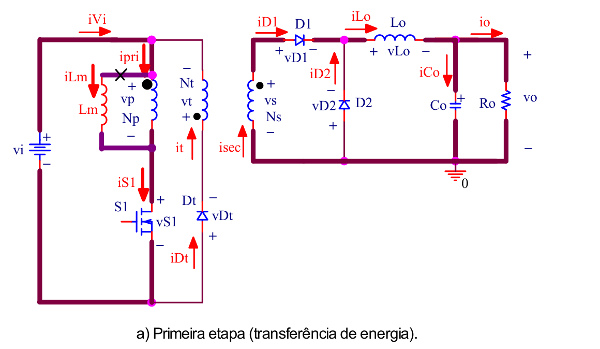

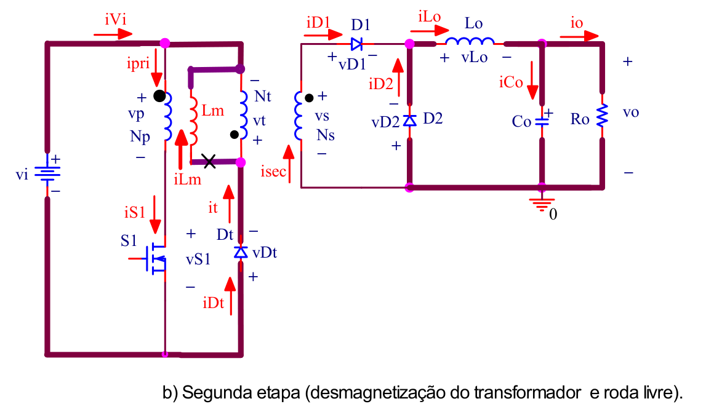

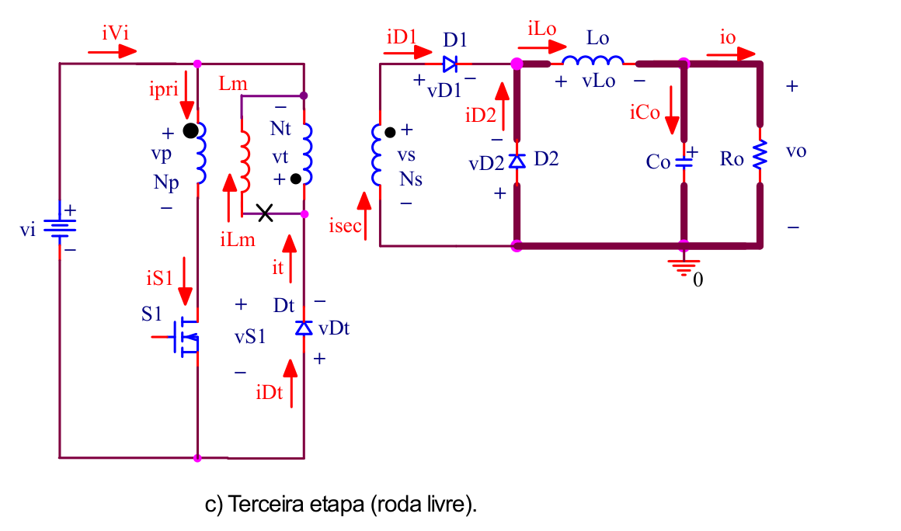

*a) Primeira etapa (transferência de energia). b) Segunda etapa (desmagnetização do transformador e roda livre). c) Terceira etapa (roda livre).*

### 1.3. EXEMPLO DE PROJETO

As especificações e considerações de projeto estão dadas a seguir:

#### 1.3.1. Especificações e Considerações

**Especificações:**

| Grandeza | Valor | Unidade | Descrição |
|---|---|---|---|
| $P_o$ | 500 | [W] | potência de saída |
| $V_i$ | 200 | [V] | tensão de entrada |
| $V_o$ | 54 | [V] | tensão de saída |

**Considerações:**

| Grandeza | Valor | Unidade | Descrição |
|---|---|---|---|
| $f_s$ | 20000 | [Hz] | frequência de comutação adotada |
| $\Delta I_{Lo}$ | 1.5 | [A] | corresponde a 20% de Io |
| $\Delta V_{Co}$ | 0.27 | [V] | corresponde a 0,5% de Vo |
| $D$ | 0.4 | | razão cíclica adotada |
| $\eta$ | 1 | | rendimento ideal |

#### 1.3.2. Alguns Parametros de Projeto

A relação de transformação é determinada a partir do ganho estático expressada na Eq. (3).

$$n := \frac{V_o}{V_i}\cdot\frac{1}{D} \qquad\qquad n = 0.675$$

A corrente média de saída é dada pela Eq. (46).

$$I_o := \frac{P_o}{V_o} \qquad\qquad I_o = 9.259\ \text{[A]}$$

> Nota da conversão: as referências "Eq. (3)" e "Eq. (46)" constam assim no original e não
> correspondem a equações numeradas deste documento.

#### 1.3.3. Indutor Filtro de Saída Lo

**A. Indutância do Indutor**

$$L_o := \frac{(n\cdot V_i - V_o)\cdot D}{\Delta I_{Lo}\cdot f_s} \qquad\qquad L_o = 1.08\times10^{-3}\ \text{[H]}$$

#### 1.3.4. Capacitor Filtro de Saída Co

**A. Capacitância do Capacitor**

$$C_o := \frac{\Delta I_{Lo}}{8\cdot f_s\cdot \Delta V_{Co}} \qquad\qquad C_o = 3.472\times10^{-5}\ \text{[F]}$$

A resistência série equivalente do capacitor deve ser:

$$R_{se} := \frac{\Delta V_{Co}}{\Delta I_{Lo}} \qquad\qquad R_{se} = 0.18\ [\Omega]$$

#### 1.3.5. Resistor de Carga Ro

**A. Resistência do Resistor**

$$R_o := \frac{V_o^2}{P_o} \qquad\qquad R_o = 5.832\ [\Omega]$$

#### 1.3.6. Determinação da Indutância Magnetizante do Transformador

A corrente magnetizante deve ser considerado entre 2 a 5% da corrente de pico no primário do transformador

$$I_m := 0.02\cdot(n\cdot I_o) \qquad\qquad I_m = 0.125\ \text{[A]}$$

$$X_{Lm} := \frac{V_i}{I_m} \qquad\qquad X_{Lm} = 1.6\times10^{3}\ [\Omega]$$

$$X_{Lm} = 2\cdot\pi\cdot f_s\cdot L_m$$

$$L_m := \frac{X_{Lm}}{2\cdot\pi\cdot f_s} \qquad\qquad L_m = 0.013\ \text{[H]}$$

### 1.4. RESULTADOS DE SIMULAÇÃO

#### 1.4.1. Testes de Degrau de Carga para Verificação de Equivalência dos Conversores Isolado e não Isolado

Os circuitos de simulação do conversor isolado e não isolado são mostrados na Fig. 4. Esta validação é importante, pois a modelagem para levantamento de funções de transferência será realizado no conversor não isolado.

*Fig. 4. Circuitos de simulação, (a) Conversor CC-CC Forward (isolado); (b) Conversor CC-CC Buck Equivalente (não isolado).*

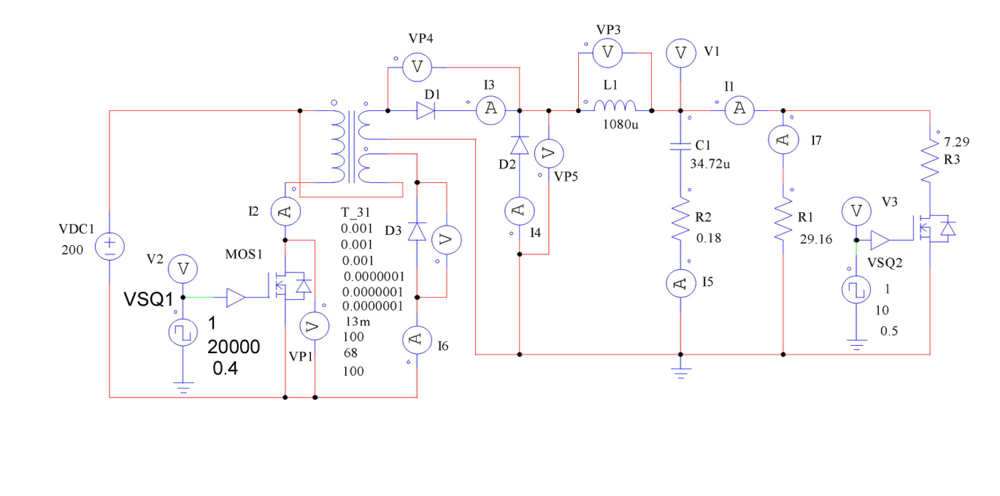

*(a)*

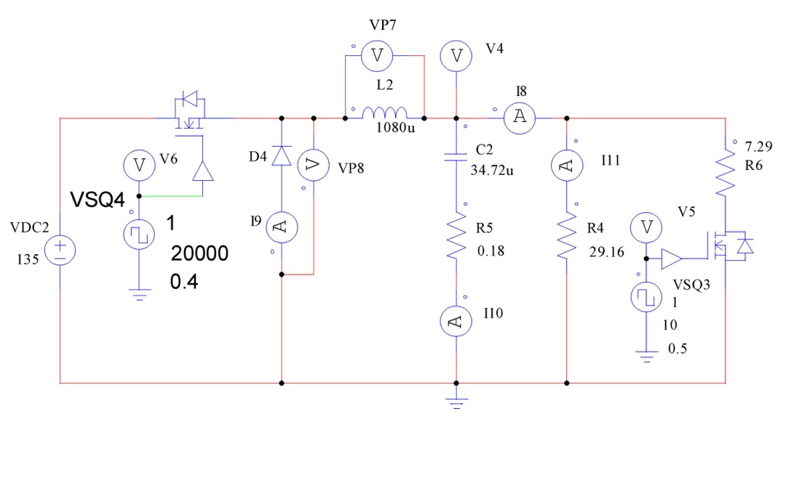

*(b)*

*Fig. 5. Formas de onda de tensão e corrente de saída durante os degraus de carga de, (a) 20% a 100%; (b) 100% a 20%.*

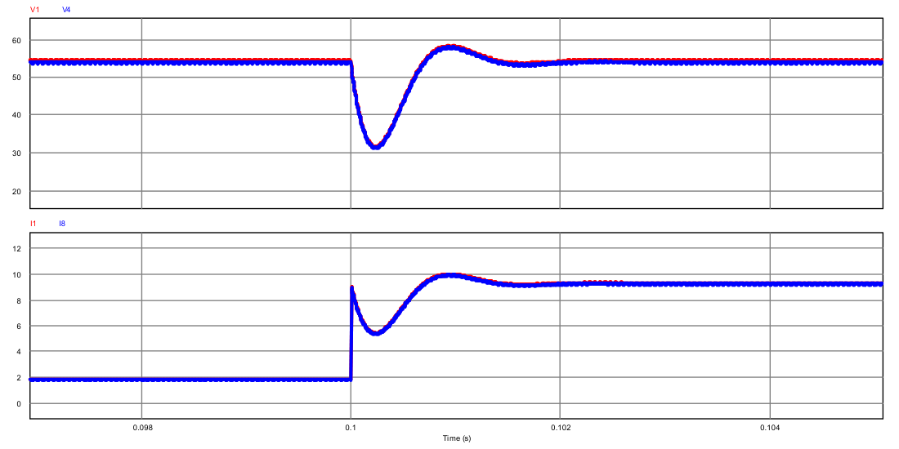

*(a)*

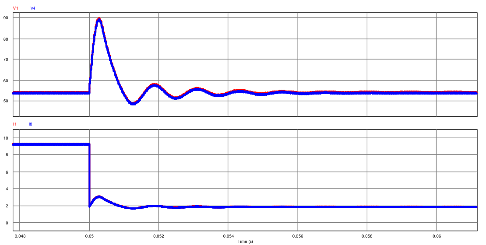

*(b)*

> Nota da conversão. Parâmetros legíveis nos esquemáticos PSIM da Fig. 4:
> transformador de 3 enrolamentos `T_31` com resistências 0,001 Ω (×3), indutâncias de dispersão
> 0,1 µH (×3), $L_m$ = 13 mH e espiras $N_p:N_s:N_t$ = 100:68:100; VDC1 = 200 V; gerador de
> comando VSQ1 com 1 V, 20 kHz, D = 0,4; L1 = 1080 µH; C1 = 34,72 µF com R2 = 0,18 Ω em série;
> carga R1 = 29,16 Ω (20 %) e R3 = 7,29 Ω chaveado por MOSFET comandado por VSQ2 (1 V, 10 Hz,
> D = 0,5). Buck equivalente: VDC2 = 135 V, VSQ4 com 1 V, 20 kHz, D = 0,4, demais valores iguais.
> Nos gráficos, V1/V4 são as tensões de saída e I1/I8 as correntes de saída (isolado/equivalente).

---

## 2. CONVERSOR CC-CC PONTE COMPLETA (*FULL-BRIDGE*)

### 2.1. INTRODUÇÃO

> **ESCREVER**

### 2.2. ANÁLISE QUALITATIVA

#### 2.2.1. Topologia do Conversor CC-CC Ponte Completa

> **ESCREVER**

*Fig. 6. Topologia do conversor.*

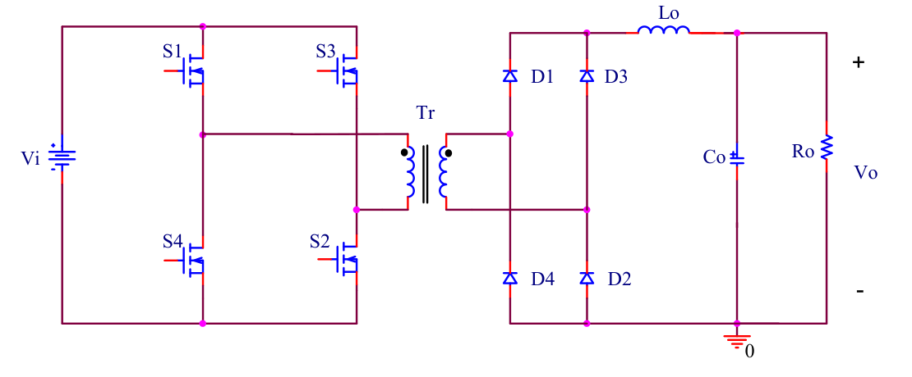

#### 2.2.2. Formas de Onda Teóricas

> **ESCREVER ALGUM TEXTO**

*Fig. 7. Formas de onda de tensão e corrente teóricas.*

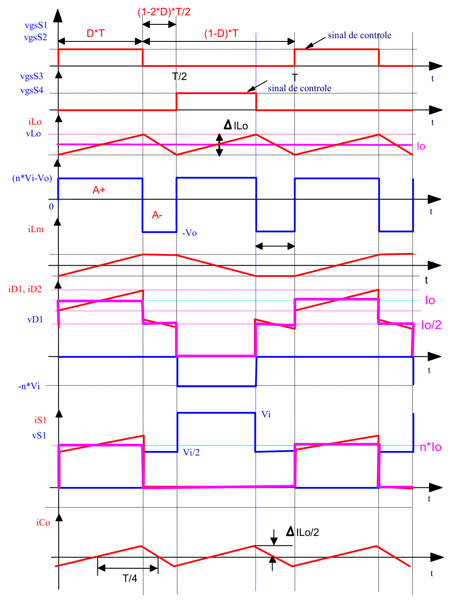

#### 2.2.3. Etapas de Operação

Em um periodo de comutação, T, apresenta quatro etapas de operação, sendo duas de transferência da entrada para a saída, e duas de roda livre.

> **COLOCAR 4 CONVERSORES E MARCAR EM NEGRITO POR ONDE PERCORRE A CORRENTE**

### 2.3. EXEMPLO DE PROJETO

#### 2.3.1. Especificações e Considerações

**Especificações:**

| Grandeza | Valor | Unidade | Descrição |
|---|---|---|---|
| $P_o$ | 5000 | [W] | potência de saída |
| $V_i$ | 400 | [V] | tensão de entrada |
| $V_o$ | 54 | [V] | tensão de saída |

**Considerações:**

| Grandeza | Valor | Unidade | Descrição |
|---|---|---|---|
| $f_s$ | 20000 | [Hz] | frequência de comutação adotada |
| $\Delta I_{Lo}$ | 18.52 | [A] | corresponde a aprox. 20% de Io |
| $\Delta V_{Co}$ | 0.27 | [V] | corresponde a 0,5% de Vo |
| $D$ | 0.4 | | razão cíclica adotada |
| $\eta$ | 1 | | rendimento ideal |

#### 2.3.2. Alguns Parametros de Projeto

Ganho estático do conversor

$$G_v = \frac{V_o}{V_i} = 2\cdot\left(\frac{N_s}{N_p}\right)\cdot D$$

$$a = \frac{N_s}{N_p} = \frac{V_s}{V_p} = \frac{I_p}{I_s}$$

Relação de transformação do transformador

$$a := \frac{V_o}{V_i}\cdot\frac{1}{2\cdot D} \qquad\qquad a = 0.169$$

A corrente de saída é dada pela seguinte equação:

$$I_o := \frac{P_o}{V_o} \qquad\qquad I_o = 92.593\ \text{[A]}$$

#### 2.3.3. Indutor de Saída Lo

**A. Indutância do indutor Lo**

$$L_o := \frac{V_o\cdot(0.5 - D)}{f_s\cdot\Delta I_{Lo}} \qquad\qquad L_o = 1.458\times10^{-5}\ \text{[H]}$$

#### 2.3.4. Capacitor de Saída Co

**B. Capacitância do capacitor Co**

$$C_o := \frac{(1 - 2\cdot D)\cdot V_o}{32\cdot L_o\cdot f_s^2\cdot\Delta V_{Co}} \qquad\qquad C_o = 2.144\times10^{-4}\ \text{[F]}$$

$$R_c := \frac{\Delta V_{Co}}{\Delta I_{Lo}} \qquad\qquad R_c = 0.015\ [\Omega]$$

#### 2.3.5. Resistor de Carga Ro

**B. Resistência do resistor de carga Ro**

$$P_o = \frac{V_{oef}^2}{R_o} = I_{oef}^2\cdot R_o \qquad\qquad V_{omed} = V_{oef}$$

$$R_o := \frac{V_o^2}{P_o} \qquad\qquad R_o = 0.583\ [\Omega]$$

#### 2.3.6. Determinação da Indutância Magnetizante do Transformador

A corrente magnetizante deve ser considerado entre 2 a 5% da corrente de pico no primário do transformador

$$I_m := 0.02\cdot(n\cdot I_o) \qquad\qquad I_m = 1.25\ \text{[A]}$$

$$X_{Lm} := \frac{V_i}{I_m} \qquad\qquad X_{Lm} = 320\ [\Omega]$$

$$X_{Lm} = 2\cdot\pi\cdot f_s\cdot L_m$$

$$L_m := \frac{X_{Lm}}{2\cdot\pi\cdot f_s} \qquad\qquad L_m = 2.546\times10^{-3}\ \text{[H]}$$

> Nota da conversão: o valor $I_m = 1{,}25$ A só é obtido com $n = 0{,}675$, que é a relação do
> Forward da Seção 1. Com a relação deste conversor, $a = 0{,}169$, resultaria $I_m = 0{,}3125$ A e
> $L_m = 10{,}2$ mH. O esquemático da Fig. 8 usa $L_m$ = 2,6 mH, coerente com o valor do enunciado.
> Ver discussão no memorial (`desenvolvimento/00-indice-do-projeto.md`).

### 2.4. RESULTADOS DE SIMULAÇÃO

#### 2.4.1. Testes de Degrau de Carga para Verificação de Equivalência dos Conversores Isolado e não Isolado

Os circuitos de simulação do conversor isolado e não isolado são mostrados na Fig. 8. Esta validação é importante, pois a modelagem para levantamento de funções de transferência será realizado no conversor não isolado.

*Fig. 8. Circuitos de simulação; (a) conversor isolado; (b) conversor equivalente.*

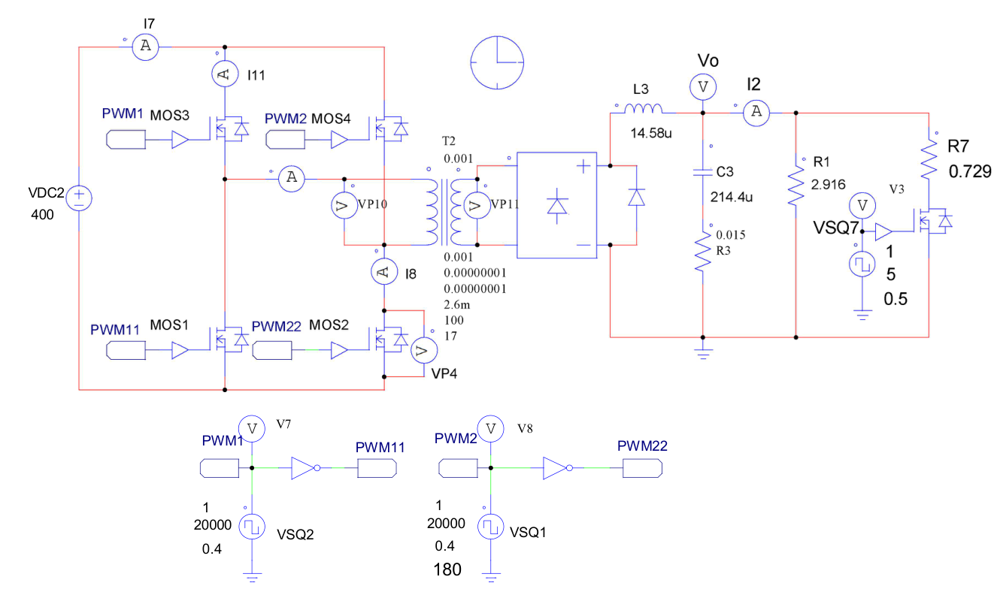

*(a)*

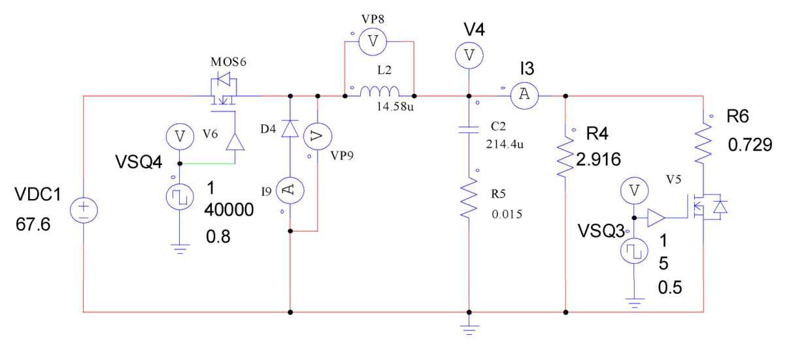

*(b)*

*Fig. 9. Formas de onda de tensão e corrente de saída durante os degraus de carga de, (a) 20% a 100%; (b) 100% a 20%.*

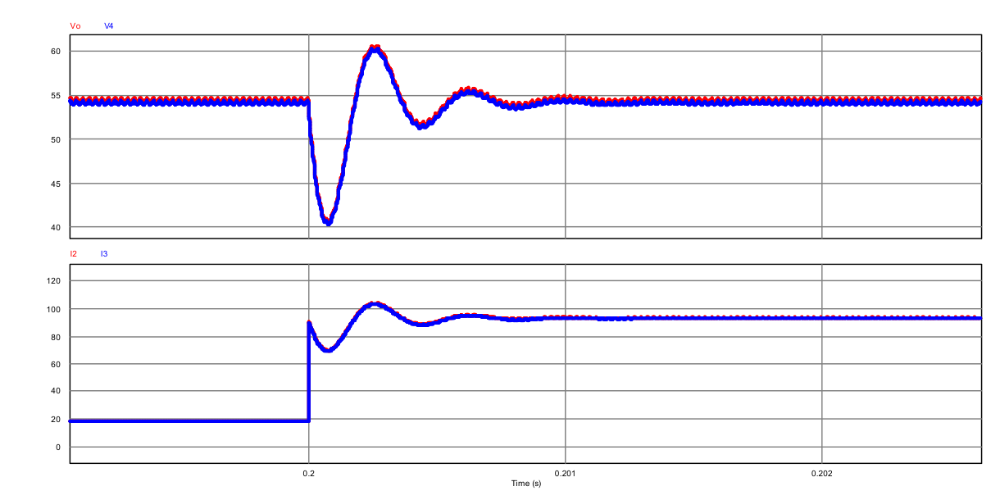

*(a)*

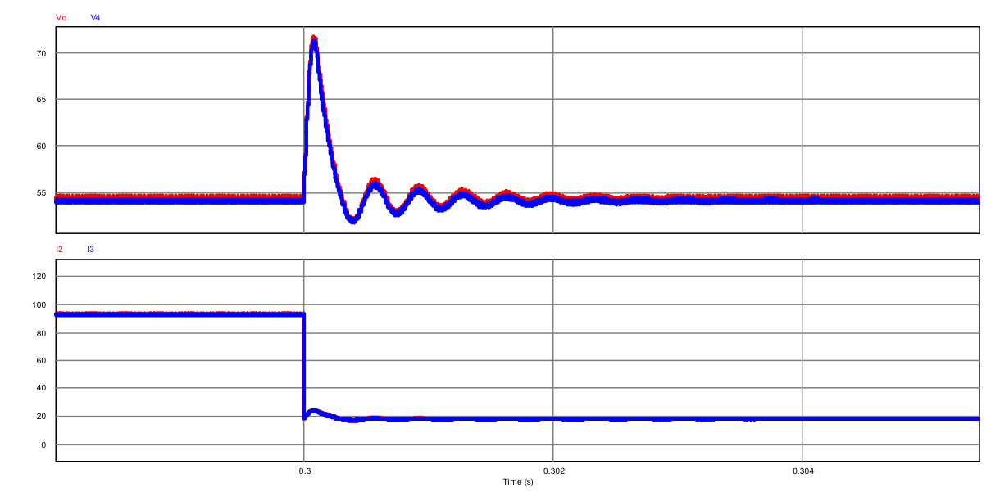

*(b)*

> Nota da conversão. Parâmetros legíveis nos esquemáticos PSIM da Fig. 8: VDC2 = 400 V; ponte com
> MOS3/MOS1 (braço esquerdo, superior/inferior) e MOS4/MOS2 (braço direito); PWM1 = VSQ2 (1 V,
> 20 kHz, D = 0,4, fase 0°), PWM11 = NOT(PWM1); PWM2 = VSQ1 (1 V, 20 kHz, D = 0,4, fase 180°),
> PWM22 = NOT(PWM2); transformador `T2` de 2 enrolamentos com resistências 0,001 Ω (×2),
> dispersões 0,01 µH (×2), $L_m$ = 2,6 mH, espiras 100:17; ponte retificadora de diodos; L3 =
> 14,58 µH; C3 = 214,4 µF com R3 = 0,015 Ω; carga R1 = 2,916 Ω (20 %) e R7 = 0,729 Ω chaveado
> por VSQ7 (1 V, 5 Hz, D = 0,5). Buck equivalente: VDC1 = 67,6 V, VSQ4 com 1 V, **40 kHz,
> D = 0,8**, L2 = 14,58 µH, C2 = 214,4 µF, R5 = 0,015 Ω, R4 = 2,916 Ω, R6 = 0,729 Ω (VSQ3, 5 Hz).
> Nos gráficos, Vo/V4 são as tensões e I2/I3 as correntes de saída.

---

## 3. CONVERSOR CC-CC PUSH-PULL ALIMENTADO EM CORRENTE

### 3.1. INTRODUÇÃO

> **ESCREVER**

### 3.2. ANÁLISE QUALITATIVA

#### 3.2.1. Topologia do Conversor

> **ESCREVER**

*Fig. 10*

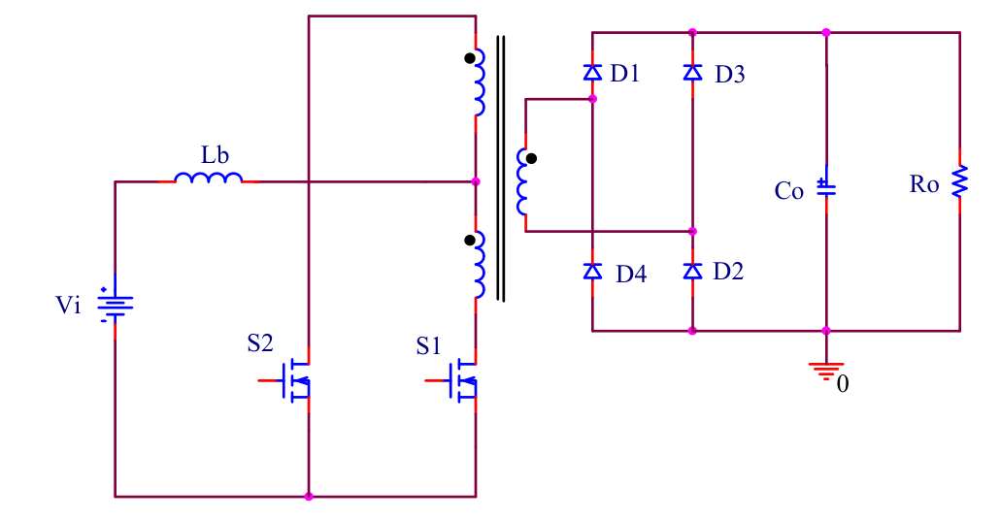

#### 3.2.2. Formas de Onda Teóricas

*Fig. 11*

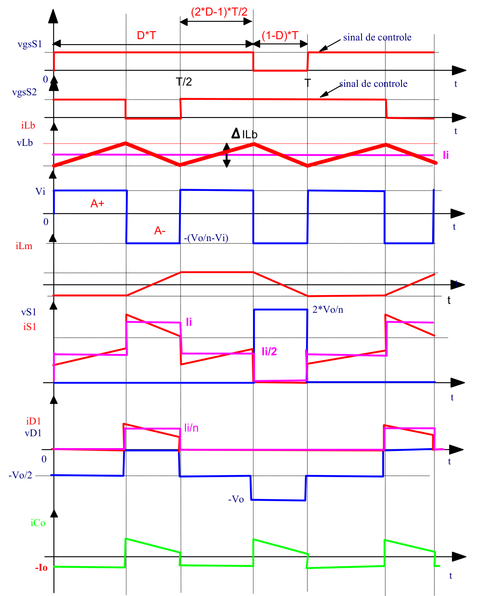

#### 3.2.3. Etapas de Operação

Em um periodo de comutação, T, o conversor apresenta quatro etapas de operação, sendo duas de armazenamento de energia no indutor de entrada, e duas de transferência de potência da entrada para a saída.

*Fig. 12*

> **COLOCAR OS QUATRO CONVERSORES E DESTACAR OS CAMINHOS DE CIRCULAÇÃO DE CORRENTE (IDEM AO FEITO NO CONVERSOR FORWARD)**

### 3.3. EXEMPLO DE PROJETO

#### 3.3.1. Especificações e Considerações

**Especificações:**

| Grandeza | Valor | Unidade | Descrição |
|---|---|---|---|
| $P_o$ | 1000 | [W] | potência de saída |
| $V_i$ | 54 | [V] | tensão de entrada |
| $V_o$ | 400 | [V] | tensão de saída |

**Considerações:**

| Grandeza | Valor | Unidade | Descrição |
|---|---|---|---|
| $f_s$ | 20000 | [Hz] | frequência de comutação adotada |
| $\Delta I_{Li}$ | 3.7 | [A] | corresponde a aprox. 20% de Ii |
| $\Delta V_{Co}$ | 4 | [V] | corresponde a 1% de Vo |
| $D$ | 0.7 | | razão cíclica adotada |
| $\eta$ | 1 | | rendimento ideal |

#### 3.3.2. Alguns Parametros de Projeto

Relação de transformação do transformador

$$a := \frac{V_o}{V_i}\cdot 2\cdot(1 - D) \qquad\qquad a = 4.444$$

A corrente média de saída é dada pela seguinte equação:

$$I_o := \frac{P_o}{V_o} \qquad\qquad I_o = 2.5\ \text{[A]}$$

#### 3.3.3. Indutor de Entrada Li

Indutância do indutor filtro Li

$$L_i := \frac{(2\cdot D - 1)\cdot V_i}{2\cdot f_s\cdot\Delta I_{Li}} \qquad\qquad L_i = 1.459\times10^{-4}\ \text{[H]}$$

#### 3.3.4. Capacitor de Saída Co

Capacitância do capacitor filtro Co

$$C_o := \frac{(2\cdot D - 1)\cdot I_o}{2\cdot f_s\cdot\Delta V_{Co}} \qquad\qquad C_o = 6.25\times10^{-6}\ \text{[F]}$$

$$P_i := P_o$$

$$I_i := \frac{P_i}{V_i} \qquad\qquad I_i = 18.519\ \text{[A]}$$

$$I_{Li\_max} := I_i + \frac{\Delta I_{Li}}{2} \qquad\qquad I_{Li\_max} = 20.369\ \text{[A]}$$

$$R_c := \frac{\Delta V_{Co}}{I_{Li\_max}}\cdot a \qquad\qquad R_c = 0.873\ [\Omega]$$

#### 3.3.5. Resistor de Carga Ro

Resistência do resistor de carga Ro

$$R_o := \frac{V_o^2}{P_o} \qquad\qquad R_o = 160\ [\Omega]$$

#### 3.3.6. Determinação da Indutância Magnetizante do Transformador

A corrente magnetizante deve ser considerado entre 2 a 5% da corrente de pico no primário do transformador

Corrente magnetizante do transformador

$$I_{Lm} := 0.01\cdot I_i \qquad\qquad I_{Lm} = 0.185\ \text{[A]}$$

$$V_{pri} := \frac{V_o}{a} \qquad\qquad V_{pri} = 90\ \text{[V]}$$

$$X_{Lm} := \frac{V_{pri}}{I_{Lm}} \qquad\qquad X_{Lm} = 486\ [\Omega]$$

$$X_{Lm} = 2\cdot\pi\cdot f_s\cdot L_m$$

$$L_m := \frac{X_{Lm}}{2\cdot\pi\cdot f_s} \qquad\qquad L_m = 3.867\times10^{-3}\ \text{[H]}$$

Para colocar no simulador pode ser adotado um valor maior ao valor calculado.

### 3.4. RESULTADOS DE SIMULAÇÃO

#### 3.4.1. Testes de Degrau de Carga para Verificação de Equivalência dos Conversores Isolado e não Isolado

Os circuitos de simulação do conversor isolado e não isolado são mostrados na Fig. 13. Esta validação é importante, pois a modelagem para levantamento de funções de transferência será realizado no conversor não isolado.

*Fig. 13. Circuitos de simulação; (a) conversor isolado; (b) conversor equivalente.*

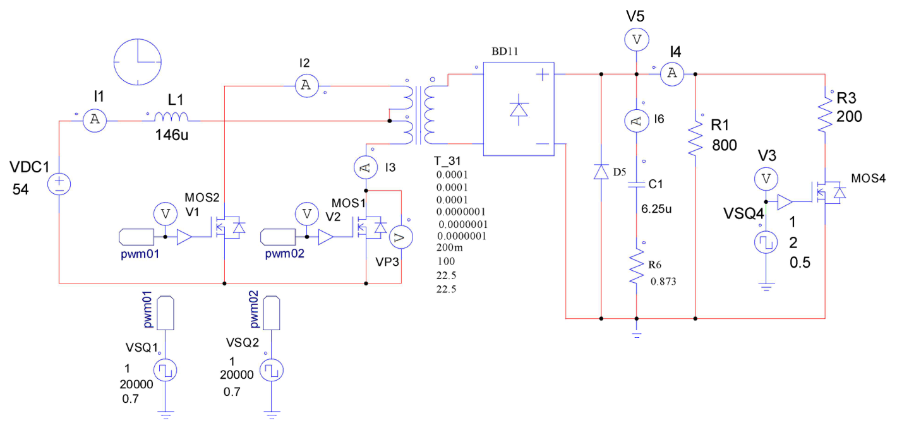

*(a)*

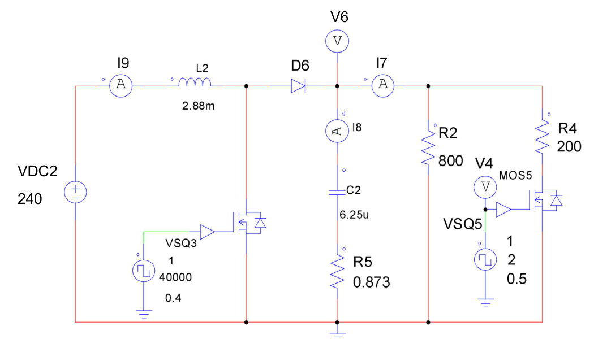

*(b)*

*Fig. 14. Formas de onda de tensão e corrente de saída durante os degraus de carga de, (a) 20% a 100%; (b) 100% a 20%.*

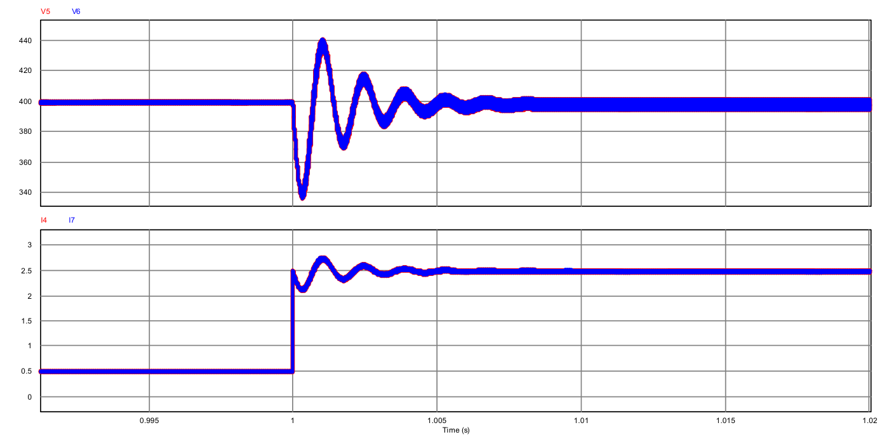

*(a)*

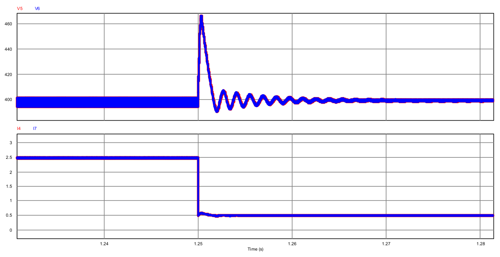

*(b)*

> Nota da conversão. Parâmetros legíveis nos esquemáticos PSIM da Fig. 13: VDC1 = 54 V; L1 =
> 146 µH; MOS2 e MOS1 comandados por VSQ1 e VSQ2 (1 V, 20 kHz, D = 0,7 cada; a defasagem de 180°
> entre eles não aparece legível na figura, mas é exigida pelo funcionamento, ver Fig. 11);
> transformador `T_31` de 3 enrolamentos com resistências 0,0001 Ω (×3), dispersões 0,1 µH (×3),
> $L_m$ = 200 mH e espiras 100:22,5:22,5 (enrolamento de 100 espiras ligado à ponte retificadora
> BD11 e os dois de 22,5 espiras formando o primário com derivação central); D5 em paralelo com a
> saída; C1 = 6,25 µF com R6 = 0,873 Ω; carga R1 = 800 Ω (20 %) e R3 = 200 Ω chaveado por VSQ4
> (1 V, 2 Hz, D = 0,5). Boost equivalente: VDC2 = 240 V, L2 = 2,88 mH, VSQ3 com 1 V, **40 kHz,
> D = 0,4**, D6, C2 = 6,25 µF, R5 = 0,873 Ω, R2 = 800 Ω, R4 = 200 Ω (VSQ5, 2 Hz).
> Nos gráficos, V5/V6 são as tensões e I4/I7 as correntes de saída.

---

## 4. CONVERSOR CC-CC FLYBACK DE UMA CHAVE

### 4.1. INTRODUÇÃO

> **ESCREVER**

### 4.2. ANÁLISE QUALITATIVA

#### 4.2.1. Topologia do Conversor

A topologia do conversor CC-CC flyback de uma chave é mostrada na Fig. 15. A mesma consiste de uma fonte de tensão de entrada Vi; um transformador de alta frequência de dois enrolamentos, sendo um primário e um secundário; uma chave controlada S1; um diodo de transferência D1; um capacitor filtro Co; e a carga representada por Ro.

*Fig. 15. Topologia do conversor flyback de uma chave.*

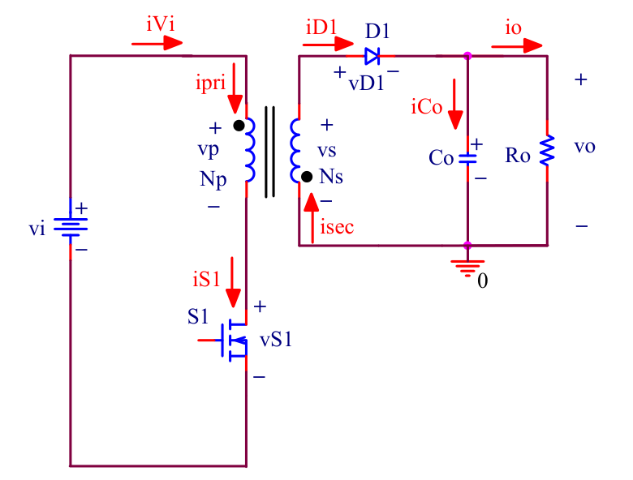

Para traçar as formas de onda deve ser definida a relação de transformação, n. O conhecimento dele facilita a determinação de grandezas elétricas, tais como, correntes e tensões.

Assim:

$$n = \frac{N_s}{N_p} = \frac{V_s}{V_p} = \frac{I_p}{I_s} \qquad (1)$$

Exemplo,

$$V_s = n\cdot V_p \qquad\qquad I_p = n\cdot I_s$$

A razão cíclica é definida pela relação do tempo de condução da chave num periodo de comutação.

$$D = \frac{t_{cond}}{T}$$

#### 4.2.2. Formas de Onda

> **ESCREVER**

*Fig. 16. Formas de onda teóricas.*

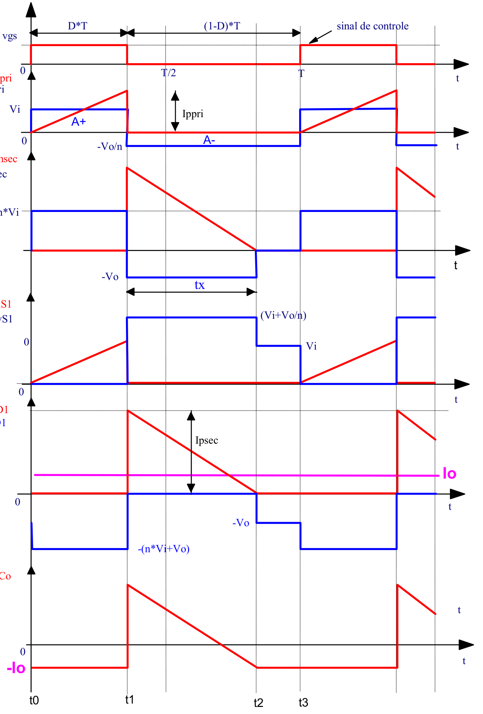

#### 4.2.3. Etapas de Operação em Modo de Condução Descontínua - MCD

Em um periodo há três etapas de operação, que as mesmas são indicadas topologicamente na Figura 17.

*Fig. 17. Circuitos correspondentes as etapas de operação num período.*

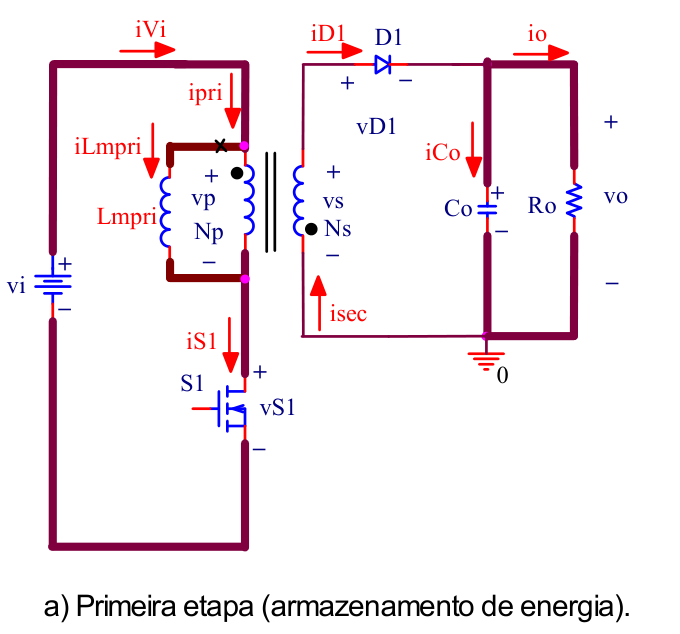

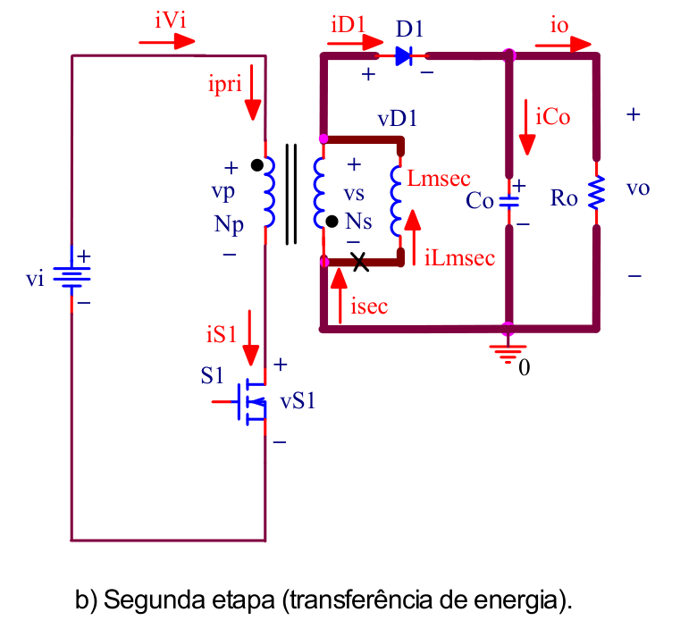

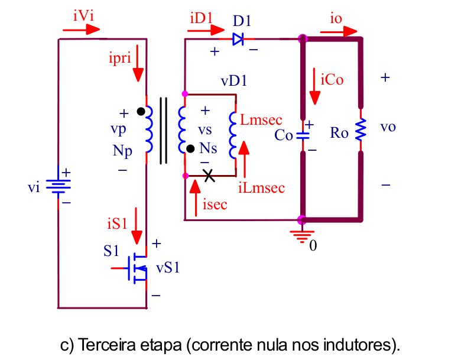

*a) Primeira etapa (armazenamento de energia). b) Segunda etapa (transferência de energia). c) Terceira etapa (corrente nula nos indutores).*

### 4.3. EXEMPLO DE PROJETO

As especificações e considerações de projeto estão dadas a seguir:

#### 4.3.1. Especificações e Considerações

**Especificações:**

| Grandeza | Valor | Unidade | Descrição |
|---|---|---|---|
| $P_o$ | 200 | [W] | potência de saída |
| $V_i$ | 200 | [V] | tensão de entrada |
| $V_o$ | 54 | [V] | tensão de saída |

**Considerações:**

| Grandeza | Valor | Unidade | Descrição |
|---|---|---|---|
| $f_s$ | 20000 | [Hz] | frequência de comutação adotada |
| $\Delta V_{Co}$ | 0.54 | [V] | corresponde a 1% de Vo |
| $D$ | 0.4 | | razão cíclica adotada |
| $\eta$ | 1 | | rendimento ideal |

#### 3.3.2. Alguns Parametros de Projeto

> Nota da conversão: a numeração 3.3.x desta seção está assim no original (deveria ser 4.3.x).

Relação de transformação do transformador obtido do modo crítico

$$a := \frac{V_o}{V_i}\cdot\frac{(1 - D)}{D} \qquad\qquad a = 0.405$$

A corrente média de saída é dada pela seguinte equação:

$$I_o := \frac{P_o}{V_o} \qquad\qquad I_o = 3.704\ \text{[A]}$$

#### 3.3.3. Indutância Magnetizante no Lado Primário

Indutância magnetizante do lado primário:

$$P_i := \frac{P_o}{\eta} \qquad\qquad P_i = 200\ \text{[W]}$$

$$L_{mpri} := \frac{V_i^2\cdot D^2}{2\cdot f_s\cdot P_i} \qquad\qquad L_{mpri} = 8\times10^{-4}\ \text{[H]}$$

$$L_{mpri\_MCD} := 0.9\cdot L_{mpri} \qquad\qquad L_{mpri\_MCD} = 7.2\times10^{-4}\ \text{[H]}$$

#### 3.3.4. Capacitor de Saída Co

Capacitância do capacitor Co:

$$I_o := \frac{P_o}{V_o} \qquad\qquad I_o = 3.704\ \text{[A]}$$

$$C_o := \frac{I_o\cdot D}{f_s\cdot\Delta V_{Co}} \qquad\qquad C_o = 1.372\times10^{-4}\ \text{[F]}$$

$$R_{se} := \frac{\Delta V_{Co}}{\dfrac{2\cdot I_o}{1 - D}} \qquad\qquad R_{se} = 0.044\ [\Omega]$$

#### 3.3.5. Resistor de Carga Ro

Resistência do reistor de carga Ro:

$$R_o := \frac{V_o^2}{P_o} \qquad\qquad R_o = 14.58\ [\Omega]$$

### 4.4. RESULTADOS DE SIMULAÇÃO

#### 4.4.1. Testes de Degrau de Carga para Verificação de Equivalência dos Conversores Isolado e não Isolado

Os circuitos de simulação do conversor isolado e não isolado são mostrados na Fig. 18 (MCD) e Fig. 20 (MCC). Esta validação é importante, pois a modelagem para levantamento de funções de transferência será realizado no conversor não isolado.

*Fig. 18. Circuitos de simulação; (a) conversor isolado; (b) conversor equivalente.*

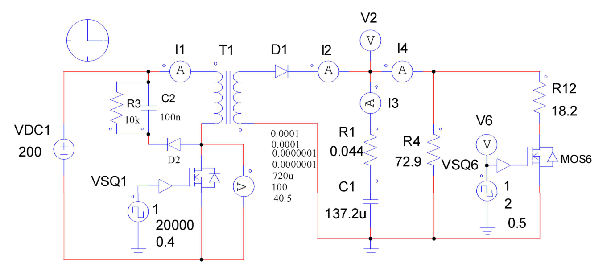

*(a)*

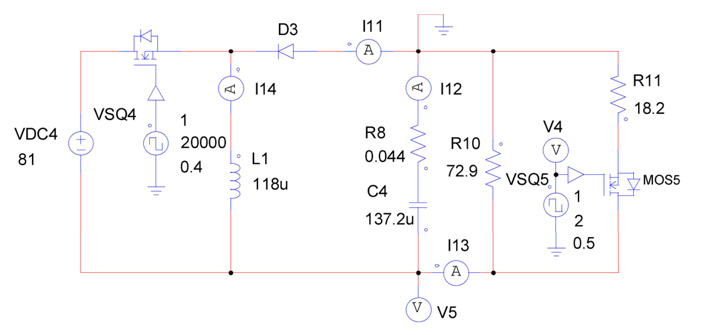

*(b)*

*Fig. 19. Formas de onda de tensão e corrente de saída em MCD durante os degraus de carga de, (a) 20% a 100%; (b) 100% a 20%.*

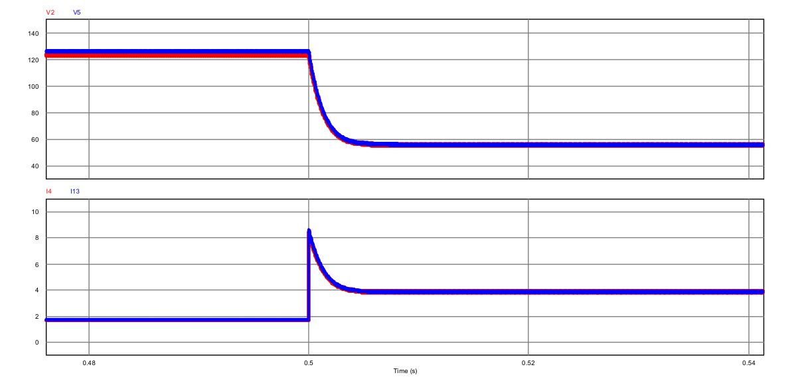

*(a)*

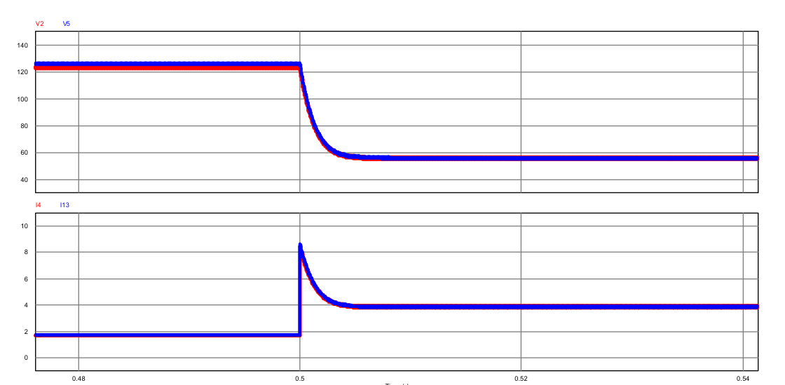

*(b)*

> Nota da conversão: no original, as Figs. 19(a) e 19(b) são o mesmo gráfico (degrau em 0,5 s,
> tensão de ~125 V para ~56 V, isto é, 20 % → 100 %). O gráfico de 100 % → 20 % em MCD está
> ausente e deverá ser gerado pela equipe.

**NOTA SOBRE O FLYBACK:**

O comportamento dimâmico a degraus de carga entre o o conversores isolado e não isolado, são mais evidentes em MODO DE CONDUÇÃO CONTÍNUA (MCC). Para mostrar isso, a indutância calculada no projeto em MCD foi multiplicada x10. Então, basta dividir por esse valor para simular em MODO DE CONDUÇÃO DESCONTINUA (MCD) e também mostrar os resultados..

*Fig. 20. Circuitos de simulação; (a) conversor isolado; (b) conversor equivalente.*

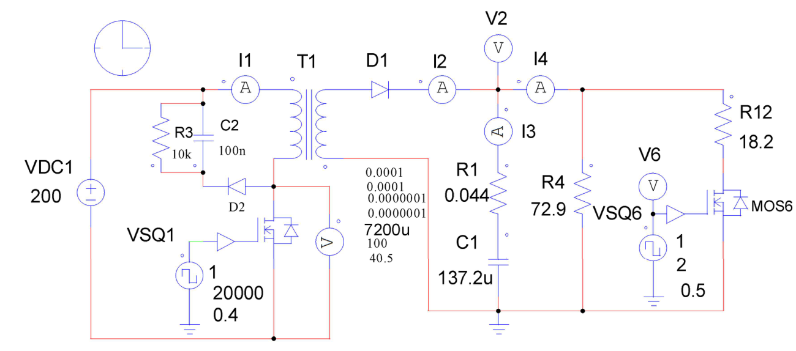

*(a)*

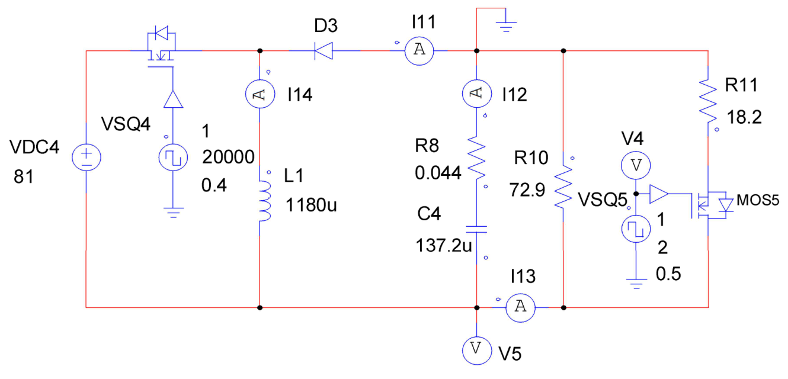

*(b)*

*Fig. 21. Formas de onda de tensão e corrente de saída em MCD durante os degraus de carga de, (a) 20% a 100%; (b) 100% a 20%.*

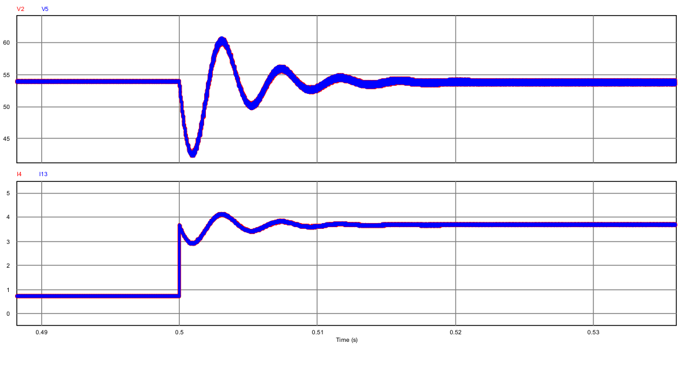

*(a)*

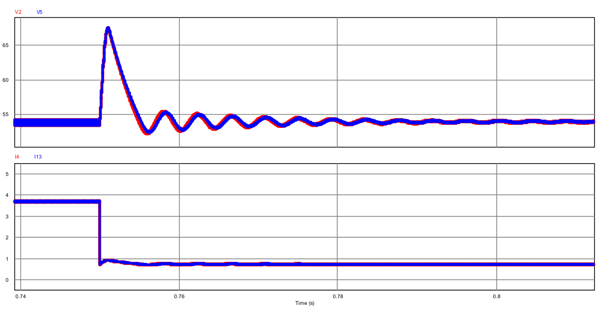

*(b)*

> Nota da conversão. A legenda da Fig. 21 diz "em MCD", mas os circuitos são os da Fig. 20, com
> $L_m$ = 7200 µH, ou seja, em **MCC**. Parâmetros legíveis nos esquemáticos PSIM das Figs. 18 e 20:
> VDC1 = 200 V; transformador `T1` de 2 enrolamentos com resistências 0,0001 Ω (×2), dispersões
> 0,1 µH (×2), $L_m$ = 720 µH (MCD) ou 7200 µH (MCC), espiras 100:40,5; grampeador RCD no primário
> (D2, C2 = 100 nF, R3 = 10 kΩ); VSQ1 com 1 V, 20 kHz, D = 0,4; D1; C1 = 137,2 µF com R1 = 0,044 Ω;
> carga R4 = 72,9 Ω (20 %) e R12 = 18,2 Ω chaveado por VSQ6 (1 V, 2 Hz, D = 0,5). Buck-boost
> equivalente: VDC4 = 81 V, VSQ4 com 1 V, 20 kHz, D = 0,4, L1 = 118 µH (MCD) ou 1180 µH (MCC), D3,
> C4 = 137,2 µF, R8 = 0,044 Ω, R10 = 72,9 Ω, R11 = 18,2 Ω (VSQ5, 2 Hz). A saída do equivalente é
> negativa em relação ao terra (o terra está no nó superior). Nos gráficos, V2/V5 são as tensões e
> I4/I13 as correntes de saída.

---

## 5. CONCLUSÕES GERAIS

> **ESCREVER**

## 6. REFERÊNCIAS

> **LISTAR**
