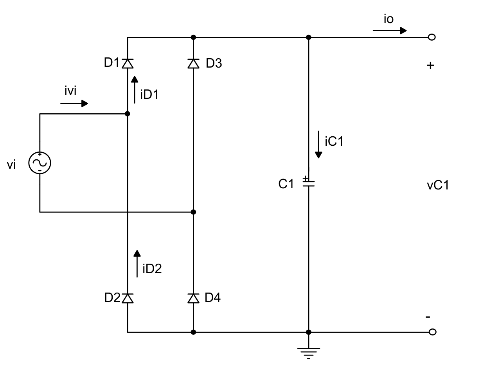
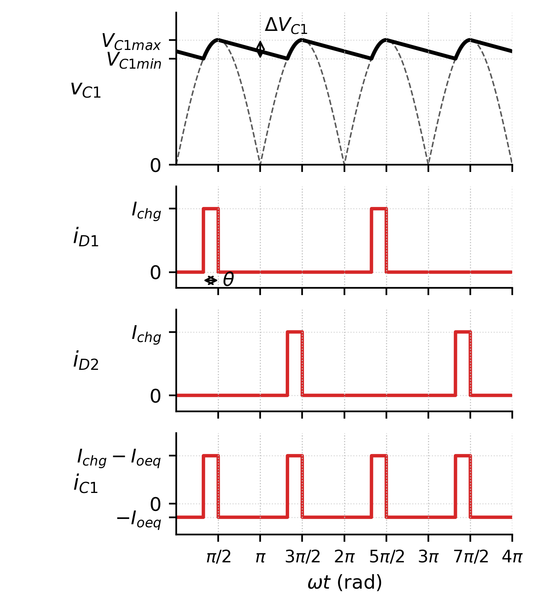
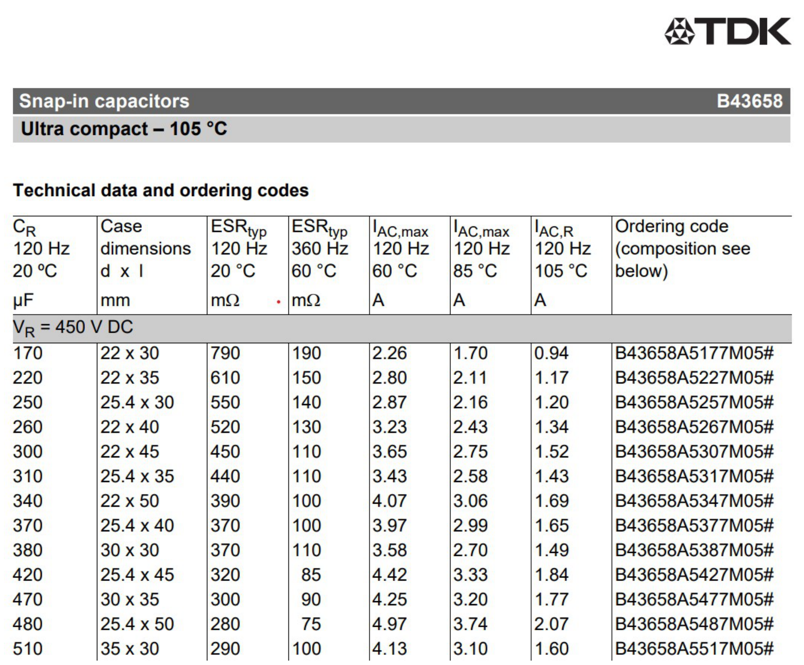

# Especificações e retificador com filtro capacitivo

> Gerado por `artigo/fonte/exportar_markdown.py` a partir de `conteudo.py`. Para alterar o texto, edite `conteudo.py` e gere de novo. A numeração de seções, figuras, tabelas e equações é a do artigo.

## I. Introdução

Baterias estacionárias de chumbo-ácido de 7 Ah a 150 Ah alimentam a iluminação de emergência de casas, edifícios e centros comerciais. Elas passam quase toda a vida em flutuação e são exigidas apenas quando a rede falta, de modo que a sua durabilidade depende de como são recarregadas: corrente excessiva aquece e deforma as placas, e tensão acima da de flutuação acelera a corrosão e a perda de água [3], [4]. O carregador precisa, portanto, limitar a corrente durante a recarga e regular a tensão quando a bateria se aproxima da carga plena.

O objetivo deste trabalho é projetar e simular um carregador desse tipo, com corrente de recarga ajustável de 0 a 15 A por uma referência $V_{refi}$ de 0 a 2,5 V, para um banco de 24 V [1]. A energia vem da rede por um retificador a diodos com filtro capacitivo, e a adaptação de tensão, a isolação e o controle ficam a cargo de um conversor CC-CC Forward de duas chaves. Essa topologia foi escolhida pela faixa de potência, por entregar à carga uma corrente filtrada por indutor e, principalmente, por submeter as chaves apenas à tensão de entrada, e não ao dobro dela como no Forward de uma chave. O ponto fraco do arranjo está na entrada: o retificador com filtro capacitivo drena da rede uma corrente pulsada, com fator de potência inferior a 0,5.

O ponto de partida é a planilha de projeto do professor [1], que traz o dimensionamento do capacitor de barramento, do transformador e do filtro de saída, o projeto das duas malhas de controle e três ensaios simulados no PSIM com a rede em 176 V. Este artigo confere todos esses cálculos e desenvolve o que a planilha não traz: a análise qualitativa do Forward de duas chaves, com etapas de operação e formas de onda; os esforços nos diodos do retificador e nos semicondutores do conversor, com a escolha de componentes comerciais; o circuito de controle com o UC3525A e a sua lista de componentes; e a repetição dos ensaios também com a rede em 264 V. As simulações foram feitas no PLECS [10], e não no PSIM, e os resultados são comparados com os do professor.

As Seções II e III reúnem as especificações da bateria e da rede. A Seção IV trata do retificador, a Seção V do Forward de duas chaves e a Seção VI do controle. A Seção VII apresenta os resultados de simulação e a Seção VIII, as conclusões.

## II. Especificações Básicas da Bateria Estacionária

O projeto é feito para a maior bateria da faixa, de 150 Ah, em um banco de 24 V formado por doze elementos. A tensão mínima adotada é de 20 V, o que corresponde a 1,67 V por elemento com a bateria descarregada, e a máxima é de 27 V, ou 2,25 V por elemento, que é a tensão de flutuação recomendada pelos fabricantes [3]. A corrente de recarga é de um décimo da capacidade, $I_{rec}$ = 0,1·150 = 15 A, e a potência máxima entregue à bateria é o produto dessa corrente pela tensão máxima, $P_{bat}$ = 27·15 = 405 W.

O regime de carga é o usual para baterias reguladas a válvula [4]: corrente constante enquanto a tensão está abaixo do valor regulado e, a partir daí, tensão constante, com a corrente caindo naturalmente. Para baterias menores basta reduzir a referência de corrente. Como 2,5 V correspondem a 15 A, a sensibilidade é de 6 A/V, e uma bateria de 7 Ah, que pede 0,7 A, é atendida com $V_{refi}$ = 0,117 V.

## III. Dados da Rede Elétrica

A alimentação é a rede monofásica de 220 V e 60 Hz, com tolerância de 20 % para mais e para menos, isto é, de 176 V a 264 V eficazes. Os picos correspondentes, de 248,9 V e 373,4 V, definem os extremos da tensão do barramento CC. O limite inferior é ainda reduzido pela ondulação do capacitor de filtro, e por isso o conversor é projetado para operar de 225 V a 373 V. A Tabela I resume as especificações.

**Tabela I.** Especificações do carregador

| Grandeza | Valor |
|---|---|
| Capacidade da bateria | 150 Ah (faixa de 7 a 150 Ah) |
| Tensão da bateria | 20 V a 27 V |
| Corrente de recarga | 15 A (0 a 15 A por $V_{refi}$) |
| Potência máxima na bateria | 405 W |
| Tensão da rede | 220 V (176 V a 264 V), 60 Hz |
| Barramento CC | 225 V a 373 V |
| Frequência de comutação | 50 kHz |
| Razão cíclica máxima | 0,4 |
| Ondulação de corrente em $L_{o}$ | 3 A (20 %) |
| Ondulação de tensão em $C_{o}$ | 0,27 V (1 %) |

## IV. Projeto do Retificador a Diodos com Filtro Capacitivo

### Topologia e formas de onda

O retificador é a ponte completa da Fig. 1. No semiciclo positivo conduzem os diodos D1 e D4 e, no negativo, D3 e D2. Os diodos só entram em condução quando a tensão da rede, em módulo, supera a do capacitor C1, o que acontece durante um intervalo curto em torno do pico da senoide. Nesse intervalo o capacitor é recarregado até o valor de pico e, no restante do semiciclo, alimenta sozinho a carga, com a tensão caindo quase linearmente. A Fig. 2 mostra as formas de onda usadas no dimensionamento, nas quais o pulso de corrente dos diodos é aproximado por um retângulo de amplitude $I_{chg}$ e duração angular θ [5].

**Fig. 1.** Retificador monofásico em ponte completa com filtro capacitivo [1].

**Fig. 2.** Formas de onda básicas do retificador: tensão no capacitor, correntes nos diodos e corrente no capacitor, com o pulso de carga aproximado por um retângulo (adaptado de [1]).

### Capacitor de filtro

O pior caso é a rede em 176 V. A tensão máxima no capacitor é o pico da rede, $V_{C1max}$ = 248,9 V, e admite-se uma ondulação de 10 % desse valor, ΔV_C1 = 24,89 V, o que leva a $V_{C1min}$ = 224,0 V. O ângulo de condução dos diodos é o intervalo entre o instante em que a senoide alcança $V_{C1min}$ e o seu pico:

$$\theta = \frac{\pi}{2} - \mathrm{arcsen}\left(\frac{V_{C1min}}{V_{C1max}}\right) \tag{1}$$

O resultado é θ = 0,451 rad, ou 1,196 ms. O capacitor é obtido igualando a energia que ele cede à carga, durante a fração do semiciclo em que os diodos estão bloqueados, à variação da sua energia armazenada:

$$C_1 = \frac{P_{ret}\,(\pi - \theta)}{\pi f_r\,(V_{C1max}^2 - V_{C1min}^2)} \tag{2}$$

Com rendimento estimado de 90 % para os estágios seguintes, a potência na saída do retificador é $P_{ret}$ = 405/0,9 = 450 W, e (2) fornece $C_{1}$ = 545,7 µF. A carga equivalente drena $I_{oeq}$ = $P_{ret}$/$V_{C1med}$ = 1,903 A, com $V_{C1med}$ = 236,5 V. Como toda a carga reposta em um semiciclo passa pelos diodos durante θ, a amplitude do pulso retangular e a corrente eficaz no capacitor valem

$$I_{chg} = \frac{\pi\,I_{oeq}}{\theta} \tag{3}$$

$$I_{C1ef} = \sqrt{\frac{(I_{chg} - I_{oeq})^2\,\theta + I_{oeq}^2\,(\pi - \theta)}{\pi}} \tag{4}$$

o que dá $I_{chg}$ = 13,26 A e $I_{C1ef}$ = 4,65 A. Todos esses valores coincidem com os da planilha [1]. A corrente eficaz, e não a capacitância, é o que define o componente: no catálogo da Fig. 3, o capacitor de 470 µF e 450 V suporta 4,25 A a 60 °C e 3,20 A a 85 °C, valores insuficientes para um único componente. Adotam-se, por isso, dois capacitores TDK B43658 de 470 µF em paralelo, $C_{1}$ = 940 µF, que juntos suportam 8,5 A a 60 °C [11].

**Fig. 3.** Trecho do catálogo do capacitor do barramento, TDK B43658 de 450 V. Foram adotados dois capacitores de 470 µF em paralelo [1], [11].

A capacitância adotada é 72 % maior que a calculada, e convém refazer as contas com ela. Resolvendo (1) e (2) para $C_{1}$ = 940 µF obtém-se ondulação de 14,7 V, ou 5,9 %, ângulo de condução menor e, por consequência, pulso de corrente mais alto. A Tabela II reúne os resultados para as duas tensões extremas da rede.

### Diodos retificadores

A planilha não dimensiona os diodos da ponte. No modelo de pulso retangular, cada diodo conduz um pulso por ciclo da rede, de modo que as suas correntes média e eficaz são

$$I_{Dmed} = \frac{I_{chg}\,\theta}{2\pi}, \qquad I_{Def} = I_{chg}\sqrt{\frac{\theta}{2\pi}} \tag{5}$$

e a tensão reversa máxima é o pico da rede em 264 V, 373,4 V. Com $C_{1}$ = 940 µF e a rede em 176 V resultam 0,93 A médios e 3,97 A eficazes por diodo. Escolheu-se a ponte Vishay GBU8J, de 600 V e 8 A, cuja tabela de valores máximos aparece na Fig. 8(a) [12]. A folga de tensão é de 1,6 vez, e a corrente de surto admissível, de 200 A, cobre com sobra o pulso repetitivo. A corrente de energização do capacitor descarregado não foi tratada aqui e, numa montagem real, exige um limitador em série.

### Fator de potência

A corrente da rede é formada por dois pulsos por ciclo, um positivo e um negativo. O seu valor eficaz e o fator de potência seguem do mesmo modelo:

$$I_{ief} = I_{chg}\sqrt{\frac{\theta}{\pi}}, \qquad \mathrm{FP} = \frac{P_{ret}}{V_{ief}\,I_{ief}} \tag{6}$$

O fator de potência previsto é de 0,455 em 176 V e de 0,379 em 264 V. Ele piora com o aumento da tensão da rede, e também com o aumento do capacitor, porque nos dois casos o intervalo de condução encolhe e a mesma potência passa a ser transferida em pulsos mais estreitos e mais altos. Esse é o ponto negativo apontado na introdução: a corrente é rica em harmônicas e o valor eficaz drenado da rede é mais que o dobro do necessário. A correção exigiria um estágio pré-regulador, tipicamente um conversor Boost com controle da corrente de entrada, entre a ponte e o capacitor.

**Tabela II.** Retificador com filtro capacitivo: modelo de pulso retangular

| Grandeza | 176 V, 545,7 µF (planilha) | 176 V, 940 µF | 264 V, 940 µF |
|---|---|---|---|
| ΔV_C1 (V) | 24,89 | 14,70 | 10,03 |
| $V_{C1min}$ (V) | 224,0 | 234,2 | 363,3 |
| θ (rad) | 0,451 | 0,345 | 0,232 |
| Tempo de condução (ms) | 1,196 | 0,916 | 0,616 |
| $I_{chg}$ (A) | 13,26 | 16,94 | 16,52 |
| $I_{C1ef}$ (A) | 4,65 | 5,30 | 4,32 |
| $I_{Dmed}$ (A) | 0,95 | 0,93 | 0,61 |
| $I_{Def}$ (A) | 3,55 | 3,97 | 3,18 |
| $I_{ief}$ (A) | 5,02 | 5,62 | 4,49 |
| Fator de potência | 0,509 | 0,455 | 0,379 |
