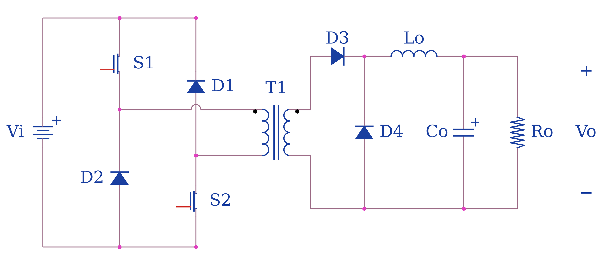
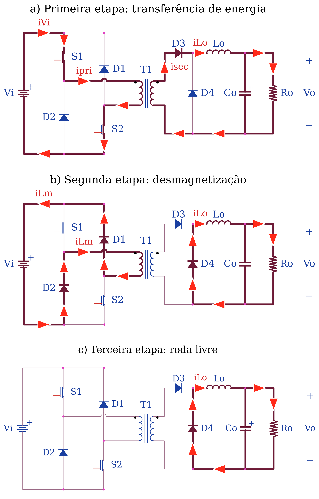
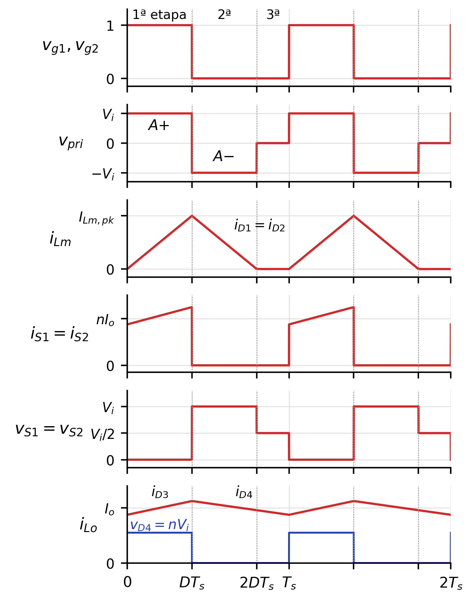
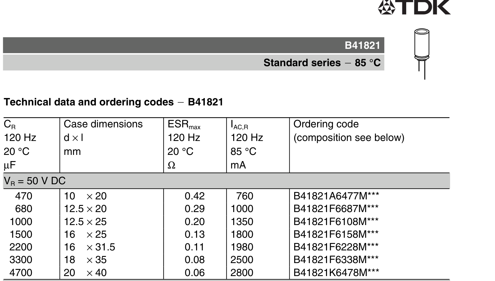
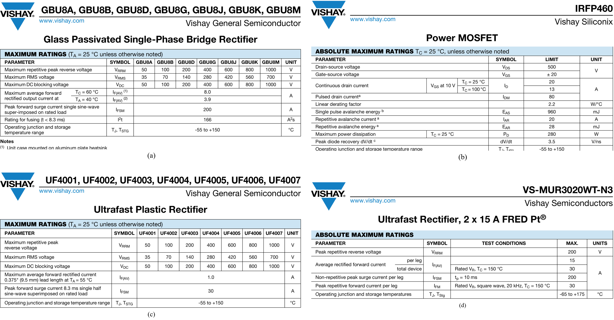

# Conversor Forward de duas chaves

> Gerado por `artigo/fonte/exportar_markdown.py` a partir de `conteudo.py`. Para alterar o texto, edite `conteudo.py` e gere de novo. A numeração de seções, figuras, tabelas e equações é a do artigo.

## V. Projeto do Conversor Forward de Duas Chaves

### Topologia e etapas de operação

A Fig. 4 mostra a topologia. O primário do transformador fica entre duas chaves, S1 ligada ao positivo do barramento e S2 ao negativo, comandadas pelo mesmo sinal. Dois diodos, D1 e D2, ligam em cruz os terminais do primário ao barramento. No secundário, D3 retifica e D4 faz a roda livre do indutor de filtro, como em um conversor Buck. O funcionamento em condução contínua tem as três etapas da Fig. 5, e as formas de onda idealizadas estão na Fig. 6 [6], [7].

**Fig. 4.** Topologia do conversor Forward de duas chaves.

Na primeira etapa, de duração DT_s, as duas chaves conduzem e o primário recebe a tensão $V_{i}$. O secundário, com a mesma polaridade, polariza D3 diretamente e aplica nV_i à entrada do filtro, de modo que a corrente de $L_{o}$ cresce. A corrente das chaves é a do indutor refletida ao primário, somada à corrente magnetizante, que cresce linearmente a partir de zero.

Na segunda etapa as chaves são bloqueadas. A corrente magnetizante não pode ser interrompida e passa a circular por D1 e D2, que ligam o primário à fonte com a polaridade invertida. O transformador fica submetido a −$V_{i}$, a corrente magnetizante decresce e a energia armazenada no núcleo é devolvida à fonte. É essa etapa que distingue a topologia: a tensão sobre cada chave fica grampeada em $V_{i}$ pelos diodos, sem enrolamento terciário e sem circuito de grampeamento dissipativo, e a energia da dispersão também é recuperada. No secundário, D3 bloqueia e D4 assume a corrente de $L_{o}$.

A terceira etapa começa quando a corrente magnetizante se anula. O primário fica sem corrente, a tensão sobre o transformador é nula e cada chave suporta metade de $V_{i}$. A roda livre continua até o início do período seguinte. Como a tensão de desmagnetização tem o mesmo módulo da de magnetização, a segunda etapa dura o mesmo que a primeira, e as áreas A+ e A− da Fig. 6 são iguais. Para que haja tempo de desmagnetizar o núcleo antes de um novo ciclo, a razão cíclica precisa ser menor que 0,5.

**Fig. 5.** Etapas de operação do Forward de duas chaves em condução contínua: (a) transferência de energia; (b) desmagnetização; (c) roda livre. O caminho da corrente está em traço grosso e as setas indicam o seu sentido.

**Fig. 6.** Formas de onda teóricas do Forward de duas chaves: comando, tensão no primário, corrente magnetizante, corrente e tensão nas chaves, corrente em $L_{o}$ e tensão na entrada do filtro.

### Relação de transformação e razão cíclica

Visto do secundário, o conversor é um Buck alimentado por nV_i. O ganho estático e a relação de espiras, definida para a razão cíclica máxima na tensão mínima de entrada, são

$$\frac{V_o}{V_i} = nD, \qquad n = \frac{N_s}{N_p} = \frac{V_o}{V_{imin}\,D_{max}} \tag{7}$$

Com $V_{o}$ = 27 V, $V_{imin}$ = 225 V e $D_{max}$ = 0,4, resulta n = 0,3, e a simulação usa 100 espiras no primário e 30 no secundário. Na tensão máxima de entrada, de 373 V, a razão cíclica cai para $D_{min}$ = 0,241.

### Filtro de saída

O indutor é calculado para a ondulação de 3 A na pior condição, que em um conversor da família Buck é a de maior tensão de entrada [5]:

$$L_o = \frac{n V_{imax}\,D_{min}\,(1 - D_{min})}{f_s\,\Delta I_{Lo}} \tag{8}$$

O resultado é $L_{o}$ = 136,6 µH. A capacitância necessária para limitar a ondulação de tensão a 0,27 V, considerando apenas a carga e a descarga do capacitor, é

$$C_o = \frac{n V_{imax}\,D_{min}\,(1 - D_{min})}{8 L_o f_s^2\,\Delta V_c} \tag{9}$$

isto é, 27,8 µF. Na prática quem determina a ondulação é a resistência série equivalente, que não poderia passar de $R_{se}$ = ΔV_c/ΔI_Lo = 0,09 Ω. Não existe capacitor eletrolítico de 47 µF com resistência tão baixa, e a planilha adota o EPCOS B41821 de 2200 µF e 50 V, com $R_{se}$ = 0,11 Ω, cuja tabela está na Fig. 7 [11]. A capacitância fica oitenta vezes maior que a calculada e a ondulação prevista sobe para 0,11·3 = 0,33 V, pouco acima da especificada. A corrente eficaz admissível, de 1,98 A, é mais que o dobro da ondulação eficaz do indutor. O capacitor grande tem um efeito importante na dinâmica: leva a ressonância do filtro para 290 Hz e o zero da resistência série para 658 Hz, bem abaixo das frequências de cruzamento das malhas. A carga nominal é representada por $R_{o}$ = 27/15 = 1,8 Ω.

**Fig. 7.** Trecho do catálogo do capacitor de saída, EPCOS/TDK B41821 de 50 V. O de 2200 µF tem resistência série máxima de 0,11 Ω e corrente eficaz admissível de 1,98 A [11].

### Esforços nos semicondutores e componentes comerciais

A planilha também não traz os esforços nos semicondutores. Eles foram calculados para os extremos do barramento, incluindo as quedas que existem no circuito simulado: 0,7 V em cada diodo e 10 mΩ no sensor de corrente. Com essas quedas, a razão cíclica real é

$$D = \frac{V_{bat} + 2V_F + R_{sh} I_o}{n\,V_{C1}} \tag{10}$$

em que as duas quedas $V_{F}$ são a do diodo que estiver conduzindo no filtro e a do diodo de bloqueio em série com a bateria. As correntes eficaz e de pico em cada chave são

$$I_{Sef} = n I_o \sqrt{D}, \qquad I_{Spk} = n\left(I_o + \frac{\Delta I_{Lo}}{2}\right) + I_{Lmpk} \tag{11}$$

e a corrente magnetizante de pico vale

$$I_{Lmpk} = \frac{V_i\,D}{L_m f_s} \tag{12}$$

Como o produto $V_{iD}$ é praticamente constante, a corrente magnetizante de pico não depende da tensão de entrada: com a indutância magnetizante de 20 mH usada na simulação, ela é de 95 mA. As correntes médias nos diodos do secundário são $I_{oD}$ no retificador e $I_{o}$(1 − D) no de roda livre, e a tensão reversa em ambos é nV_i. A Tabela III apresenta os esforços e os componentes escolhidos, cujas tabelas de valores máximos estão na Fig. 8 [12].

**Tabela III.** Esforços nos semicondutores do Forward e componentes escolhidos

| Componente | Tensão máxima | Corrente (pior caso) | Componente comercial |
|---|---|---|---|
| Chaves S1 e S2 | 373 V | 5,1 A de pico; 2,9 A eficazes | IRFP460 (500 V; 20 A; 0,27 Ω) |
| Diodos D1 e D2 (desmagnetização) | 373 V | 95 mA de pico | UF4005 (600 V; 1 A; 75 ns) |
| Diodo D3 (retificador) | 112 V | 6,3 A médios; 9,8 A eficazes | VS-MUR3020WT (200 V; 2 × 15 A; 35 ns) |
| Diodo D4 (roda livre) | 112 V | 11,2 A médios; 12,9 A eficazes | VS-MUR3020WT |
| Capacitor $C_{o}$ | 27 V | 0,90 A eficazes | B41821, 2200 µF, 50 V (1,98 A) |
| Sensor $R_{sh}$ | 0,15 V | 15 A (2,25 W) | 10 mΩ, 5 W |

**Fig. 8.** Tabelas de valores máximos dos semicondutores escolhidos: (a) ponte retificadora GBU8J; (b) MOSFET IRFP460; (c) diodo ultrarrápido UF4005; (d) diodo duplo ultrarrápido VS-MUR3020WT [12].

As chaves ficam submetidas a 373 V no pior caso, e o IRFP460, de 500 V, opera com 75 % da sua tensão nominal. Isso só é aceitável porque, nessa topologia, a tensão é grampeada pelos diodos de desmagnetização. No Forward de uma chave, com terciário de mesma relação de espiras, a chave teria de suportar 746 V. As perdas de condução são pequenas, da ordem de 2,9²·0,27 = 2,3 W por chave a 25 °C. Os diodos de desmagnetização conduzem apenas a corrente magnetizante e podem ser pequenos, mas precisam ser rápidos e suportar a tensão do barramento. No secundário, os dois diodos de um único VS-MUR3020WT atendem ao retificador e à roda livre, com folga de 1,8 vez na tensão. O dimensionamento físico do transformador e do indutor está fora do escopo da planilha e não foi feito.
