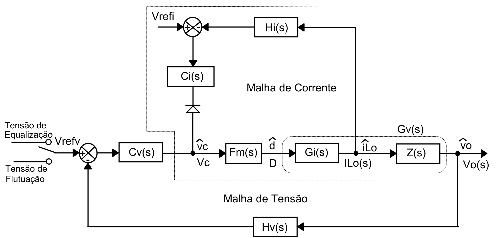
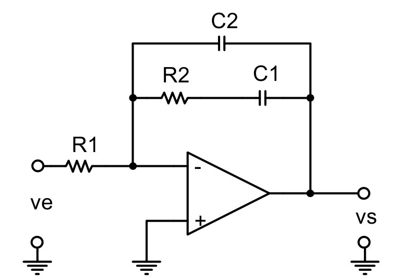
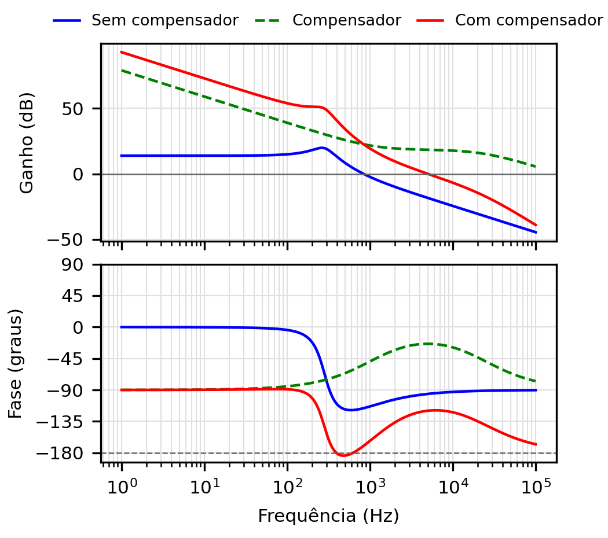
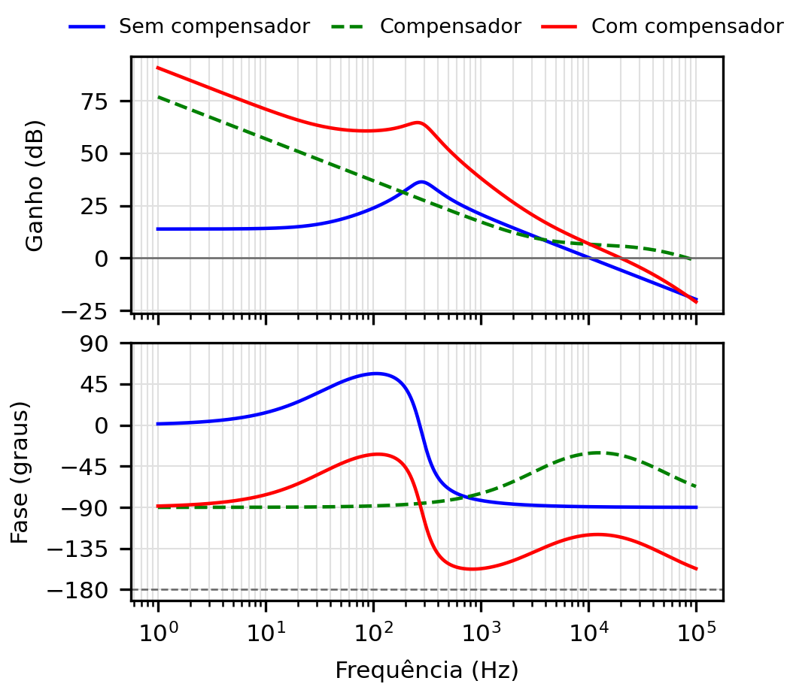
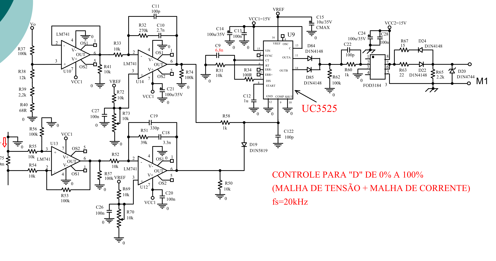

# Circuito de controle

> Gerado por `artigo/fonte/exportar_markdown.py` a partir de `conteudo.py`. Para alterar o texto, edite `conteudo.py` e gere de novo. A numeração de seções, figuras, tabelas e equações é a do artigo.

## VI. Projeto do Circuito de Controle

### Estrutura do controle

O diagrama de blocos do controle é o da Fig. 9. Há duas malhas, uma de corrente e uma de tensão, que não atuam ao mesmo tempo. Cada uma tem o seu compensador, e as duas saídas são combinadas de modo que prevaleça a menor: o compensador de tensão chega ao modulador por um resistor, e o de corrente, por um diodo que só conduz quando a sua saída está abaixo da tensão de controle. Enquanto a bateria está descarregada, a malha de tensão pede mais corrente do que o permitido, o seu compensador satura e a malha de corrente mantém a recarga no valor fixado por $V_{refi}$. Quando a tensão alcança 27 V, a malha de tensão reduz a tensão de controle, o diodo bloqueia, o compensador de corrente satura e o carregador passa a regular a tensão.

**Fig. 9.** Diagrama de blocos do controle do carregador: malha de corrente e malha de tensão [1].

O modulador compara a tensão de controle com a portadora do UC3525A, cuja amplitude a planilha toma como $V_{D}$ = 2,1 V, o que dá o ganho $F_{m}$ = 1/$V_{D}$ = 0,476. A tensão de saída é medida por um divisor resistivo, com ganho $H_{v}$ = $V_{refv}$/$V_{o}$ = 2,5/27 = 0,0926. A corrente do indutor é medida por um resistor de 10 mΩ no retorno do secundário, seguido de um amplificador diferencial de ganho 16,67, de modo que $H_{i}$ = 0,1667 V/A e 15 A correspondem a 2,5 V.

### Compensador tipo 2 e método do fator K

Os dois compensadores são do tipo 2, um integrador com um zero e um polo, montado com um amplificador operacional como na Fig. 10. A sua função de transferência é

$$C(s) = \frac{1 + s R_2 C_1}{s R_1\,(C_1 + C_2 + s R_2 C_1 C_2)} \tag{13}$$

**Fig. 10.** Compensador tipo 2 (PI com filtro) [1].

O projeto segue o método do fator K [8], [9]. Escolhida a frequência de cruzamento $f_{c}$, lê-se no diagrama de Bode do laço sem compensador o ganho e a fase P nessa frequência. O avanço de fase que o compensador deve fornecer para a margem de fase desejada e o fator K correspondente são

$$\alpha = \mathrm{MF} - P - 90^\circ, \qquad K = \tan\left(\frac{\alpha + 90^\circ}{2}\right) \tag{14}$$

O zero é posto em $f_{c}$/K e o polo em Kf_c, de modo que o avanço máximo ocorra exatamente no cruzamento. Sendo G o ganho que o compensador deve ter em $f_{c}$ e fixado $R_{1}$, os demais componentes são

$$C_2 = \frac{1}{2\pi f_c\,G K R_1}, \qquad C_1 = C_2\,(K^2 - 1) \tag{15}$$

$$R_2 = \frac{K}{2\pi f_c\,C_1} \tag{16}$$

### Malha de tensão

A planta da malha de tensão é a função de transferência entre a razão cíclica e a tensão de saída do Buck equivalente, com a resistência série do capacitor:

$$G_v(s) = \frac{n V_i\,(1 + s C_o R_{se})}{\Delta(s)} \tag{17}$$

$$\Delta(s) = s^2 L_o C_o\left(1 + \frac{R_{se}}{R_o}\right) + s\left(\frac{L_o}{R_o} + C_o R_{se}\right) + 1 \tag{18}$$

O projeto é feito na tensão máxima de entrada, em que o ganho é maior. Para o cruzamento em $f_{cv}$ = $f_{s}$/10 = 5 kHz, o laço sem compensador $G_{vF}$_mH_v tem ganho de −18,38 dB e fase de −95,67°. Com margem de fase de 60°, o avanço necessário é de 65,67° e (14) dá K = 4,64, que a planilha arredonda para 4,7. O zero fica em 1,06 kHz e o polo em 23,5 kHz. O compensador precisa de ganho G = 8,295 e, com $R_{1}$ = 10 kΩ, resultam $C_{2}$ = 81,65 pF, $C_{1}$ = 1,722 nF e $R_{2}$ = 86,88 kΩ. A Fig. 11 mostra o laço antes e depois da compensação. A margem de fase obtida é de 60,3° e a de ganho é infinita, como na planilha.

**Fig. 11.** Diagrama de Bode da malha de tensão com os valores da planilha: laço sem compensador, compensador e laço compensado. O cruzamento ocorre em 5 kHz, com margem de fase de 60,3°.

### Malha de corrente

A planta da malha de corrente relaciona a razão cíclica com a corrente do indutor e tem o mesmo denominador:

$$G_i(s) = \frac{n V_i}{R_o}\,\frac{1 + s C_o\,(R_o + R_{se})}{\Delta(s)} \tag{19}$$

A frequência de cruzamento escolhida é $f_{ci}$ = $f_{s}$/4 = 12,5 kHz, maior que a da malha de tensão. Nessa frequência a fase do laço sem compensador é de −89,45°, o avanço necessário é de 59,45° e K = 3,66, arredondado para 3,7, com zero em 3,38 kHz e polo em 46,25 kHz. A planilha obtém $C_{2}$ = 165,8 pF, $C_{1}$ = 2,104 nF e $R_{2}$ = 22,39 kΩ.

A conferência revelou uma divergência nesse ponto. O ganho usado na planilha, de 6,34 dB, é o do laço sem compensador em $f_{cv}$ = 5 kHz, e não em $f_{ci}$. Em 12,5 kHz o laço tem −1,64 dB, de modo que o compensador deveria ter ganho de 1,21, e não de 2,08. Com os valores da planilha, o laço da Fig. 12 cruza 0 dB em 20,0 kHz, e não em 12,5 kHz, com margem de fase de 57,4°. A margem continua boa, porque o avanço do compensador é largo, mas o cruzamento passa a 40 % da frequência de comutação, região em que o modelo médio já não é confiável. Lendo o ganho na frequência correta, o projeto daria $R_{2}$ = 13,05 kΩ, $C_{1}$ = 3,57 nF e $C_{2}$ = 288 pF.

**Fig. 12.** Diagrama de Bode da malha de corrente com os valores da planilha. O laço compensado cruza 0 dB em 20,0 kHz, com margem de fase de 57,4°.

### Componentes comerciais e laços resultantes

O circuito de simulação do professor usa valores comerciais próximos dos calculados, reunidos na Tabela IV. Ele difere da planilha em mais dois pontos: a portadora tem 2,4 V de pico a pico, de 0,8 V a 3,2 V, e não 2,1 V, e os sensores têm ganhos ligeiramente diferentes dos ideais, $H_{v}$ = 10,2/110,2 = 0,09256 e $H_{i}$ = 0,167 V/A. Com isso a tensão regulada é de 27,01 V e o limite de corrente, de 14,97 A. As frequências de cruzamento e as margens de fase resultantes, calculadas com esses valores para as duas tensões da rede, também estão na tabela. O ganho dos laços é proporcional à tensão do barramento, e por isso os cruzamentos são mais baixos em 176 V. Em todos os casos a margem de fase fica entre 48° e 60°.

**Tabela IV.** Compensadores: valores calculados, valores comerciais e laços resultantes

| Grandeza | Malha de tensão | Malha de corrente |
|---|---|---|
| Frequência de cruzamento de projeto | 5 kHz | 12,5 kHz |
| Fator K (exato / adotado) | 4,64 / 4,7 | 3,66 / 3,7 |
| $R_{1}$ | 10 kΩ | 10 kΩ |
| $R_{2}$ (calculado / comercial) | 86,88 kΩ / 82 kΩ | 22,39 kΩ / 18 kΩ |
| $C_{1}$ (calculado / comercial) | 1,722 nF / 1,5 nF | 2,104 nF / 2,7 nF |
| $C_{2}$ (calculado / comercial) | 81,65 pF / 100 pF | 165,8 pF / 220 pF |
| Cruzamento e margem de fase, 176 V | 2,9 kHz; 48° | 10,0 kHz; 60° |
| Cruzamento e margem de fase, 264 V | 4,2 kHz; 55° | 14,6 kHz; 59° |

### Circuito com o UC3525A e lista de componentes

O circuito de referência para a implementação é o da Fig. 13, do material da disciplina [2]: um UC3525A, quatro amplificadores operacionais e um acionador isolado. Ele foi projetado para 20 kHz e razão cíclica de até 100 %, e precisa de quatro adaptações para este carregador. A primeira é a frequência do oscilador, dada por [9]

$$f_s = \frac{1}{C_T\,(0{,}7 R_T + 3 R_D)} \tag{20}$$

que, mantidos $R_{T}$ = 10 kΩ e $R_{D}$ = 100 Ω, pede $C_{T}$ = 2,7 nF para 50,7 kHz. A segunda é o limite de razão cíclica. No circuito original as duas saídas do integrado são somadas por diodos para alcançar 100 %. Aqui deve-se usar uma única saída, o que limita a razão cíclica a menos de 50 % e garante a desmagnetização do transformador. A terceira é o acionamento: as duas chaves têm fontes em potenciais diferentes e cada uma precisa do seu acionador isolado, comandados pelo mesmo sinal. A quarta são os sensores e os compensadores, com os valores da Tabela IV. A Tabela V lista os componentes, com os designadores do circuito de simulação quando existem.

**Fig. 13.** Circuito de controle de referência com o UC3525A, malha de tensão e malha de corrente, projetado para 20 kHz [2]. As adaptações para este carregador estão no texto.

**Tabela V.** Lista de componentes do circuito de controle

| Referência | Componente ou valor | Função |
|---|---|---|
| U1 | UC3525A | Modulador PWM, oscilador e referência de 5,1 V |
| U2 a U5 | 4 amplificadores operacionais (LM741 em [2]) | Seguidor, amplificador diferencial e dois compensadores |
| U6, U7 | 2 × FOD3184 | Acionadores isolados, um por chave |
| $R_{T}$, $C_{T}$, $R_{D}$ | 10 kΩ; 2,7 nF; 100 Ω | Oscilador de 50,7 kHz |
| $C_{SS}$ | 1 µF | Partida suave (pino 8) |
| R11, R12 | 100 kΩ; 10,2 kΩ | Divisor da tensão de saída (27,01 V) |
| R13, R14, C5, C6 | 10 kΩ; 82 kΩ; 1,5 nF; 100 pF | Compensador de tensão |
| $R_{sh}$ | 10 mΩ; 5 W | Sensor de corrente |
| R2, R3, R4, R5 | 10 kΩ; 10 kΩ; 167 kΩ; 167 kΩ | Amplificador diferencial (ganho de 16,7) |
| R16, R18, C7, C8 | 10 kΩ; 18 kΩ; 2,7 nF; 220 pF | Compensador de corrente |
| R7, D6 | 1 kΩ; 1N5819 | Combinação das malhas (prevalece a menor) |
| 2 potenciômetros | 10 kΩ | Ajuste de $V_{refv}$ e de $V_{refi}$ (0 a 2,5 V) |
| Por chave | 22 Ω; 15 Ω; 2 × 1N4148; 2,2 kΩ; 1N4744 | Circuito de gatilho |
| Desacoplamento | 100 nF e 100 µF, 35 V | Alimentações de 15 V |
