# Resultados de simulação

> Gerado por `artigo/fonte/exportar_markdown.py` a partir de `conteudo.py`. Para alterar o texto, edite `conteudo.py` e gere de novo. A numeração de seções, figuras, tabelas e equações é a do artigo.

## VII. Resultados de Simulação

### Modelo de simulação

O circuito simulado pelo professor no PSIM é o da Fig. 14. Ele foi reproduzido no PLECS com os mesmos designadores e valores, e o resultado é o esquemático da Fig. 15. O modelo contém o retificador, o Forward de duas chaves e o controle analógico completo, com amplificadores operacionais de saída limitada entre 0 e 5 V. A carga é trocada conforme o ensaio: resistores para o degrau de carga, um resistor de 1 mΩ para o curto-circuito, ou o modelo da bateria, formado por uma fonte de 20 V em série com um capacitor e com a resistência interna de 10 mΩ.

Quatro ajustes foram necessários ou convenientes na passagem para o PLECS. O PLECS trabalha com chaves ideais e passo variável, e não aceita que um capacitor fique em paralelo com uma fonte por meio de chaves ideais: a indutância de dispersão do transformador do PSIM, de 0,1 µH por enrolamento, foi mantida, referida ao secundário, e os diodos da ponte receberam 5 mΩ de resistência de condução. O valor do diodo Zener que limita a tensão de controle não é legível no esquemático, e adotou-se 1,95 V, o que limita a razão cíclica a 0,48. O capacitor do barramento é o adotado na planilha, de 940 µF, embora o esquemático mostre 470 µF. O capacitor do modelo da bateria é de 0,8 F, valor que reproduz o tempo de recarga da figura do professor, embora o esquemático mostre 400 mF. Cada ensaio foi feito com a rede em 176 V e em 264 V.

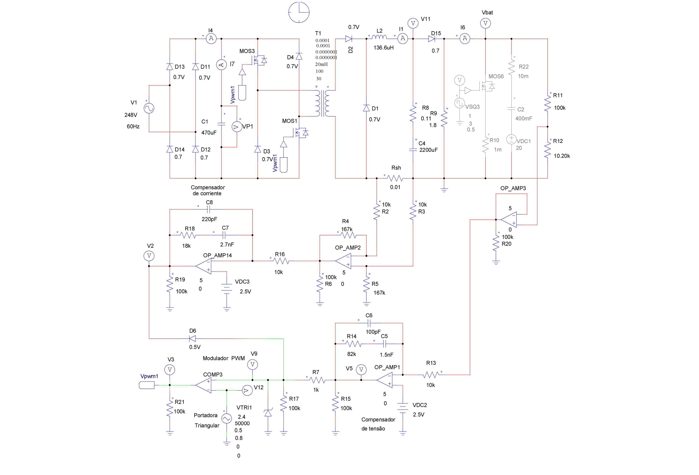

**Fig. 14.** Circuito de simulação do carregador usado pelo professor no PSIM, com o estágio de potência, o compensador de corrente, o compensador de tensão e o modulador PWM [1].

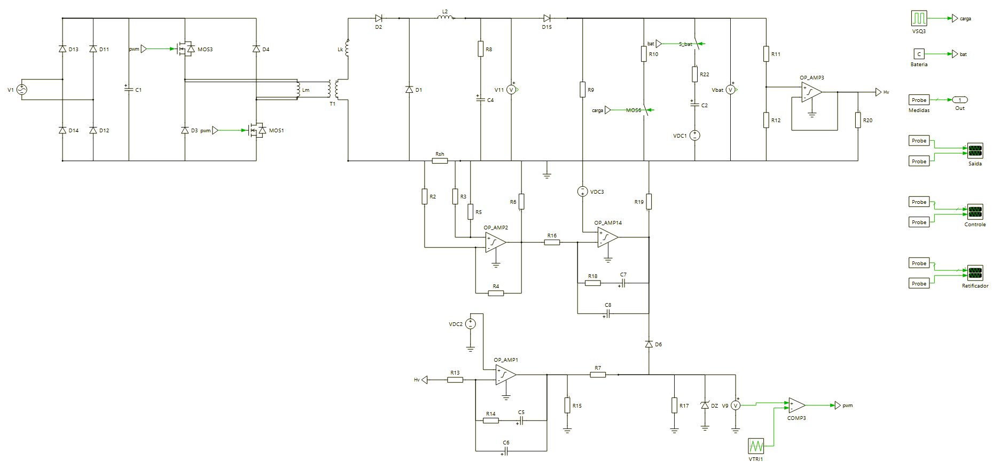

**Fig. 15.** Modelo do carregador no PLECS, com os mesmos designadores do circuito do professor.

### Regime permanente

A Fig. 16 mostra a tensão do barramento e as correntes da rede e de um diodo da ponte com carga nominal, e a Tabela VI compara os valores medidos com os calculados. A ondulação do barramento, de 14,0 V em 176 V e de 9,6 V em 264 V, concorda com a prevista pelo modelo para 940 µF, e a diferença se deve à potência de entrada, que na simulação é de 430 W e não de 450 W. O fator de potência medido é de 0,405 em 176 V e de 0,335 em 264 V, com distorção harmônica total da corrente de 220 % e de 278 %. O fator de deslocamento é praticamente unitário, e o baixo fator de potência se deve inteiramente à distorção.

Dois valores medidos se afastam do modelo, e os dois por causa da forma do pulso. A corrente de pico é de 30,8 A, contra 16,9 A do pulso retangular: o pulso real começa no valor máximo e decresce até zero, e a sua amplitude é quase o dobro da de um retângulo de mesma área. A corrente eficaz no capacitor é de 6,17 A, contra 5,30 A, porque ao pulso mais agudo se soma a corrente pulsada de 50 kHz drenada pelo Forward. O valor medido supera o que um único capacitor de 470 µF suporta, o que confirma a decisão de usar dois em paralelo.

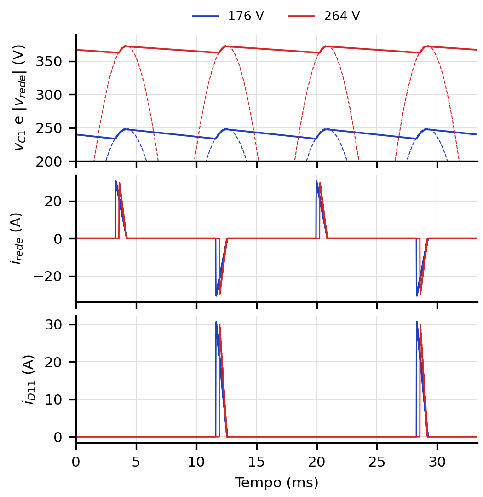

**Fig. 16.** Retificador em regime permanente com carga nominal, no PLECS: tensão no capacitor C1 (traço cheio) e módulo da tensão da rede (tracejado), corrente da rede e corrente em um diodo da ponte, com a rede em 176 V (azul) e em 264 V (vermelho).

As formas de onda do Forward, na Fig. 17, coincidem com as teóricas da Fig. 6. A tensão sobre a chave fica grampeada na do barramento durante a desmagnetização e cai à metade na terceira etapa, a desmagnetização dura o mesmo que a condução, e a corrente magnetizante chega a 95 mA nas duas tensões. A corrente nas chaves vai de 4,1 A a 5,0 A. A razão cíclica média é de 0,396 em 176 V e de 0,259 em 264 V, e (10) prevê 0,395 e 0,259 com as tensões médias de barramento medidas. O rendimento da simulação é de 94 %. Como as chaves são ideais, ele reflete apenas as quedas nos diodos e nos resistores, e o valor real será menor.

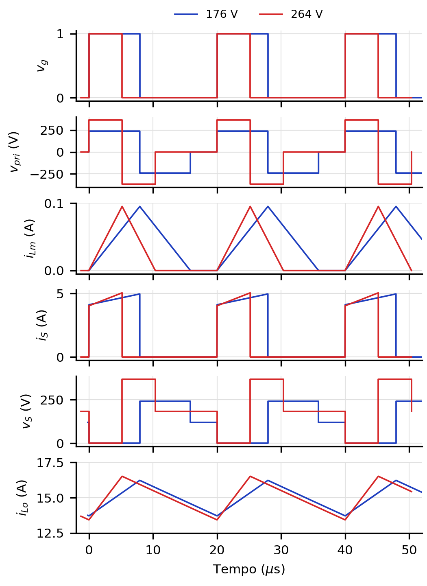

**Fig. 17.** Formas de onda do Forward de duas chaves em regime permanente, no PLECS: comando, tensão no primário, corrente magnetizante, corrente e tensão na chave inferior e corrente em $L_{o}$, com a rede em 176 V (azul) e em 264 V (vermelho).

**Tabela VI.** Regime permanente com carga nominal: valores calculados e simulados no PLECS

| Grandeza | Calculado, 176 V | PLECS, 176 V | Calculado, 264 V | PLECS, 264 V |
|---|---|---|---|---|
| Ondulação em C1 (V) | 14,70 | 13,99 | 10,03 | 9,55 |
| Tempo de condução dos diodos (ms) | 0,916 | 0,946 | 0,616 | 0,629 |
| Corrente eficaz da rede (A) | 5,62 | 6,03 | 4,49 | 4,85 |
| Corrente de pico da rede (A) | 16,9 | 30,8 | 16,5 | 30,0 |
| Fator de potência | 0,455 | 0,405 | 0,379 | 0,335 |
| Corrente eficaz em C1 (A) | 5,30 | 6,17 | 4,32 | 5,11 |
| Corrente média em um diodo da ponte (A) | 0,93 | 0,89 | 0,61 | 0,58 |
| Razão cíclica | 0,395 | 0,396 | 0,259 | 0,259 |
| Ondulação de corrente em $L_{o}$ (A) | 2,53 | 2,57 | 3,10 | 3,11 |
| Tensão máxima nas chaves (V) | 248,9 | 248,2 | 373,4 | 372,6 |
| Corrente de pico nas chaves (A) | 4,97 | 4,97 | 5,06 | 5,05 |
| Corrente eficaz nas chaves (A) | 2,83 | 2,86 | 2,29 | 2,32 |
| Corrente média em D3 / D4 (A) | 5,93 / 9,07 | 5,93 / 9,04 | 3,89 / 11,11 | 3,89 / 11,09 |
| Tensão reversa em D3 e D4 (V) | 74,7 | 74,0 | 112,0 | 111,3 |
| Ondulação da tensão de saída (V) | 0,28 | 0,27 | 0,34 | 0,32 |

*Calculado com $C_{1}$ = 940 µF, $P_{ret}$ = 450 W e, no Forward, com a tensão média de barramento medida (240,8 V e 367,3 V). D3 e D4 são os diodos retificador e de roda livre da Fig. 4, que no circuito de simulação se chamam D2 e D1.*

A Fig. 18 atende à sugestão de observar cinco períodos da portadora e da moduladora. A tensão de controle não é constante: carrega uma ondulação de 0,44 V em 176 V e de 0,48 V em 264 V, que é a ondulação da corrente do indutor amplificada pelo compensador de corrente. Mesmo assim há um único cruzamento por rampa da portadora, os pulsos são todos iguais e a forma de onda se repete a cada período, sem sinal de oscilação sub-harmônica. A inclinação máxima da ondulação, de 0,07 V/µs em 176 V e de 0,11 V/µs em 264 V, é menor que a da portadora, de 0,24 V/µs.

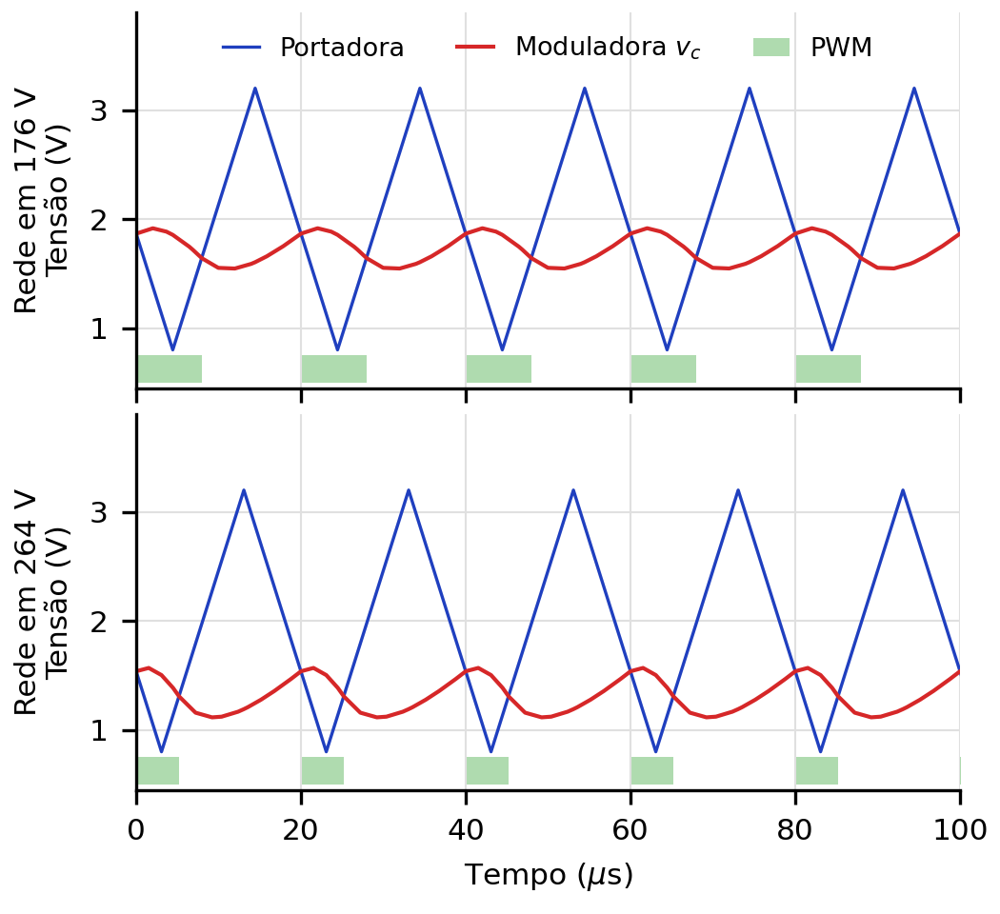

**Fig. 18.** Cinco períodos da portadora triangular e da moduladora, com o sinal PWM resultante (faixa verde), em regime permanente com carga nominal.

### Degrau de carga

No primeiro ensaio a carga alterna entre 100 % e 20 % a cada 167 ms: um resistor de 9 Ω fica sempre ligado e outro, de 2,25 Ω, é comutado a 3 Hz. A Fig. 19 compara o resultado do PLECS, nas duas tensões da rede, com o do professor. A tensão permanece em 27 V, com um afundamento breve a cada aplicação de carga e uma elevação a cada retirada, e a corrente do indutor alterna entre 15 A e 3 A. O vale de tensão é de 25,62 V nas duas tensões da rede, contra cerca de 25,7 V na figura do professor. Ele corresponde ao degrau de corrente no capacitor multiplicado pela resistência série, 12·0,11 = 1,32 V, o que mostra que nos primeiros instantes quem sustenta a saída é o capacitor. A corrente do indutor ultrapassa o valor final e chega a 22,6 A em 176 V e a 20,8 A em 264 V, contra cerca de 23 A do professor.

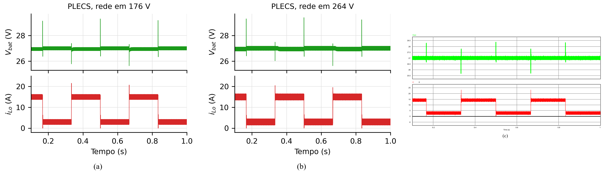

**Fig. 19.** Degrau de carga de 100 % para 20 % e vice-versa, tensão de saída e corrente no indutor de filtro: (a) PLECS, rede em 176 V; (b) PLECS, rede em 264 V; (c) resultado do professor no PSIM, rede em 176 V [1].

O detalhe dos transitórios está nas Figs. 20 e 21. Na aplicação de carga a tensão se recupera em menos de 0,4 ms. Na retirada, porém, o pico chega a 29,3 V em 176 V e a 29,5 V em 264 V, um volt acima dos cerca de 28,3 V da figura do professor, e a tensão demora 1,6 ms para voltar à faixa de 1 %.

A causa é uma coincidência do projeto. Com a carga de 1,8 Ω, a malha de tensão regula 27,01 V e pede 15,006 A, mas o limite da malha de corrente é de 14,97 A. As duas malhas disputam o comando, e a de corrente acaba assumindo: o compensador de tensão satura em 5 V cerca de 3 ms depois de cada aplicação de carga em 176 V, e cerca de 30 ms depois em 264 V, e a tensão cai para 26,95 V. Quando a carga é retirada, a malha de corrente continua impondo 15 A a uma carga que só consome 3 A, e os 12 A excedentes carregam o capacitor de saída até que o compensador de tensão saia da saturação e retome o comando.

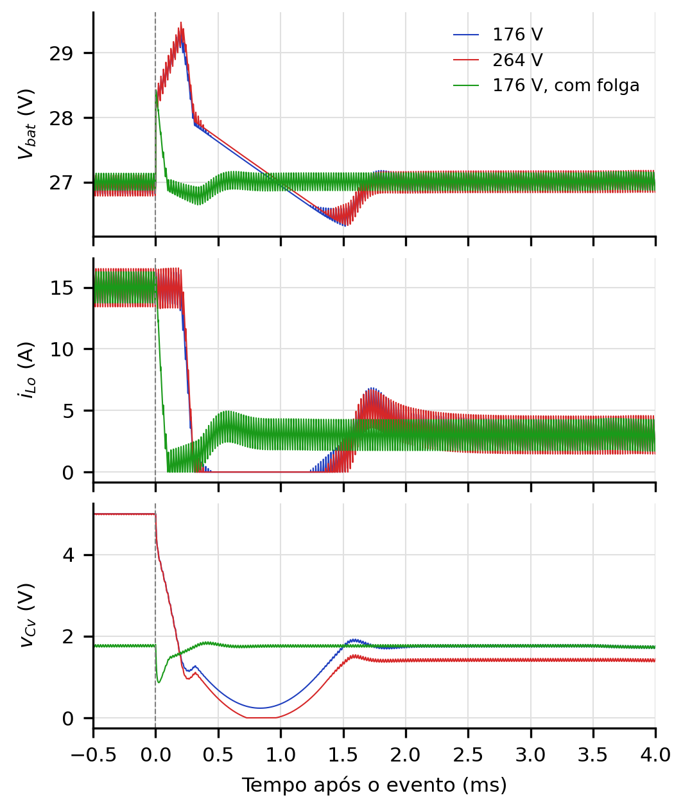

**Fig. 20.** Retirada de carga, de 100 % para 20 %, no PLECS: tensão de saída, corrente no indutor e saída do compensador de tensão. Em azul e em vermelho, o projeto nominal com a rede em 176 V e em 264 V; em verde, 176 V com folga de 4 % no limite de corrente.

Para confirmar a explicação, o ensaio foi repetido com $V_{refi}$ = 2,6 V, o que eleva o limite de corrente para 15,6 A, uma folga de 4 %. O resultado é a curva verde das Figs. 20 e 21. Com a folga, o compensador de tensão permanece ativo com a carga nominal, em 1,76 V, o pico na retirada de carga cai para 28,4 V, valor que é só o degrau na resistência série do capacitor, e a tensão volta à faixa de 1 % em menos de 0,1 ms. O resultado passa a coincidir com o do professor, o que indica que na simulação dele a malha de tensão estava no comando com a carga nominal.

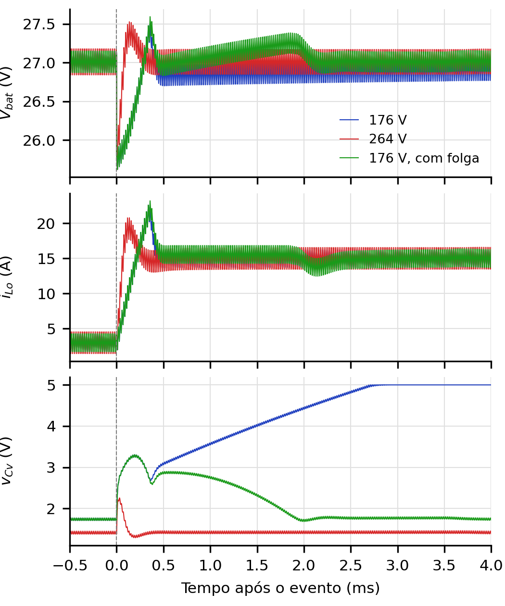

**Fig. 21.** Aplicação de carga, de 20 % para 100 %, no PLECS, com as mesmas grandezas e cores da figura anterior. No projeto nominal em 176 V, o compensador de tensão satura em 5 V cerca de 3 ms depois do degrau.

### Curto-circuito na saída

No segundo ensaio a carga nominal fica ligada e a saída é curto-circuitada por 1 mΩ durante metade de cada período de 333 ms. A Fig. 22 mostra que, em curto, a tensão cai a zero e a corrente do indutor é mantida em 14,97 A pela malha de corrente, com ondulação muito menor porque a razão cíclica fica pequena. O resultado é igual nas duas tensões da rede e coincide com o do professor.

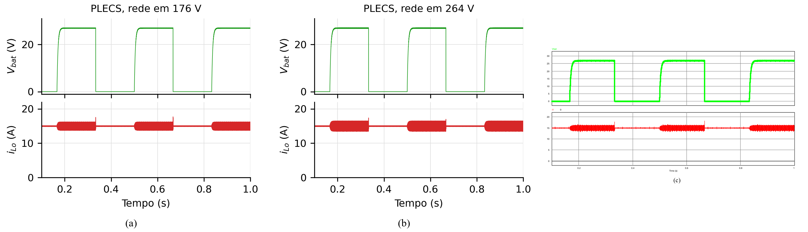

**Fig. 22.** Curto-circuito na saída, tensão de saída e corrente no indutor de filtro: (a) PLECS, rede em 176 V; (b) PLECS, rede em 264 V; (c) resultado do professor no PSIM, rede em 176 V [1].

O detalhe da Fig. 23 mostra os dois transitórios. Na aplicação do curto, a corrente do indutor sobe a 17,6 A e volta a 15 A em 0,4 ms, tempo que a malha de corrente leva para reduzir a razão cíclica. Na retirada, a tensão se restabelece com a corrente limitada em 15 A e alcança 90 % do valor final em 9,4 ms, crescimento exponencial com a constante de tempo $R_{oC}$_o = 4 ms. Um efeito não aparece na corrente do indutor: no instante do curto, o capacitor de saída se descarrega pelo diodo de bloqueio D15, com pico de 256 A, limitado apenas pela resistência série do capacitor. Esse diodo precisa ser escolhido pela corrente de surto, e não só pelos 15 A de regime.

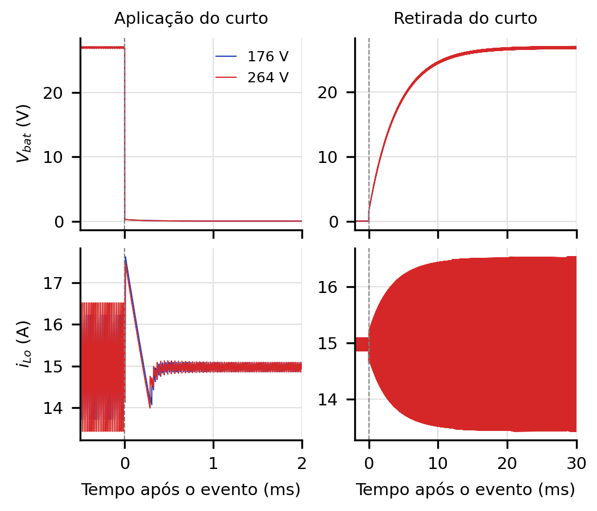

**Fig. 23.** Detalhe da aplicação e da retirada do curto-circuito no PLECS, nas duas tensões da rede.

### Recarga da bateria

No terceiro ensaio os resistores são retirados e a carga é o modelo da bateria, inicialmente com 20 V. A Fig. 24 mostra as duas fases da recarga. Na primeira, a malha de corrente mantém 14,97 A e a tensão cresce linearmente, a 18,7 V/s, que é a corrente dividida pela capacitância do modelo. Em 0,378 s a tensão nos terminais alcança o valor regulado, a malha de tensão assume e a corrente cai a zero em cerca de 20 ms, com a tensão mantida em 27,02 V. A transição ocorre no mesmo instante que na figura do professor, cerca de 0,375 s, e não depende da tensão da rede.

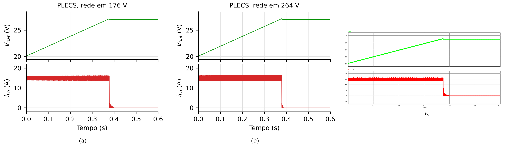

**Fig. 24.** Recarga da bateria, tensão nos terminais e corrente de recarga: (a) PLECS, rede em 176 V; (b) PLECS, rede em 264 V; (c) resultado do professor no PSIM, rede em 176 V [1].

### Comparação com os resultados do professor

**Tabela VII.** Resultados dos ensaios: PLECS e professor (PSIM)

| Grandeza | PLECS, 176 V | PLECS, 264 V | Professor, 176 V |
|---|---|---|---|
| Tensão de saída com 20 % de carga (V) | 27,01 | 27,01 | ≈ 27 |
| Tensão de saída com 100 % de carga (V) | 26,95 | 26,95 | ≈ 27 |
| Vale de tensão, 20 % → 100 % (V) | 25,62 | 25,62 | ≈ 25,7 |
| Pico de tensão, 100 % → 20 % (V) | 29,33 | 29,47 | ≈ 28,3 |
| Idem, com folga de 4 % no limite de corrente (V) | 28,42 | 28,44 | — |
| Pico de corrente em $L_{o}$, 20 % → 100 % (A) | 22,6 | 20,8 | ≈ 23 |
| Corrente em $L_{o}$ durante o curto-circuito (A) | 14,97 | 14,97 | ≈ 15 |
| Pico de corrente em $L_{o}$ ao aplicar o curto (A) | 17,6 | 17,5 | ≈ 18 |
| Retorno da tensão após o curto, 90 % (ms) | 9,4 | 9,4 | ≈ 10 |
| Corrente de recarga (A) | 14,97 | 14,97 | ≈ 15 |
| Fim da recarga em corrente constante (s) | 0,378 | 0,379 | ≈ 0,375 |
| Tensão final da bateria (V) | 27,02 | 27,02 | ≈ 27 |

A Tabela VII reúne os valores característicos dos três ensaios. Os do professor foram lidos nas figuras da planilha e são aproximados. A concordância é boa em todos os pontos, com a única diferença já discutida, do pico na retirada de carga. Os resultados em 264 V, que a planilha não traz, praticamente repetem os de 176 V: o controle compensa a variação da tensão de entrada, e o que muda é a razão cíclica, a ondulação de corrente e o ganho dos laços. Na partida, que as figuras do professor não mostram, a corrente do indutor chega a 25 A antes de a malha de corrente atuar, porque o circuito simulado não tem partida suave. O UC3525A tem esse recurso, e ele está previsto na Tabela V.
