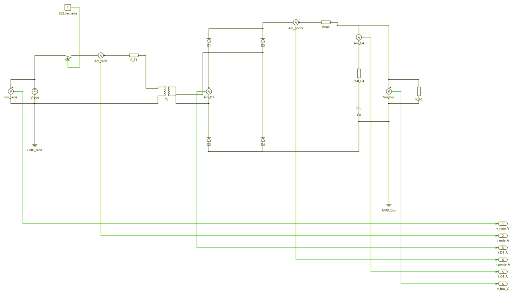
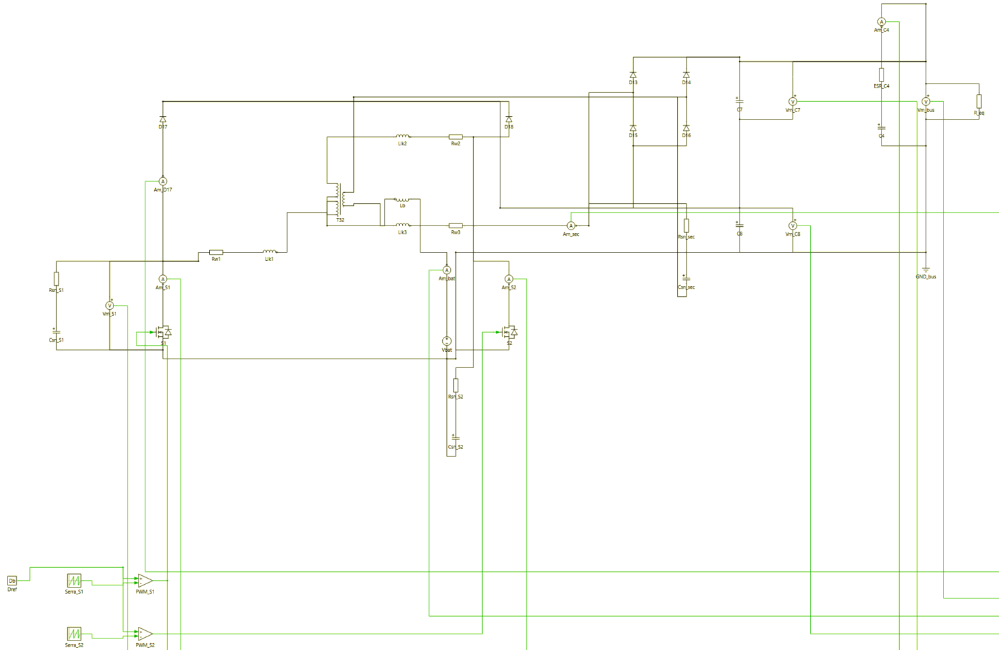
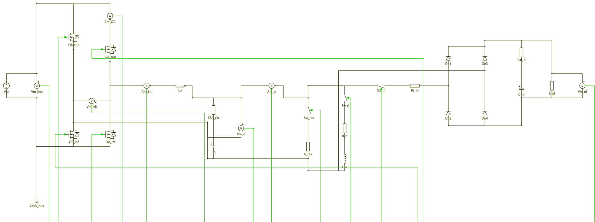
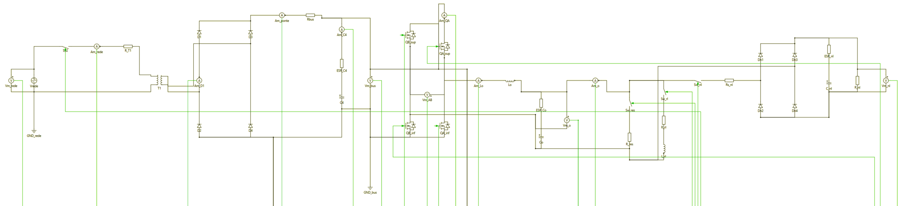
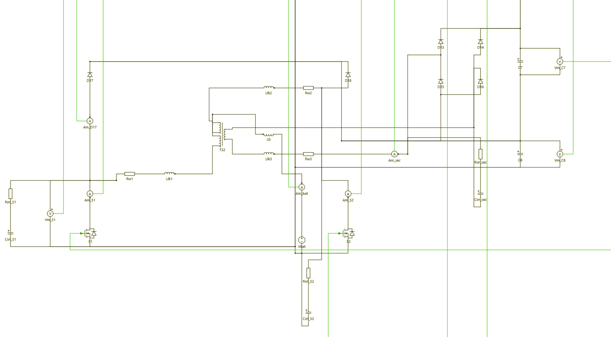

# 07. Guia reproduzível de simulação no PLECS

Este guia permite refazer do zero todos os modelos e ensaios. Ele descreve o ambiente, a ordem de execução, os modelos, as condições de cada ensaio, as ligações, o solver, as grandezas exportadas, os critérios de aceitação e a interpretação adotada para os ensaios que a planilha define apenas por título.

## 1. Ambiente e versão

O arquivo-base `simulação PLECS/arquivo_exemplo.plecs` declara o formato `Version "5.0"` e permanece intacto (SHA-256 13c61562adcebe923f7799adee904e8f76fc7c3670352634d84cefb713cb2f9a). Os modelos foram gerados e executados no PLECS Standalone 5.0.3 de 64 bits instalado em `C:\Users\josem\OneDrive - L2M Power Electronics\Documentos\Plexim\PLECS 5.0 (64 bit)`; a primeira rodada de 9 de novembro usou a mesma versão 5.0 numa segunda máquina, em `C:\Users\Carlos Neto\Documents\Plexim\PLECS 5.0 (64 bit)`. O caminho da instalação entra em `desenvolvimento/inspecionar_biblioteca.py` e em nenhum outro lugar. Não é preciso MATLAB nem PSIM.

O Python tem três papéis, nenhum deles de simulador. Ele gera os arquivos `.plecs` como texto, chama o solver do PLECS pela interface XML-RPC e pós-processa os CSVs retornados. O executor usa só a biblioteca padrão; o gerador e o analisador precisam de numpy e matplotlib.

## 2. Ordem de execução

Todos os comandos são executados na pasta Trabalho 6. No PowerShell, `$taskPython` pode ser o Python usado no Trabalho 4 ou qualquer Python 3.

```powershell
$taskPython = 'python'
& $taskPython 'desenvolvimento\inspecionar_biblioteca.py'        # sintaxe e geometria dos blocos do PLECS
& $taskPython 'desenvolvimento\calculos.py'                      # parametros.json, auditoria e Bodes
& $taskPython 'simulação PLECS\gerar_modelos.py'                 # cinco modelos, modelos.json e ensaios.json
& $taskPython 'simulação PLECS\conferir_modelos.py'              # conferência estrutural, sem PLECS
& $taskPython 'simulação PLECS\conferir_conexoes.py'             # layout novo contra layout_anterior
& $taskPython 'resultados PLECS\executar_ensaios.py' --teste     # carrega cada modelo e simula 2 ms
& $taskPython 'resultados PLECS\executar_ensaios.py' --grupo diagnostico --grupo submodelo
& $taskPython 'resultados PLECS\executar_ensaios.py' --todos     # matriz completa
& $taskPython 'resultados PLECS\analisar_resultados.py'          # métricas e gráficos
```

Antes do executor é preciso abrir o PLECS e habilitar a interface RPC em File, PLECS Preferences, General, porta 1080. Se a opção for alterada com o programa aberto, convém confirmar a ativação ou reiniciar o PLECS. O executor fecha e recarrega apenas o modelo que vai simular; modificações manuais em um modelo devem ser salvas antes, mas lembrando que a gravação pelo PLECS normaliza a formatação e muda o hash. Por isso os modelos usados nos ensaios não devem ser salvos pela interface.

Opções do executor: `--ensaio nome` (repetível) roda ensaios específicos, `--grupo nome` roda um grupo (`diagnostico`, `submodelo`, `secao_6`, `regulacao`, `regulacao_bateria`, `verificacao`), `--forcar` repete ensaios já executados e `--paralelo N` define o tamanho dos lotes de regulação enviados ao PLECS como simulações paralelas (padrão 11; 1 para sequencial). Um ensaio só é considerado já executado se o registro diz `executado`, se o hash do modelo e o das opções coincidem com os atuais e se o CSV ainda tem o hash registrado.

Cada simulação leva também `SolverOpts.Timeout`, o limite de tempo de relógio do PLECS, definido por ensaio em `ensaios.json`: 90 s nos diagnósticos, 300 s no retificador, 600 s nos demais submodelos e 1200 s no modelo completo. Se o PLECS não termina nesse prazo, o ensaio fica registrado como falha, com a mensagem do PLECS, e a execução passa ao seguinte. O limite não altera o resultado de um ensaio que termina, por isso fica fora do hash das opções. Ctrl+C no PowerShell marca o ensaio em curso como `interrompido`; se o PLECS continuar simulando, a simulação deve ser parada na própria janela do PLECS.

## 3. Modelos

| Modelo | Finalidade | Componentes principais |
|---|---|---|
| `retificador_barramento.plecs` | Verificar a seção 3 da planilha | Rede, SS2 fechada, T1 ideal 1:1, ponte D1 a D4, Rbus, C4 com ESR, resistência equivalente |
| `elevador_bateria.plecs` | Verificar o CC-CC da seção 5 | Bateria, Lb, célula de três estados com T_32 [2 1], D17, D18, ponte D13 a D16, C7, C8, C4, carga de 19,6 Ω e ramos RC em S1, S2 e no secundário |
| `elevador_sem_amortecedor.plecs` | Diagnóstico numérico | O mesmo CC-CC sem os ramos RC, usado só no grupo `diagnostico` |
| `inversor_malha_fechada.plecs` | Verificar o inversor e a malha com barramento ideal | Fonte CC, ponte de quatro MOSFETs, Lo, Co com ESR, três cargas comutáveis, C-Script do compensador, modulador unipolar |
| `nobreak_completo.plecs` | Ensaios da seção 6 e curvas de regulação | Todos os blocos acima ligados ao mesmo barramento, com SS2 comandada e lógica de transferência |

Os cinco arquivos são escritos por `gerar_modelos.py` a partir de `parametros.json`. Antes de gravar, o gerador confere que todo terminal de todo bloco está ligado e que nenhum bloco ocupa a posição de outro, porque o PLECS recusa carregar um modelo com terminal solto coberto por fio ou bloco. Eles ficam somente em ASCII, com quebras CRLF e com o cabeçalho copiado do arquivo-base, alterando apenas `Name`, `TimeSpan`, `Solver`, `MaxStep`, `RelTol`, `AbsTol` e `InitializationCommands`. Os sinais de interesse são levados a blocos Output e declarados como terminais de saída de nível superior; não há Scopes, porque a exportação por RPC só enxerga terminais de saída. `modelos.json` lista as colunas de cada modelo na ordem dos terminais.

`conferir_modelos.py` faz uma conferência estrutural antes da execução. Ele verifica chaves balanceadas, nomes únicos, parâmetros existentes nos blocos da biblioteca (`desenvolvimento/blocos_biblioteca.json`), terminais válidos por tipo, terminais elétricos ligados uma única vez, entradas de sinal com uma única origem, variáveis definidas nos comandos de inicialização e variáveis de `ModelVars` existentes. Ele também compila o código do C-Script com gcc sobre macros simuladas e confere a realização do compensador contra Cv(s). Nada disso substitui carregar o modelo no PLECS, que é o papel do `--teste`.

## 4. Bibliotecas e ligações

Tipos nativos usados (biblioteca do PLECS 5.0): ACVoltageSource, DCVoltageSource, Switch, Ammeter, Voltmeter, Resistor, Inductor, Capacitor, Diode, MosfetWithDiode, Transformer, Ground, TriangleGenerator, Comparator, Constant, CScript e Output. A numeração de terminais seguida é a das demos da instalação: diodo 1 anodo e 2 catodo; MOSFET 1 dreno, 2 fonte e 3 gate; fontes 1 positivo; medidores 1 e 2 elétricos e 3 saída; comparador 1 entrada não inversora, 2 inversora e 3 saída; transformador com o enrolamento k nos terminais 2k − 1 (ponto) e 2k.

- **Rede e retificador.** Fonte √2·Vrms·sen(2π60t + φ) com φ = 0, voltímetro da rede, chave SS2, amperímetro de entrada, 2 mΩ e primário de T1 (Transformer [1 1], relação 1:1, magnetização infinita). O secundário alimenta a ponte. D1 tem um amperímetro em série para medir a corrente de um diodo. O catodo comum passa por um amperímetro e por Rbus = 0,1 Ω até o barramento, onde ficam C4 = 1880 µF em série com 0,05 Ω (com amperímetro) e o voltímetro do barramento. Há uma referência de terra no neutro da rede e outra no negativo do barramento, separadas por T1.
- **CC-CC.** Bateria ideal Vbat, amperímetro, Lb e derivação central de T_32 (Transformer [2 1], relação [1 1 1], magnetização de 10 mH). O primeiro enrolamento tem o ponto do lado de S1 e o segundo tem o ponto na derivação, em série aditiva; cada enrolamento tem 1 µH e 1 mΩ em série. S1 e S2 (MosfetWithDiode, 10 mΩ) vão ao negativo comum; D17 e D18 levam as extremidades ao ponto médio entre C8 (embaixo) e C7 (em cima). O terceiro enrolamento alimenta a ponte D13 a D16, com anodos de D15 e D16 no ponto médio e catodos de D13 e D14 no barramento positivo. Os comandos vêm de duas dentes de serra de 0 a 1 em fsb, a segunda atrasada de meio período, comparadas com a razão cíclica (ou com −1 quando o conversor está desabilitado). Em paralelo com S1, com S2 e com o secundário de T_32 há um ramo RC de 33 Ω e 1 nF (seção 5).
- **Inversor.** Quatro MosfetWithDiode de 50 mΩ. O braço A alimenta Lo por um amperímetro; Co com 5 mΩ, o voltímetro de saída e as cargas voltam ao braço B. Um amperímetro de saída antecede três ramos com chaves: resistivo (Rres), RL de 3 kVA (3,086 Ω e 8,351 mH) e não linear (0,2 Ω, ponte de diodos, 1880 µF com 0,05 Ω e 9,5 Ω).
- **Controle.** O C-Script `Controle` recebe vo e produz, nesta ordem, vc limitado a ±5 V, vref, o comando de SS2, a razão cíclica do CC-CC (Db ou −1), os comandos das três cargas e vc sem limite. O modulador compara vc com as portadoras A e B (−5 V a +5 V, 20 kHz, a segunda atrasada de 25 µs). QA_sup liga quando vc > portadora A, QA_inf no complemento, QB_inf liga quando vc > portadora B e QB_sup no complemento.

### Layout dos esquemas

Até a primeira rodada o gerador escrevia cada `Connection` apenas com origem, destino e `Branch`, sem pontos de passagem, e posicionava os blocos com coordenadas soltas. Sem pontos de passagem o PLECS liga os dois terminais por uma reta, o que produzia fios diagonais cruzando o desenho e passando sobre blocos. O layout foi refeito, sem mexer em nenhuma ligação.

A geometria de cada tipo de bloco foi medida na própria instalação do PLECS por `desenvolvimento/inspecionar_biblioteca.py`, que lê os 238 arquivos `.plecs` de `demos`, `examples`, `components.plecs` e afins. Num arquivo gravado pelo PLECS, cada conexão é uma polilinha formada pelo terminal de origem, pelos `Points` e pelo terminal de destino, com todos os segmentos ortogonais; os `Points` estão no arquivo e os dois extremos não. Cada extremo impõe então, contra o ponto vizinho p, que `posição.x + deslocamento.x = p.x` ou que `posição.y + deslocamento.y = p.y`. Levando cada medida ao referencial do bloco (`Direction` gira, `Flipped` espelha ao longo do eixo do bloco e troca as duas pontas), as quatro direções somam evidência sobre o mesmo deslocamento e sobra um único candidato. O lado de cada terminal sai de uma votação à parte: num esquema limpo o fio não atravessa o corpo do bloco, de modo que o ponto vizinho está do mesmo lado que o terminal. O resultado, com o número de restrições e de votos de cada terminal, fica em `desenvolvimento/blocos_biblioteca.json`.

A medida mostra que, no referencial do bloco, todo bipolo tem o terminal 1 em +20 e o terminal 2 em −20 ao longo do eixo; a saída de sinal de amperímetro e voltímetro fica em (0, 15); o gate do MOSFET em (0, −35) e o da chave em (0, 20); o terminal do Ground em (20, 0); a saída do Constant em (15, 0) e a entrada do Output em (−10, 0); o comparador tem as entradas em y = −5 e y = +5 e a saída em y = 0. O transformador e o C-Script mudam de tamanho com os parâmetros: num lado com n enrolamentos, o enrolamento k tem centro em y = (k − (n+1)/2)·40 e terminais em centro ∓15, com o lado 1 em x = +10 e o lado 2 em x = −10; as portas do C-Script ficam com passo de 20, centradas, entradas à esquerda e saídas à direita.

Com essa geometria, `gerar_modelos.py` posiciona os blocos em grade de 10, por grupos funcionais e com o fluxo de potência da esquerda para a direita: rede, SS2, T1 e ponte à esquerda; barramento C4 no centro; inversor, filtro LC e cargas à direita; CC-CC da bateria numa faixa abaixo; modulação, PWM e C-Script numa faixa inferior separada; terminais Output numa coluna à direita, com as ordenadas numa faixa livre entre o circuito de potência e o CC-CC, de modo que os sinais não atravessem o circuito. O barramento positivo ocupa uma linha horizontal no alto e o negativo uma linha embaixo; os medidores ficam ao lado do elemento medido e os ramos em derivação são verticais. A escolha de `Direction` e de `Flipped` de cada bloco segue o papel dos seus terminais no circuito, para que o terminal a montante seja desenhado do lado de onde vem o fio.

Os `Points` são calculados por `simulação PLECS/roteador.py`. Cada terminal ganha um trecho inicial no sentido em que aponta, com comprimento tal que o fim do trecho caia na grade de roteamento; o miolo do caminho é procurado por A\* com custo 1 por passo, 4 por mudança de direção e 8 por andar junto de um fio de outra rede, tendo as caixas dos blocos como obstáculos. Num nó com mais de dois terminais os terminais entram um a um, partindo de todos os pontos já ligados ao nó com custo zero, o que produz uma árvore com tronco comum em vez de uma estrela; os caminhos são depois fundidos por prefixo comum e viram a árvore `Connection`/`Branch` do arquivo. Nenhum bloco Goto, From ou novo foi acrescentado, porque isso mudaria a lista de componentes.

### Os esquemas como o PLECS os desenha

As capturas abaixo são dos cinco modelos abertos no PLECS 5.0.3, depois da reorganização. Os arquivos originais estão em `resultados PLECS/circuitos-foto/` e as versões recortadas, usadas no artigo, em `artigo/figuras/plecs_*.png`.

| Modelo | Captura |
|---|---|
| `retificador_barramento` | [plecs_retificador.png](../artigo/figuras/plecs_retificador.png) |
| `elevador_bateria` | [plecs_elevador.png](../artigo/figuras/plecs_elevador.png) |
| `elevador_sem_amortecedor` | [plecs_elevador_sem_amort.png](../artigo/figuras/plecs_elevador_sem_amort.png) |
| `inversor_malha_fechada` | [plecs_inversor.png](../artigo/figuras/plecs_inversor.png) |
| `nobreak_completo`, faixa de potência | [plecs_nobreak_top.png](../artigo/figuras/plecs_nobreak_top.png) |
| `nobreak_completo`, faixa do CC-CC | [plecs_nobreak_bot.png](../artigo/figuras/plecs_nobreak_bot.png) |











O que se vê nelas é o resultado do roteamento: fios ortogonais, medidores ao lado do elemento medido, barramento positivo numa linha no alto, negativo embaixo e os sinais verdes correndo por uma faixa própria até a coluna de terminais de saída, sem atravessar o circuito de potência. Quatro delas entram no artigo como as Figuras 4 a 7, ocupando a largura das duas colunas, como o modelo IEEE faz com esquemas de circuito; a do retificador isolado ficou só aqui, para o artigo não passar de oito páginas, já que o mesmo estágio de entrada aparece na figura do modelo completo.

### Conferência das ligações

Os cinco arquivos anteriores à reorganização estão em `simulação PLECS/layout_anterior/`, fora do manifesto, só como referência. `simulação PLECS/conferir_conexoes.py` compara cada modelo novo com o antigo e falha se houver qualquer diferença em:

- o conjunto de componentes, cada um como tipo, nome e parâmetros ordenados (`Position`, `Direction`, `Flipped` e `LabelPosition` ficam de fora de propósito, porque são desenho);
- o conjunto de nós elétricos e o de nós de sinal, cada nó como o conjunto de pares (componente, terminal) que ele liga, unidos pelas componentes conexas do grafo de pinos, de modo que a comparação não dependa de como as conexões foram quebradas em `Branch`;
- os terminais Output de nível superior e o índice de cada bloco Output.

O mesmo programa refaz a posição de cada terminal com a tabela usada na geração e confere, em todos os segmentos de todas as polilinhas, inclusive o trecho entre o último `Points` e o terminal, que o segmento é horizontal ou vertical e que não entra na caixa de nenhum bloco alheio à conexão. O resultado fica em `simulação PLECS/conferencia_conexoes.json`.

## 5. Parâmetros e hipóteses de simulação

Os valores do Anexo 01 foram mantidos sempre que existem. Os demais são hipóteses (H), escolhidas para representar componentes comuns sem pretender modelar perdas com precisão.

| Grandeza | Valor | Origem |
|---|---|---|
| Lo, Co, ESR de Co | 365,6 µH; 60 µF; 5 mΩ | Planilha e Anexo 01 |
| C4, ESR | 1880 µF; 0,05 Ω | Planilha |
| Rbus | 0,1 Ω | Anexo 01 |
| T1 | 1:1 ideal com 2 mΩ | Anexo 01 simplificado (seção 8 de [03](03-retificador-e-barramento.md)) |
| Lb, C7, C8 | 39,2 µH; 10 µF; 10 µF | Planilha e Anexo 01 |
| T_32 | [1 1 1], Lm = 10 mH, 1 µH e 1 mΩ por enrolamento | Anexo 01 |
| Diodos da ponte de entrada | 0,8 V; 10 mΩ | H |
| Diodos rápidos (D13 a D18 e carga não linear) | 0,8 V; 5 mΩ | H |
| MOSFETs do inversor | 50 mΩ, diodo ideal | H |
| MOSFETs do CC-CC | 10 mΩ, diodo ideal | H |
| Ramos RC em S1, S2 e no secundário de T_32 | 33 Ω em série com 1 nF | H |
| Bateria | fonte ideal de 42 V (56 V em `elev_56`) | Anexo 01 e H |
| Compensador | Cv(s) da planilha, saída ±5 V, anti-windup | Planilha, Anexo 01 e H |

Os ramos RC representam a capacitância de saída das chaves, da ordem de 1 nF para MOSFETs de 150 V e 50 A. Com a dispersão de 1 µH, o resistor de 33 Ω dá amortecimento ζ = (Rsn/2)·√(Csn/Llk) = 16,5·√(10⁻⁹/10⁻⁶) ≈ 0,52, de modo que a oscilação de cada comutação some em cerca de 1 µs. A função numérica deles é dar uma capacitância a cada nó de comutação, que sem eles fica flutuante quando a corrente de um ramo se anula com a chave e o diodo abertos. A perda em cada ramo é da ordem de Csn·V²·fsb = 10⁻⁹ × 140² × 20000 ≈ 0,4 W, pouco mais de 1 W nos três, desprezível diante de 2250 W.

Sem tempo morto, sem perdas de comutação, com indutores lineares, sem modelo térmico e sem EMI. Essas limitações valem para todos os resultados.

## 6. Condições iniciais

As condições iniciais evitam longos transitórios de partida e não certificam a partida real do no-break, que exigiria pré-carga do barramento e partida suave do inversor.

- C4 começa em √2·Vrms − 1,6 V nos ensaios com rede (pico menos duas quedas de diodo) e em 210 V nos ensaios em bateria.
- C8 e C7 começam em 2/3 e 1/3 da tensão inicial do barramento nos ensaios com rede, a mesma proporção do CC-CC em operação, e em 140 V e 70 V nos ensaios em bateria.
- Lb começa com a corrente média prevista nos ensaios do elevador e nos de regulação em bateria, e com zero nos demais. As dispersões de T_32 começam com metade dessa corrente cada uma, coerentes com o corte indutivo.
- O capacitor da carga não linear começa em 140 V, próximo da tensão de regime.
- Lo, Co e os estados do compensador começam em zero; a referência também parte de zero, porque vref = 4 sen(2π60t).

## 7. Solver

Solver implícito Radau, passo máximo de 5 µs (Ts/10 para fs = 20 kHz), tolerância relativa de 10⁻⁶ e absoluta de 10⁻⁸, detecção de eventos a 1 ns do arquivo-base. Os eventos de comutação são localizados pelo solver e não ficam presos à grade de saída. O ensaio `conv_176_nl` repete `nb_176_nl` com passo máximo de 1 µs e tolerância relativa de 10⁻⁷ para medir a sensibilidade numérica. As opções efetivamente enviadas ficam em cada `_execucao.json`.

A saída é pedida em instantes especificados (`OutputTimesOption = specified`), uma grade grossa ao longo de todo o ensaio e grades finas nas janelas de detalhe. Isso mantém os CSVs com poucos megabytes. Nas curvas de regulação só a janela de regime, de 0,1 s a 0,2 s, é exportada, a cada 40 µs.

## 8. Grandezas exportadas

As colunas de cada CSV estão em `modelos.json` e no registro de execução; a unidade está no próprio nome.

| Coluna | Grandeza |
|---|---|
| `tempo_s` | tempo (s) |
| `v_rede_V`, `i_rede_A` | tensão da fonte da rede e corrente através de SS2 |
| `i_D1_A`, `i_ponte_A`, `i_C4_A` | corrente em D1, corrente de saída da ponte e corrente no ramo de C4 |
| `v_bus_V` | tensão do barramento do inversor |
| `i_bat_A` | corrente da bateria, igual à corrente de Lb |
| `v_C8_V`, `v_C7_V`, `v_S1_V`, `i_S1_A`, `i_S2_A`, `i_D17_A`, `i_sec_A`, `gate_S1` | grandezas internas do CC-CC |
| `v_o_V`, `i_o_A`, `i_Lo_A`, `v_AB_V`, `i_QA_A` | tensão e corrente de saída, corrente no indutor, tensão entre braços e corrente em QA_sup |
| `v_c_V`, `v_c_livre_V`, `v_ref_V` | sinal modulante limitado e sem limite, referência |
| `rede_on`, `dref_cc` | comando de SS2 e razão cíclica aplicada ao CC-CC (−1 quando desabilitado) |
| `v_nl_V` | tensão no capacitor da carga não linear |

## 9. Matriz de ensaios

As condições completas, com todos os `ModelVars`, estão em `simulação PLECS/ensaios.json`.

| Ensaio | Modelo | Condição | Duração (s) | Grade de saída |
|---|---|---|---|---|
| `ret_176_planilha` | retificador | Condições ideais da seção 3 a 176 V (1,796 mF, diodos ideais, sem resistência série), 23,56 Ω | 0,15 | 10 µs; 2 µs de 0,10 a 0,11 s |
| `ret_176_anexo` | retificador | 1880 µF com 0,05 Ω, Rbus = 0,1 Ω, diodos de 0,8 V, 176 V, 23,56 Ω | 0,15 | idem |
| `ret_264_anexo` | retificador | Mesmo circuito a 264 V, carga de 2250 W na tensão média | 0,15 | idem |
| `elev_42` | elevador | 42 V, D = 0,70, 19,6 Ω | 0,10 | 10 µs; 0,25 µs nos 2 ms finais |
| `elev_56` | elevador | 56 V, D = 0,60, 19,6 Ω | 0,10 | idem |
| `inv_373_res`, `inv_2116_res` | inversor | Barramento ideal de 373,35 V ou 211,57 V, 6,298 Ω | 0,10 | 10 µs; 0,25 µs em 2 ms em torno de um pico |
| `inv_373_vazio`, `inv_2116_vazio` | inversor | Mesmos barramentos, sem carga | 0,10 | idem |
| `inv_2116_nl` | inversor | 211,57 V, carga não linear | 0,10 | idem |
| `inv_degrau_2116` | inversor | 211,57 V, degrau de vazio para 6,298 Ω no pico de vo (t = 54,17 ms) | 0,10 | 10 µs; 1 µs de −1 ms a +4 ms do degrau |
| `nb_176_nl`, `nb_176_lin` | completo | Rede de 176 V, carga não linear ou resistiva, falta em 0,1 s | 0,20 | 20 µs; 0,5 µs em 2 ms em torno de um pico em rede e outro em bateria; 1 µs de 99 ms a 104 ms |
| `nb_220_lin`, `nb_220_nl` | completo | Rede de 220 V, resistiva ou não linear, falta em 0,1 s | 0,20 | idem |
| `nb_264_lin`, `nb_264_nl` | completo | Rede de 264 V, resistiva ou não linear, falta em 0,1 s | 0,20 | idem |
| `nb_220_rl3k` | completo | Rede de 220 V, carga RL de 3 kVA e FP 0,7, falta em 0,1 s | 0,20 | idem |
| `nb_176_nl_anexo` | completo | Como `nb_176_nl`, com o CC-CC sempre comandado (D = 0,7), como no PSIM | 0,20 | idem |
| `nb_176_nl_pico` | completo | Como `nb_176_nl`, com a falta no pico positivo (t = 104,17 ms) | 0,20 | 20 µs; 1 µs de −1 ms a +4 ms da falta |
| `nb_220_retorno` | completo | 220 V resistiva, falta em 0,1 s e retorno em 0,2 s | 0,30 | 20 µs; 1 µs de 199 ms a 210 ms |
| `conv_176_nl` | completo | Refinamento numérico de `nb_176_nl` | 0,20 | como `nb_176_nl` |
| `reg_176_*`, `reg_220_*`, `reg_264_*` | completo | Rede presente, carga resistiva nominal de 0 a 2100 W em passos de 210 W (R = 115²/P; 0 W sem carga) | 0,20 | 40 µs de 0,1 a 0,2 s |
| `reg_bat_*` | completo | Modo bateria desde o início (42 V, D = 0,7), mesmas cargas | 0,20 | idem |

## 10. Interpretação adotada para os ensaios da seção 6

A seção 6 da planilha só traz títulos. As escolhas abaixo tornam cada ensaio reprodutível.

**Emulação da falta de rede.** A chave SS2 do Anexo 01 é comandada pelo C-Script. Ela fica fechada até tfalta = 0,1 s e abre nesse instante, que coincide com um cruzamento por zero da tensão da rede (seis ciclos com φ = 0). No cruzamento por zero a ponte não conduz, então a abertura não interrompe corrente. O ensaio `nb_176_nl_pico` abre no pico positivo, quando a ponte conduz, para mostrar que o instante da falta pouco importa para a saída quando o barramento tem capacitância suficiente. O retorno da rede só é exercitado em `nb_220_retorno`, com fechamento no cruzamento por zero em 0,2 s, porque ele produz uma corrente de recarga do barramento limitada apenas por Rbus; esse pico é registrado como resultado e como limitação. No circuito do professor a fonte quadrada de 2 Hz abre e fecha SS2 a cada 250 ms.

**Lógica de transferência.** Com a rede presente, o CC-CC fica desabilitado. No mesmo instante em que SS2 abre ele é habilitado com D fixo, sem atraso de detecção e sem rampa (detecção ideal, hipótese H). O ensaio `nb_176_nl_anexo` reproduz o comando permanente do PSIM para comparação.

**Carga não linear.** É a do Anexo 01: 0,2 Ω em série com uma ponte de diodos que alimenta 1880 µF (0,05 Ω) em paralelo com 9,5 Ω. A carga linear é a resistência de 6,298 Ω (2100 W nominais). A carga de 3 kVA com FP 0,7 é um ensaio complementar.

**Janelas.** Grandezas de regime em rede são calculadas de 4/60 s a 6/60 s (dois ciclos antes da falta) e em bateria de 10/60 s a 12/60 s (dois ciclos, depois de o barramento se acomodar). Valores eficazes, médios e potências são integrais trapezoidais sobre número inteiro de ciclos de 60 Hz. A transferência é observada de 95 ms a 120 ms. Nas curvas de regulação a janela é de 0,1 s a 0,2 s, seis ciclos completos depois de 0,1 s de acomodação.

**Grandezas de cada grupo da planilha.** O grupo (a) é a tensão da fonte e a corrente de entrada através de SS2. O grupo (b) é a tensão do barramento do inversor e a corrente da bateria. O grupo (c) é a tensão e a corrente de saída do inversor.

## 11. Critérios de aceitação

| Critério | Limite | Origem |
|---|---|---|
| Tensão eficaz de saída em regime | 115 V ± 2% | Critério adotado (H) |
| Coeficiente de regulação RV | ≤ 2% | Critério adotado (H) |
| DHT da tensão de saída | ≤ 5% com carga linear; ≤ 8% com carga não linear | Critério adotado (H), na faixa usual para no-breaks |
| Índice de modulação efetivo (pico de vc/5) | < 0,85 em regime | Planilha |
| Ondulação ΔILo no pico | ≤ 10,33 A | Planilha |
| Vale do barramento a 176 V | ≥ 210 V | Coerência com o CC-CC |
| Barramento em bateria | 210 V ± 5% | Planilha (Vob) e H |
| Estabilidade | ausência de oscilação sustentada fora de 60 Hz e de 2fs | Projeto da malha |
| Continuidade na transferência | Vo eficaz por ciclo sem queda maior que 10% | Critério adotado (H) |

Os critérios marcados com H são escolhas deste trabalho, explicitadas para que a análise diga com clareza o que atende e o que não atende.

Próximo arquivo: [08. Resultados](08-resultados.md).

## 12. Histórico de execução e correções

Primeira rodada no PLECS (9 de novembro de 2026, 18h29, horário de Brasília). O `--teste` carregou e simulou 2 ms do retificador, do elevador e do inversor; o modelo completo não carregou, com a mensagem "Unconnected terminals overlapped by other elements". A causa estava no gerador: quatro saídas de medidores do modelo completo (tensão vAB, correntes de S2, de D17 e do secundário) não eram exportadas e ficaram sob fios e blocos de outros subcircuitos, dispostos em posições que se sobrepunham. No `--todos`, os três ensaios do retificador terminaram em cerca de 1 s cada, e o `elev_42` ficou mais de cinco minutos sem terminar, embora os mesmos 2 ms do teste tivessem levado 0,125 s.

Correções feitas no gerador antes da segunda rodada: todas as saídas de medidores e do C-Script passam a ser exportadas em todos os modelos; os subcircuitos do modelo completo foram reposicionados sem sobreposição; o gerador verifica terminais e posições antes de gravar; o executor passou a enviar `SolverOpts.Timeout`; o CC-CC ganhou os ramos RC da seção 5. O modelo do retificador não mudou (mesmo hash), e seus três ensaios foram preservados.

O grupo `diagnostico` compara o CC-CC sem e com os ramos RC em ensaios curtos (5 ms e 20 ms), em regime e na partida com corrente nula em Lb, situação em que os ramos de S1 e S2 entram em condução descontínua. O resultado desse grupo indica se o travamento vinha de nós flutuantes e se a correção resolve; ele é relatado em [08](08-resultados.md).

Segunda rodada (9 de novembro de 2026, 22h58 a 23h20, horário de Brasília), depois da reorganização do layout. O `--teste` carregou e simulou 2 ms dos cinco modelos sem erro, o que é a validação do novo desenho pelo próprio PLECS. O `--todos` executou 70 dos 71 ensaios e registrou uma falha, o `diag_cc_sem_20ms`, que estourou os 90 s de limite; o mesmo caso com os ramos RC terminou em 2,8 s, o que confirma a hipótese dos nós de comutação sem capacitância. Os tempos por ensaio foram de 0,5 s no retificador, 11 s no elevador, 1,7 s a 9,7 s no inversor, 48 s a 103 s no modelo completo e 25 s por lote de onze simulações paralelas nas curvas de regulação com rede, contra 404 s por lote em modo bateria.

Três correções saíram desta rodada. A primeira é a tensão de bloqueio das chaves do CC-CC, que a tabela de [06](06-conversor-cc-cc-elevador.md) dava como VC8/2 e que o PLECS mediu igual a VC8; o item entrou na auditoria, que passou a ter 50 linhas, e a seleção de componentes em [09](09-componentes-e-melhorias.md) foi revista. A segunda é a janela `depois` do ensaio `inv_degrau_2116`, que terminava além do tempo simulado e contaminava o valor eficaz; a janela foi corrigida, o ensaio reexecutado e uma verificação automática passou a conferir que toda janela cabe dentro do tempo de cada ensaio. A terceira são três defeitos de legenda e de rótulo nos gráficos, listados em `artigo/qa/revisao_visual.md`. A correção dos parâmetros não alterou nenhum modelo: os cinco hashes permaneceram iguais, de modo que os ensaios já executados continuaram válidos.
